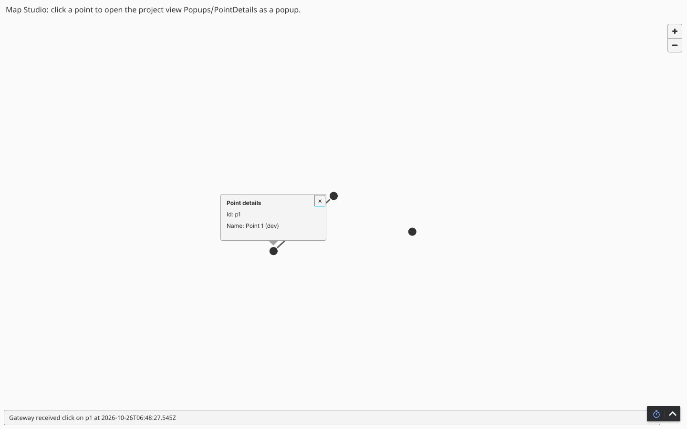

# Map Studio for Ignition Perspective

An open-source Ignition 8.3 Perspective component module: the project's map, showing each site's live state, with tools to build and edit the map in the browser.

- Module id `com.aoindustrial.perspective.mapstudio`, component `ao.mapstudio`
- Architecture for contributors: [docs/architecture.md](docs/architecture.md)
- Planning (BMAD): `_bmad-output/initiative-flowmap/` (brief, PRD, initiative, epics, architecture spine)
- Licence: Apache-2.0 ([LICENSE](LICENSE), third-party notices in [NOTICE](NOTICE))

## Status

The tracer: a MapLibre map on a blank style with three fixed points and one line, and one round trip to the Gateway through the component model delegate. Clicking a point sends `{v, type: "point.click", id, body: {pointId}}`; the Gateway answers `point.click.reply` with the time it received the click, shown on the map.

Story 4 (spike): a point click also opens a popup that renders a project view by path, the way the built-in Perspective Map renders a view from a `path`. The spike-only prop `popupView` (`path`, `params`) names the view; it receives the point as its `mapItem` parameter (`{id, name}`) beside `params`, and an empty or failing path falls back to a text popup. The platform answer and its evidence are in [docs/platform-checks.md](docs/platform-checks.md).



## Build

Requirements: JDK 17 and Docker. Node 22 is downloaded by the build; nothing else needs installing.

```bash
./gradlew build                      # produces build/Map-Studio.unsigned.modl
cd web && npx tsc --noEmit && npm test   # type check and the Jest unit tests alone
```

The build fails when the web bundle does not compile or a unit test fails. The bundle is `MapStudio.js` and `MapStudio.css`, served at `/res/mapstudio/`, with MapLibre's worker beside them as `maplibre-gl-worker.js` (MapLibre 6 runs its worker from a separate file; the component points it there). Signing happens only when `-Pignition.signing.*` properties are passed (release jobs); a plain build stays unsigned.

Layout:

| Folder | What lives there |
| --- | --- |
| `common/` | component descriptor, props schema (`mapstudio.props.json`), the message contract (`Messages.java`) |
| `gateway/` | gateway hook and the component model delegate (`MapStudioDelegate`) |
| `designer/` | the Designer palette entry |
| `web/` | the TypeScript and React component, MapLibre map, message client (`messages.ts`), the point popup (`PointPopup.tsx`, `popupParams.ts`) and their tests |
| `ops/` | the local development Gateway (Docker), its `mapstudio-dev` project (`MapStudioDev`, `Popups/PointDetails`) and the screenshot script |
| `docs/` | contributor architecture, the platform checks and screenshots |

## Run the development Gateway

```bash
ops/up.sh              # build, stage the .modl, start Ignition 8.3.10 in Docker, accept the module unattended
node ops/screenshot.mjs   # click a point in headless Chromium at 1440 and 390 px, save docs/screenshots/*.png
node ops/popup-check.mjs  # the popup view with its params, a second point, close (--expect-fallback for an empty or missing path)
ops/logs.sh -n 200     # Gateway log
ops/down.sh [--purge]  # stop; --purge also wipes the Gateway data (trial, acceptance)
```

To run several dev Gateways side by side, give each its own `MAPSTUDIO_CONTAINER` and `GATEWAY_HTTP_PORT` in its `.env`. The Gateway is at http://localhost:9088 (user `admin`, with a random password generated into the git-ignored `.env` on first start; development only, bound to localhost) and the session at http://localhost:9088/data/perspective/client/mapstudio-dev. The `mapstudio-dev` project is bind-mounted from `ops/project`, so Designer saves write back into the repository. The Gateway reads project files at start-up: restart it after editing them by hand.

The dev Gateway loads the unsigned build (`-Dignition.allowunsignedmodules=true`), which is never acceptable outside development. Releases are signed `.modl` files on GitHub.

## Message contract

Every message between the browser and the Gateway is `{v, type, id, body}` under the model event `mapstudio.message`; errors are `{code, message}`. The types this version knows are listed in `common/.../Messages.java` and `web/typescript/messages.ts`: `point.click`, `point.click.reply`, `error`.

## Attribution

Map rendering by [MapLibre GL JS](https://maplibre.org/) (BSD-3-Clause). See [NOTICE](NOTICE).
