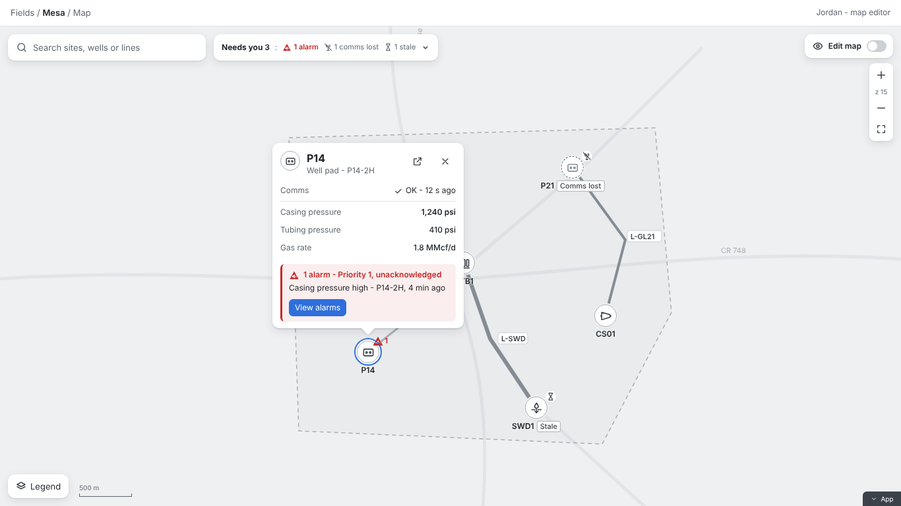
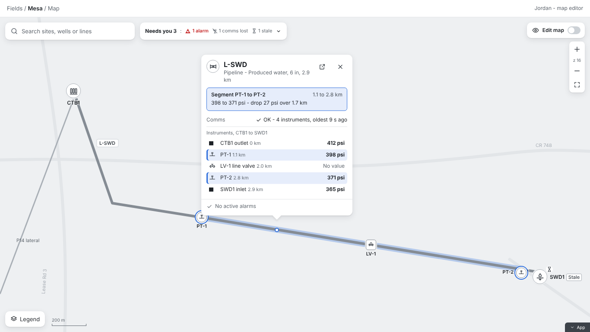
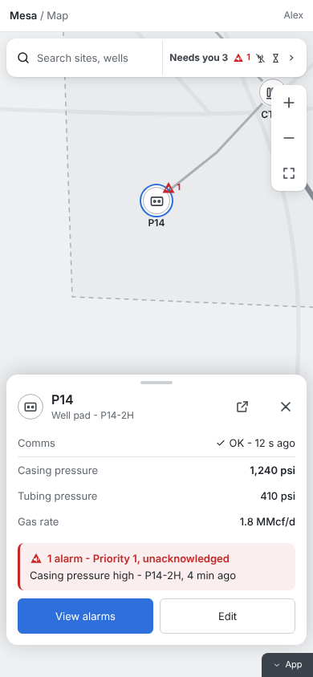
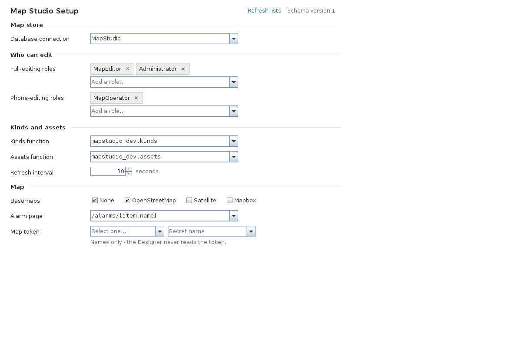

# Map Studio for Ignition Perspective

[](https://github.com/aott33/perspective-map-studio/actions/workflows/ci.yml)
[](https://github.com/aott33/perspective-map-studio/releases)
[](LICENSE)

An Ignition **8.3** Perspective module that puts your field on a map. Every site, well pad and pipeline shows its live state (comms, a key value and alarms), and map editors build and change the map right in the browser. There's no GIS tool and no hand-written SQL.

- **Module ID:** `com.aoindustrial.perspective.mapstudio`
- **Component:** `ao.mapstudio`, in the Designer palette as **Map Studio**
- **Works with:** Ignition 8.3 full Gateways (not Edge), PostgreSQL for the map store

## Showcase

The map pictures are the design that 0.3.0 is building toward (UX mockups, 2026-10-27); parts of them, such as search, Needs you and instruments on lines, are still in progress. The setup form is the shipped Designer screen.

| | |
|---|---|
|  | **Live state on the map.** Each site is a neutral disc with its kind's glyph and name; colour appears only when something needs you, always with a glyph and words ("Comms lost", "Stale", an alarm triangle with its priority). Click a site for its popup: comms with data age, key values, and its alarms with a button to your alarm page. Search and the Needs you summary sit along the top. |
|  | **Pipelines and their instruments.** Pressure taps, meters and line valves sit at their place on the line. Click a segment to see the instruments in order with their live values. |
|  | **Made for phones too.** At 390 px the popup becomes a bottom sheet with large touch targets. |
|  | **One setup per project, in the Designer.** Pick the database connection, who can edit, where your kinds and assets come from, and the basemaps. Changes apply with no Gateway restart. |

## What it does

- **One map for the whole project.** Every Map Studio component shows the same map items, stored in the project's PostgreSQL map store.
- **Live values without the tag load.** The Gateway keeps one subscription per project and sends each open map one batch of changes per refresh (10 s by default), never a subscription per site per session.
- **Your assets, your kinds.** The project supplies its list of kinds (pad, tank, pipeline...) and assets (with their tag paths) from its own script functions. A kind setup says once which tags feed comms, the key values and alarms, for every site of that kind.
- **Alarms from Ignition.** Alarm state comes from Ignition's Alarm Metrics. Map Studio shows alarms and links to your alarm page; it never acknowledges anything itself.
- **Saved as you go.** Each finished edit is saved at once and shows on every open map within seconds; two editors never overwrite each other silently, and every change records who made it and when. The full editing tools (draw, move, link to assets, undo) are being built now; today a map editor can draw a line.
- **Scripting.** `system.mapstudio.getMap` and `system.mapstudio.applyEdits` read and write the map from Gateway scripts.

Map Studio is under active development: basemaps, labels, search, value-driven styles, instruments on lines, the legend and the Needs you summary are next. What is in each release is in [CHANGELOG.md](CHANGELOG.md).

## Install and quick start

1. **Download** `Map-Studio-X.Y.Z.modl` from the [latest release](https://github.com/aott33/perspective-map-studio/releases).
2. **Install it** on the Gateway: **Platform > System > Modules > Install or Upgrade a Module**. When the Gateway asks you to accept the signing certificate, check that its SHA-256 fingerprint matches the one below.
3. **Create a PostgreSQL database connection** for the map store. Map Studio creates and upgrades its own `mapstudio_` tables there; the connection's user needs the right to create tables.
4. **Add a Map Studio setup** to your project in the Designer (**Map Studio Setup**): the connection, the editing roles, your kind and asset functions ([docs/setup.md](docs/setup.md), [docs/kinds-and-assets.md](docs/kinds-and-assets.md)).
5. **Drag a Map Studio component** onto a view from the Designer palette.

### Verify a download

Every release is signed with one certificate held by the project owner:

Signing certificate SHA-256: 8F:93:FD:5C:B8:D9:C7:9B:E4:14:FD:EC:84:CF:21:26:A2:AC:39:F3:DA:3F:C9:0D:F8:08:0E:EA:5C:4D:38:3D

Check it in the Gateway's certificate prompt, or before you install:

```bash
sha256sum -c Map-Studio-X.Y.Z.modl.sha256                                  # the file's own SHA-256
scripts/ci/modl-verify.sh Map-Studio-X.Y.Z.modl "<fingerprint above>"      # structure and fingerprint
```

Projects that install modules through a lock file (such as `ign-scada-template`) pin the release by the file's SHA-256 and this fingerprint. How releases are made: [RELEASING.md](RELEASING.md).

## Documentation

| Topic | Where |
|---|---|
| Project setup | [docs/setup.md](docs/setup.md), the Designer form in [docs/setup-editor.md](docs/setup-editor.md) |
| Kinds and assets from your project | [docs/kinds-and-assets.md](docs/kinds-and-assets.md), example adapters in [docs/examples/adapters](docs/examples/adapters) |
| Kind setups (tags, key values, alarms, popups, styles) | [docs/kind-setup.md](docs/kind-setup.md) |
| Icons | [docs/icons.md](docs/icons.md) |
| Messages, the map store and the scripting API | [docs/contract.md](docs/contract.md) |
| Running the map store | [docs/operations.md](docs/operations.md) |
| Releases and the checks behind them | [RELEASING.md](RELEASING.md), [CHANGELOG.md](CHANGELOG.md) |

## Developing

Build the module, run the local development Gateway in Docker and run the tests: [docs/development.md](docs/development.md). Architecture for contributors: [docs/architecture.md](docs/architecture.md). Live checks on 8.3 and their evidence: [docs/platform-checks.md](docs/platform-checks.md). Performance records: [docs/perf/README.md](docs/perf/README.md). Planning documents: `_bmad-output/initiative-flowmap/`.

```bash
./gradlew build        # build/Map-Studio.unsigned.modl
ops/up.sh              # Ignition 8.3 and PostgreSQL in Docker, with the module loaded
cd e2e && npm ci && npm test
```

## Licence and attribution

Apache-2.0 ([LICENSE](LICENSE)); third-party notices in [NOTICE](NOTICE). Map rendering by [MapLibre GL JS](https://maplibre.org/) (BSD-3-Clause); drawing by [Terra Draw](https://terradraw.io/) and its MapLibre adapter (MIT).
