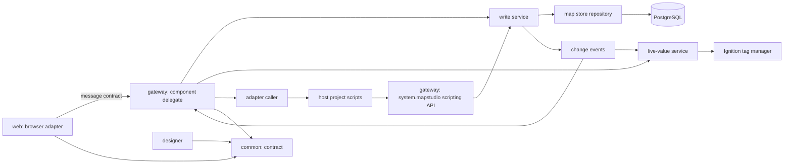
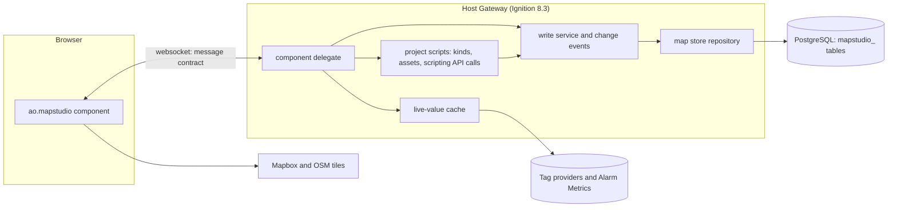
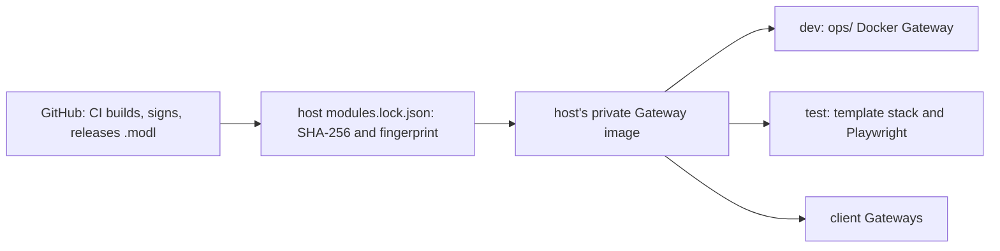
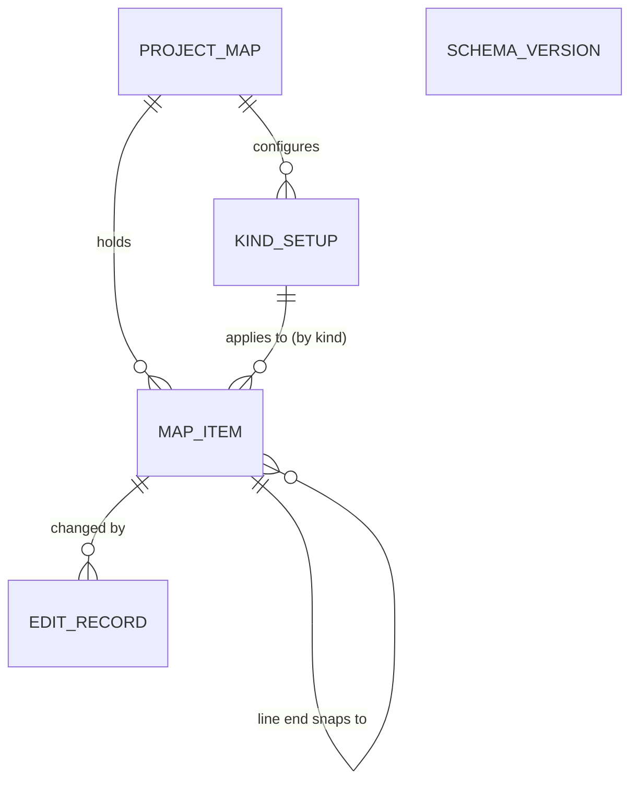

# Architecture Spine - Map Studio

## Design Paradigm

Hexagonal (ports and adapters) with the Gateway as the authority. The core lives in the module's Gateway scope: it owns the map store, every write, role checks and live values. The browser client is an adapter that draws and edits and speaks only the message contract to its component delegate. The host project plugs in through ports it implements as project script functions (its kinds, its assets and, as a fallback, its setup) and calls the core only through the scripting API.

| Layer | Lives in | Holds |
| --- | --- | --- |
| Contract | `common/` | component descriptor, props and events schema, message types, map item record, LiveValue, asset contract, kind list and setup schemas |
| Core | `gateway/` | component delegate, write service, map store repository and migrations, change events, live-value service, adapter caller, setup loader, role matrix, scripting API |
| Browser adapter | `web/` | MapLibre rendering, Terra Draw editing, one shared geometry module, popups, tools, undo stack, unsaved-edit queue, message client |
| Designer | `designer/` | palette entry and props editing |
| Host adapters | the host project | script functions for kinds, assets and the setup fallback; calls to `system.mapstudio.*`; popup links; custom popup views |



Dependencies point inward to `common/`. `web/` never reaches the database, tags or host scripts except through the delegate; host scripts reach the map only through `system.mapstudio.*`, never its tables.

## Invariants & Rules

### AD-1 - The Gateway is the authority [ADOPTED]

- **Binds:** all
- **Prevents:** logic split between browser code, Gateway code and host scripts, and side effects outside the map store.
- **Rule:** Every read of the map store, every write, every role check and every tag subscription happens in the module's Gateway scope. The browser holds only what the Gateway sent it plus unsaved edits. Map Studio reads tags only by subscription and writes only to its map store, never to tags, devices, assets or UDT instances; the host's Jython is untouched. Calls into host adapter scripts run with a timeout on a bounded pool.

### AD-2 - One write path: versioned, all-or-none batches [ADOPTED]

- **Binds:** R9, R14 to R21, R26 to R28, R30 to R32, R34, R35, R39
- **Prevents:** silent overwrites, partial imports, duplicate saves on retry, phone editors drawing, and writes that skip the edit record.
- **Rule:** Every change is an `edits.apply` batch `{batchId, ops}` with ops `{op: create|update|delete, entity: item|kindSetup, id, baseVersion, data}` (`baseVersion` 0 on create), from the browser or from `system.mapstudio.applyEdits` (AD-18). The write service checks the role matrix, checks every `baseVersion`, validates every op against the kind list (AD-20), writes, increments versions and records who and when, in one transaction: all ops or none, one undo step, every conflict returned. Deletes are tombstones with a version bump, so undo restores them. A retried `batchId` returns the first result. Large imports go as `edits.begin`, `edits.chunk`, `edits.commit` under one `batchId`. Role matrix: full editing may do every op; phone editing may only update a point's geometry and a map item's properties, and undo those; `map.load` tells the browser its level (`none`, `phone`, `full`).

### AD-3 - The map store [ADOPTED]

- **Binds:** R32, R33, R35
- **Prevents:** schema drift, cross-project leaks and database-specific features creeping in.
- **Rule:** PostgreSQL only in the first version. Tables are prefixed `mapstudio_`, every row is keyed by Ignition project name, geometry is GeoJSON text, and the module creates and migrates its tables itself, recording a schema version. No spatial SQL.

### AD-4 - Host adapters for kinds and assets [ADOPTED]

- **Binds:** R12, R13, R14, R27
- **Prevents:** the module learning one project's data model, and per-click calls into host scripts.
- **Rule:** Kinds and assets come only from project script functions the setup names, returning rows in the published kind list and asset contract shapes; every asset carries a fully qualified base path (provider included). The Gateway caches the results, refreshes them on a timer and on demand, and reports an empty, failing or incomplete adapter in words. The docs ship two example adapters (UDT instances from the tag tree, a named-query wrapper), not module code.

### AD-5 - One setup per project [ADOPTED]

- **Binds:** R9, R12, R13, R33, R36, the refresh interval of AD-6
- **Prevents:** two pages disagreeing about the database, roles or adapters of the one map.
- **Rule:** The database connection, adapter functions, full-editing and phone-editing roles, refresh interval (default 10 s), alarm page, basemaps and token secret name are set once per project in a setup with a versioned schema, as a project-level setup; if the spike shows a custom project resource type is too costly, the setup is a project script function returning the same schema. Components carry only per-page settings such as the starting area. Kind setups are never part of the project setup (AD-16).

### AD-6 - Live values: one shared subscription, batched out [ADOPTED]

- **Binds:** R2, R5, R6, R37
- **Prevents:** tag load that grows with sessions or map items, Alarm Metrics read in a way Ignition does not support, and icons and popups disagreeing on state.
- **Rule:** The Gateway holds one subscription per project to every live value the kind setups turn on (comms, the icon KPI, Alarm Metrics) and keeps it running while the Gateway runs. Each slot is one `LiveValue {value, quality, t, stale, reason}`, with stale computed in the cache from tag quality and comms state. Each open map gets `values.batch {seq, full, items}` once per refresh interval: changes only, or the whole map when `full` (on open, on reconnect, and after a link or kind setup change). No subscription per session or per map item; switched-off values are never subscribed.

### AD-7 - Popups: Map Studio's default, a project's custom view [ADOPTED]

- **Binds:** R6, R7, R8, R39
- **Prevents:** popups that each project must build, two shapes for the same map item, and acknowledging outside Ignition's alarm table.
- **Rule:** Map Studio draws the default popup from the kind setup; while it is open (`popup.open` to `popup.close`) the Gateway pushes that map item's LiveValues on change. A kind setup may name a custom popup view, which receives the map item object as its parameter: the AD-20 record plus `basePath`, `alarmsPath` and its LiveValues, kept live while the view is open. Placeholders in popup links are dotted paths into the map item object (`{asset.id}`, `{properties.route}`). A missing or failing custom view falls back to the default popup. Map Studio never acknowledges alarms.

### AD-8 - The message contract [ADOPTED]

- **Binds:** all
- **Prevents:** each epic inventing its own message shapes and error handling.
- **Rule:** Every message between browser and Gateway is `{v, type, id, body}`; types are named `area.action` and listed in `common/` (`map.load`, `map.changed`, `edits.apply`, `edits.begin`, `edits.chunk`, `edits.commit`, `values.batch`, `popup.open`, `popup.close`); every error is `{code, message}` with a plain-words message. A type not listed in `common/` is not sent.

### AD-9 - The public contract is versioned [ADOPTED]

- **Binds:** all
- **Prevents:** a host project breaking on a module upgrade without warning.
- **Rule:** Component props and events, the message contract, the map item record and object, LiveValue, the asset contract, the kind list, the setup schema, the scripting API and the CSV formats are documented in `docs/` and follow semantic versioning; a breaking change is a new major version. The component's props are a closed list in `common/`.

### AD-10 - Editing happens in the browser [ADOPTED]

- **Binds:** R10, R11, R14, R17 to R24, R32, R37, R38
- **Prevents:** a Gateway round trip per click or vertex, lost edits, and two undo models.
- **Rule:** Drawing, snapping, validation and undo run in the browser; the Gateway is called when an edit is finished. New map item ids are UUID strings created when the item is drawn. Each component session keeps one undo stack; undoing a saved edit sends the reverse batch through AD-2. Unsaved batches wait in an ordered queue in the browser's local storage, per project, and are replayed through AD-2 with their original versions until saved or discarded. When the map store is unreachable at load, the tools are disabled and no map item is drawn as current.

### AD-11 - Look and colour [ADOPTED]

- **Binds:** R2, R5, R38
- **Prevents:** colours or styles that ignore the host project's theme or read as alarms.
- **Rule:** Every colour comes from the host project's theme tokens; the module ships no colour of its own. Normal state is neutral; hue appears only for abnormal state, always with a word or glyph. State on icons, lines and popups passes the template's engineering review (ER-27) before release.

### AD-12 - Basemaps and tokens

- **Binds:** R36
- **Prevents:** tokens in views or git, and styles MapLibre cannot render.
- **Rule:** Basemaps are none, OpenStreetMap, satellite and Mapbox. Satellite is the Mapbox raster tileset `mapbox.satellite` through the Raster Tiles API, conditional on the owner confirming Mapbox's Product Terms; otherwise a commercial MapTiler or Esri imagery plan. The Gateway reads the token from the project's secret store and sends it to the browser; only public, URL-restricted tokens are used. Every basemap shows its provider's attribution.

### AD-13 - Build, release and upgrade gate [ADOPTED]

- **Binds:** all
- **Prevents:** a release that breaks on a Gateway version it claims to support, or an unsigned or unpinned module on a Gateway.
- **Rule:** The Perspective client packages are pinned to exact versions and the module declares its lowest supported 8.3.x. A release claims a new 8.3.x only after the template's test stack and the module's Playwright suite pass on it. Releases are signed `.modl` files on GitHub, installed through the host's module lock by SHA-256 and certificate fingerprint; never a `.modl` in git.

### AD-14 - Signing key custody [ADOPTED]

- **Binds:** epic-module-foundation and every release
- **Prevents:** a lost or leaked key, and a rotation that silently breaks host locks.
- **Rule:** The owner holds one self-signed module-signing certificate, stored as a GitHub Actions secret usable only by release jobs, with an offline backup in the owner's password manager. Its fingerprint is in the README. A rotation is a documented release carrying the new fingerprint.

### AD-15 - Docs carry proof [ADOPTED]

- **Binds:** all
- **Prevents:** documentation that claims behaviour nobody has seen work.
- **Rule:** The Playwright suite records screenshots of each documented behaviour, and the docs embed them. A documented behaviour without a passing test and screenshot is marked unverified.

### AD-16 - Kind list and kind setup are separate [ADOPTED]

- **Binds:** R12, R15, R16
- **Prevents:** kind setups stored in three places, and overrides saved outside the item's version.
- **Rule:** The kind list comes from the host adapter and is read only. The kind setup lives in the map store as one versioned row per project and kind id (no generated id), changed only through AD-2. Overrides are a field of the map item and save with it.

### AD-17 - Saved changes reach every open map at once [ADOPTED]

- **Binds:** R32
- **Prevents:** saved edits waiting for the next value batch, and subscriptions that miss a newly linked map item.
- **Rule:** Each committed batch emits one in-process change event. Every open map of the project receives `map.changed {seq, ops}` at once, independent of `values.batch`; the live-value service resubscribes from the same event. A gap in `seq` makes the browser reload the map.

### AD-18 - The scripting API [ADOPTED]

- **Binds:** R32, the template cut-over, AD-2
- **Prevents:** host projects or the cut-over writing the tables by SQL, and duplicate map items on a re-run.
- **Rule:** Gateway-scope `system.mapstudio.getMap(project)` and `system.mapstudio.applyEdits(project, batch, actor)` run on the same write service as the browser. Callers may supply map item ids, as UUIDv5 from a stable name, so a re-run updates instead of duplicating; an actor is required. Owned by epic-map-store-and-data; part of the public contract.

### AD-19 - Snapping is stored [ADOPTED]

- **Binds:** R18, R19, R30, R35
- **Prevents:** snapped ends inferred by coordinates in one epic and stored in another.
- **Rule:** A line's `ends` record what each end snaps to (`{start: {itemId}, end: {itemId}}`, or null). Moving a snapped-to map item moves its attached ends in the same batch, through one shared geometry module in `web/` that the phone epic reuses; the Gateway rejects a batch that moves a snapped-to item without its ends. Coordinate equality never infers snapping.

### AD-20 - The map item record is closed and typed [ADOPTED]

- **Binds:** R11, R14, R23, R25 to R28, R35
- **Prevents:** stored derived fields, untyped properties, and duplicates on re-import.
- **Rule:** The stored record is `{id, kind, name, geometry, properties, assetId, overrides, ends, version, deleted}`. Base path, unlinked reason and unknown kind are derived at read time from the adapter caches, never stored. Properties are keyed and typed by the kind list's form fields; the write service validates and normalises every op (CSV strings are converted there, once). Export writes ids, overrides and the exported kinds' setups; importing a known id is an update.

### AD-21 - Operations [ADOPTED]

- **Binds:** R32, R33, epic-map-store-and-data, every release
- **Prevents:** a map lost without a backup, a half-created schema, and two Gateways writing at once.
- **Rule:** Map Studio has no backup of its own: the site's PostgreSQL backups cover the map store, the docs say so, and export is the portable copy. On start the module creates or migrates its tables; when it lacks the rights or a migration fails, it logs an error naming the connection and the missing right, as the historian and alarm journal do, and the map store is unavailable (components say so, tools off) until fixed. A schema newer than the module knows makes the map read only, with the reason logged. In a redundant pair only the active Gateway subscribes and accepts writes; after a failover the new active Gateway rebuilds its caches from the database and the tags, and open maps reload.

### AD-22 - The cut-over writes through the scripting API [ADOPTED]

- **Binds:** epic-template-cutover
- **Prevents:** the template's map seeded by SQL or by hand, and duplicates when the cut-over is re-run.
- **Rule:** A one-time template script reads the registry and `_Model/Map` and writes the Mesa field through `system.mapstudio.applyEdits`, with UUIDv5 ids from each asset's name, so it can be re-run safely.

## Consistency Conventions

| Concern | Convention |
| --- | --- |
| Names | Module id `com.aoindustrial.perspective.mapstudio`; component `ao.mapstudio`; npm `@aoindustrial/perspective-map-studio`; Java packages under `com.aoindustrial.perspective.mapstudio`; tables and columns `mapstudio_` snake_case; message types `area.action`; scripting `system.mapstudio.*`; the PRD's Glossary terms used exactly in code, messages and docs |
| Ids and versions | Map item ids are UUID strings (browser-created, or UUIDv5 from a stable name through the scripting API); kind setups keyed by project and kind id; asset ids are the adapter's strings, unchanged; versions are integers starting at 1 |
| Geometry and coordinates | GeoJSON, longitude before latitude, WGS 84, 6 decimals stored |
| Times | ISO 8601 UTC strings in messages; `timestamptz` in the map store |
| Errors | `{code, message}`; codes are stable kebab-case words (`conflict`, `role`, `stale`, `invalid`, `store-unreachable`); messages are plain words for the user |
| Logging | Gateway loggers named `MapStudio.<area>`; never a token, a password or a map item's properties in a log line |
| Config | Only the project setup (AD-5) and per-component settings; no Gateway-wide module settings |
| Auth | The role matrix (AD-2), checked on the Gateway on every write |
| Breakpoints | Drawing tools off below 768 px; phone layout at 390 px |
| Host scripts in docs | Example adapters and scripts follow Jython 2.7 rules and catch both Java and Python exceptions |
| Licences and attribution | Apache-2.0 with a NOTICE file; attributions for Natural Earth, GeoNames and any icon seed shipped with the module; nothing derived from OpenBridge |
| Static assets | The place-check data and the icon sprite are static assets the module serves; the browser loads the place-check data on first use |
| Text | No em dashes in code, messages, labels or docs |

## Stack

| Name | Version |
| --- | --- |
| Ignition (minimum declared, current) | 8.3.x, set in the spike; 8.3.10 current |
| Java | 17 |
| Gradle module plugin `io.ia.sdk.modl` | 0.5.0 |
| `com.github.node-gradle.node` / Node | 7.1.0 / 22 |
| `@inductiveautomation/perspective-client` | 2.x, exact version set in the spike |
| React / TypeScript / webpack | 16.14.0 / 4.9 / 5 |
| maplibre-gl | 6.16.0, unverified with the adapter and toolchain; older pin as fallback |
| terra-draw / terra-draw-maplibre-gl-adapter | 1.38.0 / 1.5.0 |
| @turf/turf | 7.4.0 |
| PostgreSQL | minimum version and JDBC driver set in the spike, tested with 8.3.10's connection defaults |
| Playwright | pinned in the spike |

## Structural Seed

Map Studio's own layout, modelled on Mustry's module:

```text
perspective-map-studio/
  common/     # contract: descriptor, schemas, message types, map item record, LiveValue
  gateway/    # core: hook, delegate, write service, store and migrations, change events, live values, adapters, setup, scripting API
  designer/   # palette entry and props editing
  web/        # browser adapter: TypeScript, React, MapLibre, Terra Draw, shared geometry module
  e2e/        # Playwright suite and the screenshots the docs embed
  ops/        # local dev Gateway (Docker) for building and testing
  docs/       # contracts, example adapters, example custom popup view, screenshots
```







## Capability → Architecture Map

| Capability / Area | Lives in | Governed by |
| --- | --- | --- |
| R1, R3, R4, R5, R36, R37 map view, labels, search, parity, basemaps, speed | `web/` | AD-1, AD-6, AD-11, AD-12 |
| R2, R6, R7, R8, R39 icons, popups, alarm summary, links, custom popup view | `web/`, `gateway/` live values | AD-6, AD-7, AD-11 |
| R9, R32, R33, R34 roles, saving, map store, conflicts, live updates | `gateway/` write service, store, change events | AD-2, AD-3, AD-5, AD-10, AD-17, AD-18 |
| R12, R13, R14, R15, R16, R27 kinds, assets, linking, kind setup, overrides, import matching | `gateway/` adapters and store, `web/` | AD-4, AD-5, AD-16, AD-20 |
| R10, R11, R17 to R24, R38 tools, drawing, snapping, forms | `web/`, saved through `gateway/` | AD-2, AD-10, AD-11, AD-19 |
| R25, R26, R28, R29, R35 CSV templates, import, bulk edit, reference layer, export | `web/`, `gateway/` | AD-2, AD-9, AD-20 |
| R30, R31 phone | `web/` | AD-2, AD-10, AD-19 |
| Releases, upgrades, signing, docs | build, CI, `e2e/`, `docs/` | AD-13, AD-14, AD-15 |
| Template cut-over | `ign-scada-template` | AD-2, AD-4, AD-5, AD-11, AD-18, AD-22 |
| Operations: backup, schema rights, redundancy | `gateway/`, `docs/` | AD-3, AD-21 |

## Deferred

- **deck.gl and flow animation:** not in the first version; MapLibre layers draw lines and icons. Revisit with flow.
- **Viewport-limited batches:** whole-map batches until the 300-site target needs less.
- **Databases other than PostgreSQL:** after the first version.
- **Setup as a custom project resource or a script:** the spike decides; AD-5 fixes the schema either way.
- **Internal structure of `gateway/` and `web/`:** owned by the code once it exists.
- **Parsers for CSV, KML and GeoJSON, and the place-check data package:** chosen in epic-import-export and epic-editing, within the licence convention.
- **Saving reference layers between sessions:** a reference layer lasts for the session in the first version.
- **Clustering, offline tiles, map version history:** out of scope for the first version.

Open questions, each with its revisit point:

- Do Java tag subscriptions reach Alarm Metrics on folders and UDT instances? The spike checks it; if not, the fallback is a reference or expression tag per asset.
- Can a third-party component open a project view as a custom popup view in 8.3? The spike checks it (Embr Periscope embeds views, so it is likely).
- Can module code call project script functions and register `system.mapstudio.*` functions? The spike checks it; the adapter fallback is a named query.
- Does the Perspective toolchain (React 16.14, TypeScript 4.9) build MapLibre 6 and Terra Draw? The spike checks it; if not, pin an older MapLibre.
- Do Mapbox's current Product Terms allow `mapbox.satellite` raster tiles in MapLibre for client SCADA sites? The owner reads them before epic-viewing.
