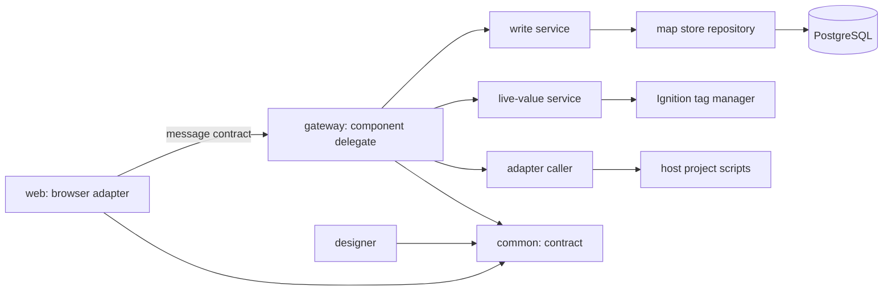
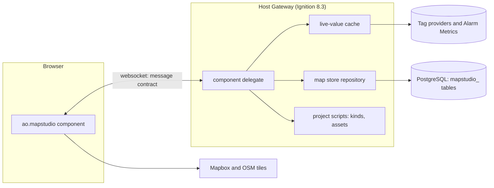
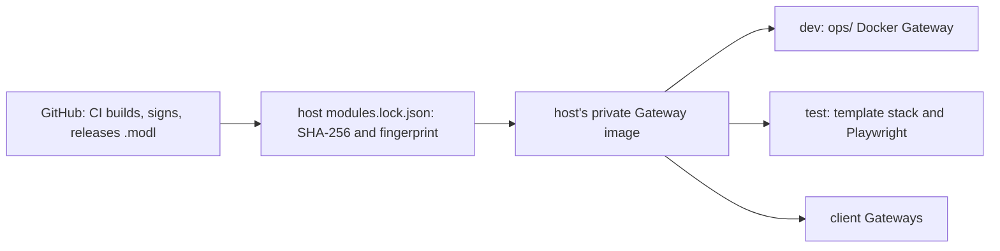
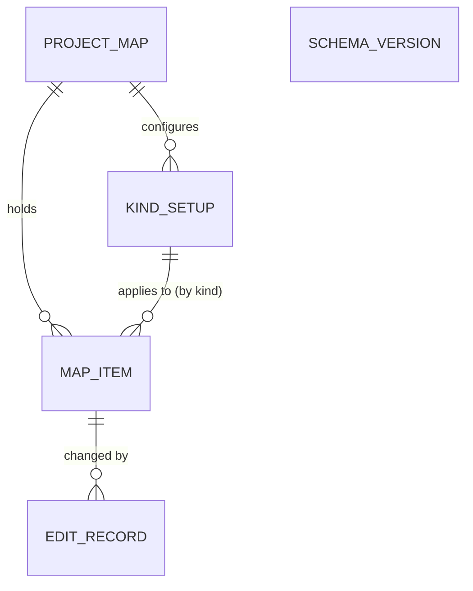

# Architecture Spine - Map Studio

## Design Paradigm

Hexagonal (ports and adapters) with the Gateway as the authority. The core lives in the module's Gateway scope: it owns the map store, every write, role checks and live values. The browser client is an adapter that draws and edits and speaks only the message contract to its component delegate. The host project plugs in through ports it implements as project script functions: its kinds, its assets and, as a fallback, its setup.

| Layer | Lives in | Holds |
| --- | --- | --- |
| Contract | `common/` | component descriptor, props and events schema, message types, map item object schema, asset contract, kind list schema |
| Core | `gateway/` | component delegate, write service, map store repository and migrations, live-value service, adapter caller, setup loader, role checks |
| Browser adapter | `web/` | MapLibre rendering, Terra Draw editing, popups, tools UI, undo stack, message client |
| Designer | `designer/` | palette entry and props editing |
| Host adapters | the host project | script functions for kinds, assets and the setup fallback; popup links; custom popup views |



Dependencies point inward to `common/`. `web/` never reaches the database, tags or host scripts except through the delegate; host scripts never reach the map store tables.

## Invariants & Rules

### AD-1 - The Gateway is the authority [ADOPTED]

- **Binds:** all
- **Prevents:** logic split between browser code, Gateway code and host scripts, and edits that bypass role or version checks.
- **Rule:** Every read of the map store, every write, every role check and every tag subscription happens in the module's Gateway scope. The browser holds only what the Gateway sent it plus unsaved edits.

### AD-2 - One write path, with versions [ADOPTED]

- **Binds:** R9, R17 to R21, R26, R28, R30 to R32, R34, R35
- **Prevents:** silent overwrites between two map editors and writes that skip the edit record.
- **Rule:** The only write is a finished edit sent as `item.save` (or a batch of them, one undo step) carrying each map item's version. The write service checks the editing role from the project setup, compares versions, writes, increments the version and records who and when, in one transaction. A version mismatch returns a conflict with the current map item. Host projects change the map only through an API the module exposes on the same path, never by SQL to its tables.

### AD-3 - The map store [ADOPTED]

- **Binds:** R32, R33, R35
- **Prevents:** schema drift, cross-project leaks and database-specific features creeping in.
- **Rule:** PostgreSQL only in the first version. Tables are prefixed `mapstudio_`, every row is keyed by Ignition project name, geometry is GeoJSON text, and the module creates and migrates its tables itself, recording a schema version. No spatial SQL.

### AD-4 - Host adapters for kinds and assets [ADOPTED]

- **Binds:** R12, R13, R14, R27
- **Prevents:** the module learning one project's data model, and per-click calls into host scripts.
- **Rule:** Kinds and assets come only from project script functions the setup names, returning rows in the published kind list and asset contract shapes. The Gateway caches the results, refreshes them on a timer and on demand, and reports an empty, failing or incomplete adapter in words. The docs ship two example adapters (UDT instances from the tag tree, a named-query wrapper), not module code.

### AD-5 - One setup per project [ADOPTED]

- **Binds:** R9, R12, R13, R33, R36, and the refresh interval of AD-6
- **Prevents:** two pages disagreeing about the database, roles or adapters of the one map.
- **Rule:** The database connection, adapter functions, editing and phone-editing roles, refresh interval, alarm page, basemaps and token secret name are set once per project, as a project-level setup; if the spike shows a custom project resource type is too costly, the setup is a project script function instead. Components carry only per-page settings such as the starting area.

### AD-6 - Live values: one shared subscription, batched out [ADOPTED]

- **Binds:** R2, R5, R6, R37
- **Prevents:** tag load that grows with sessions or map items, and Alarm Metrics read in a way Ignition does not support.
- **Rule:** The Gateway holds one subscription per project to every live value the kind setups turn on (comms, the icon KPI, Alarm Metrics), keeps the latest values with their quality in a cache, and keeps it running while the Gateway runs. Each open map gets one `values.batch` of changes per refresh interval, for the whole map. Stale is decided at batch time from tag quality and comms state. No subscription per session or per map item; values that are switched off are never subscribed.

### AD-7 - Popups: Map Studio's default, a project's custom view [ADOPTED]

- **Binds:** R6, R7, R8, R39
- **Prevents:** popups that each project must build, and acknowledging outside Ignition's alarm table.
- **Rule:** Map Studio draws the default popup from the kind setup and receives its values from the Gateway cache, pushed on change only while that popup is open (`popup.open`, `popup.close`). A kind setup may name a custom popup view, which receives the documented map item object as its parameter. Map Studio never acknowledges alarms; acknowledging happens only in the built-in alarm table, on the project's alarm page or in a custom view.

### AD-8 - The message contract [ADOPTED]

- **Binds:** all
- **Prevents:** each epic inventing its own message shapes and error handling.
- **Rule:** Every message between browser and Gateway is `{v, type, id, body}`; types are named `area.action`; every error is `{code, message}` with a plain-words message. The contract is part of the public contract (AD-9).

### AD-9 - The public contract is versioned [ADOPTED]

- **Binds:** all
- **Prevents:** a host project breaking on a module upgrade without warning.
- **Rule:** Component props and events, the message contract, the map item object, the asset contract, the kind list and the CSV formats are documented and follow semantic versioning; a breaking change is a new major version.

### AD-10 - Editing happens in the browser [ADOPTED]

- **Binds:** R10, R11, R14, R17 to R24, R37, R38
- **Prevents:** a Gateway round trip per click or vertex.
- **Rule:** Drawing, snapping, validation and undo run in the browser; the Gateway is called when an edit is finished. Undoing a saved edit sends the reverse edit through AD-2. New map item ids are created in the browser when the item is drawn.

### AD-11 - Look and colour

- **Binds:** R2, R5, R38
- **Prevents:** colours or styles that ignore the host project's theme or read as alarms.
- **Rule:** Every colour comes from the host project's theme tokens; the module ships no colour of its own. Normal state is neutral; hue appears only for abnormal state, always with a word or glyph. State on icons, lines and popups passes the template's engineering review (ER-27) before release.

### AD-12 - Basemaps and tokens [ADOPTED]

- **Binds:** R36
- **Prevents:** tokens in views or git, and styles MapLibre cannot render.
- **Rule:** Basemaps are none, OpenStreetMap, satellite and Mapbox. Satellite is the Mapbox raster tileset `mapbox.satellite` through the Raster Tiles API. The Gateway reads the token from the project's secret store and sends it to the browser; only public, URL-restricted tokens are used. Every basemap shows its provider's attribution.

### AD-13 - Build, release and upgrade gate [ADOPTED]

- **Binds:** all
- **Prevents:** a release that breaks on a Gateway version it claims to support, or an unsigned or unpinned module on a Gateway.
- **Rule:** The Perspective client packages are pinned to exact versions and the module declares its lowest supported 8.3.x. A release claims a new 8.3.x only after the template's test stack and the module's Playwright suite pass on it. Releases are signed `.modl` files on GitHub, installed through the host's module lock by SHA-256 and certificate fingerprint; never a `.modl` in git.

### AD-14 - Signing key custody [ADOPTED]

- **Binds:** epic-module-foundation and every release
- **Prevents:** a lost or leaked key, and a rotation that silently breaks host locks.
- **Rule:** The owner holds one self-signed module-signing certificate, stored as a GitHub Actions secret usable only by release jobs, with an offline backup in the owner's password manager. Its fingerprint is in the README. A rotation is a documented release carrying the new fingerprint.

### AD-15 - Docs carry proof [ADOPTED]

- **Binds:** all
- **Prevents:** documentation that claims behaviour nobody has seen work.
- **Rule:** The Playwright suite records screenshots of each documented behaviour, and the docs embed them. A documented behaviour without a passing test and screenshot is marked unverified.

## Consistency Conventions

| Concern | Convention |
| --- | --- |
| Names | Module id `com.aoindustrial.perspective.mapstudio`; component `ao.mapstudio`; npm `@aoindustrial/perspective-map-studio`; Java packages under `com.aoindustrial.perspective.mapstudio`; tables and columns `mapstudio_` snake_case; message types `area.action`; Glossary terms of the PRD (section 3) used exactly in code, messages and docs |
| Ids and versions | Map item ids are UUID strings created in the browser; asset ids are the adapter's strings, unchanged; map item versions are integers starting at 1 |
| Geometry and coordinates | GeoJSON, longitude before latitude, WGS 84, 6 decimals stored |
| Times | ISO 8601 UTC strings in messages; `timestamptz` in the map store |
| Errors | `{code, message}`; codes are stable kebab-case words (`conflict`, `role`, `stale`, `invalid`, `store-unreachable`); messages are plain words for the user |
| Logging | Gateway loggers named `MapStudio.<area>`; never a token, a password or a map item's properties in a log line |
| Config | Only the project setup (AD-5) and per-component settings; no Gateway-wide module settings |
| Auth | Roles from the project setup, checked on the Gateway on every write (AD-2) |
| Text | No em dashes in code, messages, labels or docs |

## Stack

| Name | Version |
| --- | --- |
| Ignition (minimum declared, current) | 8.3.x, set in the spike; 8.3.10 current |
| Java | 17 |
| Gradle module plugin `io.ia.sdk.modl` | 0.5.0 |
| `com.github.node-gradle.node` / Node | 7.1.0 / 22 |
| `@inductiveautomation/perspective-client` | 2.x, exact version set in the spike |
| React / TypeScript / webpack | 16.14.0 / 4.9 / 5 |
| maplibre-gl | 6.16.0, or the newest the Perspective toolchain builds |
| terra-draw / terra-draw-maplibre-gl-adapter | 1.38.0 / 1.5.0 |
| @turf/turf | 7.4.0 |
| PostgreSQL | as supported by the host's Ignition version |
| Playwright | set in the spike |

## Structural Seed

```text
perspective-map-studio/
  common/     # contract: descriptor, schemas, message types (Java), shared JSON schemas
  gateway/    # core: hook, component delegate, write service, store and migrations, live values, adapters, setup
  designer/   # palette entry and props editing
  web/        # browser adapter: TypeScript, React, MapLibre, Terra Draw
  e2e/        # Playwright suite and the screenshots the docs embed
  ops/        # local dev Gateway (Docker) for building and testing
  docs/       # contracts, example adapters, example custom popup view, screenshots
```







## Capability → Architecture Map

| Capability / Area | Lives in | Governed by |
| --- | --- | --- |
| R1, R3, R4, R5, R36, R37 map view, labels, search, parity, basemaps, speed | `web/` | AD-1, AD-6, AD-11, AD-12 |
| R2, R6, R7, R8, R39 icons, popups, alarm summary, links, custom popup view | `web/`, `gateway/` live values | AD-6, AD-7, AD-11 |
| R9, R32, R33, R34 roles, saving, map store, conflicts | `gateway/` write service and store | AD-2, AD-3, AD-5 |
| R12, R13, R14, R27 kinds, assets, linking, import matching | `gateway/` adapters, `web/` | AD-4, AD-5 |
| R10, R11, R15 to R24, R38 tools, drawing, forms, kind setup | `web/`, saved through `gateway/` | AD-2, AD-10, AD-11 |
| R25, R26, R28, R29, R35 CSV templates, import, bulk edit, reference layer, export | `web/`, `gateway/` | AD-2, AD-3, AD-9 |
| R30, R31 phone | `web/` | AD-2, AD-10 |
| Releases, upgrades, signing, docs | `gateway/` build, CI, `e2e/`, `docs/` | AD-13, AD-14, AD-15 |
| Template cut-over | `ign-scada-template` | AD-2, AD-4, AD-5, AD-11 |

## Deferred

- **deck.gl and flow animation:** not in the first version; MapLibre layers draw lines and icons. Revisit with flow.
- **Viewport-limited batches:** whole-map batches until the 300-site target needs less.
- **Databases other than PostgreSQL:** after the first version.
- **Setup as a custom project resource or a script:** the spike decides (AD-5 allows both).
- **Internal structure of `gateway/` and `web/`:** owned by the code once it exists.
- **Parsers for CSV, KML and GeoJSON and the place-check data package:** chosen in epic-import-export and epic-editing, within the licence constraint.
- **Clustering, offline tiles, map version history:** out of scope for the first version.

Open questions, each with its revisit point:

- Do Java tag subscriptions reach Alarm Metrics on folders and UDT instances? The spike checks it; if not, the fallback is a reference or expression tag per asset.
- Can a third-party component open a project view as a custom popup view in 8.3? The spike checks it (Embr Periscope embeds views, so it is likely).
- Does the Perspective toolchain (React 16.14, TypeScript 4.9) build MapLibre 6 and Terra Draw? The spike checks it; if not, pin an older MapLibre.
- Do Mapbox's current Product Terms allow `mapbox.satellite` raster tiles in MapLibre for client SCADA sites? The owner reads them before epic-viewing.
