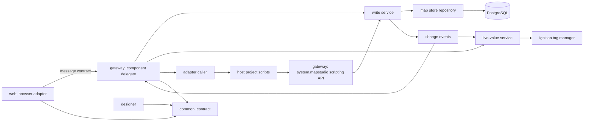
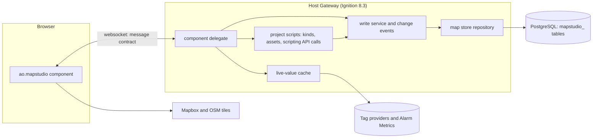
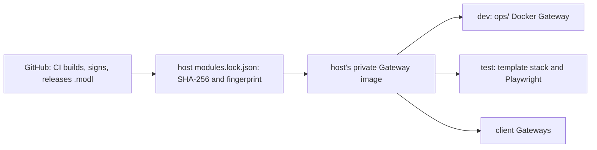
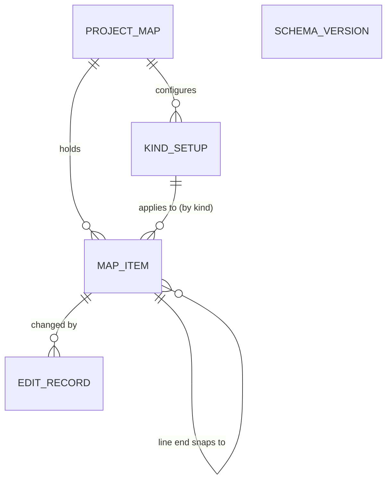

# Architecture Spine - Map Studio

## Design Paradigm

Hexagonal (ports and adapters) with the Gateway as the authority. The core lives in the module's Gateway scope: it owns the map store, every write, role checks and live values. The browser client is an adapter that draws and edits and speaks only the message contract to its component delegate. The host project plugs in through ports it implements as project script functions (its kinds, its assets and, as a fallback, its setup) and calls the core only through the scripting API.

| Layer | Lives in | Holds |
| --- | --- | --- |
| Contract | `common/` | component descriptor, props and events schema, message types, map item record, LiveValue, asset contract, kind list and setup schemas |
| Core | `gateway/` | component delegate, write service, map store repository and migrations, change events, live-value service, adapter caller, setup loader, role matrix, scripting API |
| Browser adapter | `web/` | MapLibre rendering, Terra Draw editing, one shared geometry module, popups, tools, undo stack, unsaved-edit queue, message client |
| Designer | `designer/` | palette entry and props editing |
| Host adapters | the host project | script functions for kinds, assets and the setup fallback; calls to `system.mapstudio.*`; popup links; custom popup views |



Dependencies point inward to `common/`. `web/` never reaches the database, tags or host scripts except through the delegate; host scripts reach the map only through `system.mapstudio.*`, never its tables.

## Invariants & Rules

### AD-1 - The Gateway is the authority [ADOPTED]

- **Binds:** all
- **Prevents:** logic split between browser code, Gateway code and host scripts, and side effects outside the map store.
- **Rule:** Every read of the map store, every write, every role check and every tag subscription happens in the module's Gateway scope. The browser holds only what the Gateway sent it plus unsaved edits. Map Studio reads tags only by subscription and writes only to its map store, never to tags, devices, assets or UDT instances; the host's Jython is untouched. Calls into host adapter scripts run with a timeout on a bounded pool.

### AD-2 - One write path: versioned, all-or-none batches [ADOPTED]

- **Binds:** R9, R14 to R21, R26 to R28, R30 to R32, R34, R35, R39, R41
- **Prevents:** silent overwrites, partial imports, duplicate saves on retry, phone editors drawing, and writes that skip the edit record.
- **Rule:** Every change is an `edits.apply` batch `{batchId, ops}` with ops `{op: create|update|delete, entity: item|kindSetup, id, baseVersion, data}` (`baseVersion` 0 on create), from the browser or from `system.mapstudio.applyEdits` (AD-18). The write service checks the role matrix, checks every `baseVersion`, validates every op against the kind list (AD-20), writes, increments versions and records who and when, in one transaction: all ops or none, one undo step, every conflict returned. Deletes are tombstones with a version bump, so undo restores them. A retried `batchId` returns the first result. Large imports go as `edits.begin`, `edits.chunk`, `edits.commit` under one `batchId`. Role matrix: full editing may do every op; phone editing may only update a point's geometry and a map item's properties, and undo those; `map.load` tells the browser its level (`none`, `phone`, `full`).

### AD-3 - The map store [ADOPTED]

- **Binds:** R32, R33, R35
- **Prevents:** schema drift, cross-project leaks and database-specific features creeping in.
- **Rule:** PostgreSQL only in the first version. Tables are prefixed `mapstudio_`, every row is keyed by Ignition project name, geometry is GeoJSON text, and the module creates and migrates its tables itself, recording a schema version. No spatial SQL.

### AD-4 - Host adapters for kinds and assets [ADOPTED]

- **Binds:** R12, R13, R14, R27
- **Prevents:** the module learning one project's data model, and per-click calls into host scripts.
- **Rule:** Kinds and assets come only from project script functions the setup names, returning rows in the published kind list and asset contract shapes; every asset carries a fully qualified base path (provider included). The Gateway caches the results, refreshes them on a timer and on demand, and reports an empty, failing or incomplete adapter in words. The docs ship two example adapters (UDT instances from the tag tree, a named-query wrapper), not module code.

### AD-5 - One setup per project [ADOPTED]

- **Binds:** R9, R12, R13, R33, R36, the refresh interval of AD-6
- **Prevents:** two pages disagreeing about the database, roles or adapters of the one map.
- **Rule:** The database connection, adapter functions, full-editing and phone-editing roles, refresh interval (default 10 s), alarm page, basemaps and token secret name are set once per project in a setup with a versioned schema, as a project-level setup; if the spike shows a custom project resource type is too costly, the setup is a project script function returning the same schema. Components carry only per-page settings such as the starting area. Kind setups are never part of the project setup (AD-16).

### AD-6 - Live values: one shared subscription, batched out [ADOPTED]

- **Binds:** R2, R5, R6, R37
- **Prevents:** tag load that grows with sessions or map items, Alarm Metrics read in a way Ignition does not support, and icons and popups disagreeing on state.
- **Rule:** The Gateway holds one subscription per project to every live value the kind setups turn on (comms, the icon KPI, Alarm Metrics) and keeps it running while the Gateway runs. Each slot is one `LiveValue {value, quality, t, stale, reason}`, with stale computed in the cache from tag quality and comms state. Each open map gets `values.batch {seq, full, items}` once per refresh interval: changes only, or the whole map when `full` (on open, on reconnect, and after a link or kind setup change). No subscription per session or per map item; switched-off values are never subscribed.

### AD-7 - Popups: Map Studio's default, a project's custom view [ADOPTED]

- **Binds:** R6, R7, R8, R39, R41
- **Prevents:** popups that each project must build, two shapes for the same map item, and acknowledging outside Ignition's alarm table.
- **Rule:** Map Studio draws the default popup from the kind setup; while it is open (`popup.open` to `popup.close`) the Gateway pushes that map item's LiveValues on change. A kind setup may name a custom popup view by its project view path, rendered the way the built-in Perspective Map renders a view from a `path` (its custom controls and view layer); it always receives the map item object as its `mapItem` parameter: the AD-20 record plus `basePath`, `alarmsPath` and its LiveValues, kept live while the view is open. A missing or failing custom view falls back to the default popup. Map Studio never acknowledges alarms.
- **Rule, popup view parameters and placeholders (owner, 2026-10-27; prd FR-5, FR-6, FR-37, initiative R8, R39):** the kind setup names its custom popup view as `popupView {path, params}`. `params` maps extra parameter names to a value that is either a literal or one placeholder, so a project reuses an existing view whose parameters have their own names (for example `padName`, `tagPath`) without a wrapper view or script; `mapItem` is always passed as well and is never a param name. Placeholders come from one closed list, listed in `common/`: `{item.id}`, `{item.name}`, `{asset.id}`, `{asset.path}` (the asset's base path) and `{item.properties.X}` (the map item's property X); the popup link (for example `/pad/{item.name}`) and the alarm page take the same list. They are filled in the browser from the clicked map item when the popup opens. The write service refuses an unknown placeholder (AD-16). Open, in the backlog: a per-item override of params, an empty or missing placeholder value in a param, and URL-encoding of link values.
- **Rule, a line's popup and its instruments (owner, 2026-10-27; prd FR-40, initiative R41):** a line's default popup lists the instruments attached to it (AD-19) ordered by `distanceM`, between the map items its `ends` snap to, each row with its name, distance along line, its own LiveValues and its alarm state, followed by the line's own KPIs and alarm summary. A click on a line sends `popup.open {itemId, segment}`, where `segment {fromId, toId}` names the two neighbours around the clicked spot (an instrument, a snapped-to map item, or `start` or `end` for a floating end); the popup opens at that line segment and the map highlights the instruments at its ends. While it is open the Gateway pushes the LiveValues of the line and of every instrument attached to it. A line's map item object gains `instruments: [{id, name, kind, distanceM, liveValues}]` in order and the open `segment`. No new message type; `popup.open`'s body gains the optional `segment`.

### AD-8 - The message contract [ADOPTED]

- **Binds:** all
- **Prevents:** each epic inventing its own message shapes and error handling.
- **Rule:** Every message between browser and Gateway is `{v, type, id, body}`; types are named `area.action` and listed in `common/` (`map.load`, `map.changed`, `edits.apply`, `edits.begin`, `edits.chunk`, `edits.commit`, `values.batch`, `popup.open`, `popup.close`, `tags.browse`); every error is `{code, message}` with a plain-words message. A type not listed in `common/` is not sent.
- **Rule, tag browse (owner, 2026-10-27; prd FR-12, initiative R15):** `tags.browse {assetId, folder, candidate}` and its reply serve the Kinds screen's tag browser, Map Studio's own tree (not Perspective's Tag Browse Tree component). The Gateway browses the tag provider under the example asset's base path (and `folder` below it) through Ignition's tag browse API and replies with the children, each with name, type and data type; with a `candidate` relative path it also returns how many of the kind's M map items with a base path it resolves for (N). Only a user with full editing may browse, checked on the Gateway (code `role` otherwise); it reads tags and writes nothing. The 8.3 browse API is unverified until epic-map-store-and-data entry 15 checks it live.

### AD-9 - The public contract is versioned [ADOPTED]

- **Binds:** all
- **Prevents:** a host project breaking on a module upgrade without warning.
- **Rule:** Component props and events, the message contract, the map item record and object, LiveValue, the asset contract, the kind list, the setup schema, the scripting API and the CSV formats are documented in `docs/` and follow semantic versioning; a breaking change is a new major version. The component's props are a closed list in `common/`.

### AD-10 - Editing happens in the browser [ADOPTED]

- **Binds:** R10, R11, R14, R17 to R24, R32, R37, R38
- **Prevents:** a Gateway round trip per click or vertex, lost edits, and two undo models.
- **Rule:** Drawing, snapping, validation and undo run in the browser; the Gateway is called when an edit is finished. New map item ids are UUID strings created when the item is drawn. Each component session keeps one undo stack; undoing a saved edit sends the reverse batch through AD-2. Unsaved batches wait in an ordered queue in the browser's local storage, per project, and are replayed through AD-2 with their original versions until saved or discarded. When the map store is unreachable at load, the tools are disabled and no map item is drawn as current.

### AD-11 - Look and colour [ADOPTED]

- **Binds:** R2, R5, R38, R40, R41
- **Prevents:** colours or styles that ignore the host project's theme or read as alarms.
- **Rule:** Every colour comes from the host project's theme tokens; the module ships no colour of its own. Normal state is neutral; hue appears only for abnormal state, always with a word or glyph. State on icons, lines and popups passes the template's engineering review (ER-27) before release.
- **Rule, value-driven styles and area tints (owner, 2026-10-26; prd FR-38, FR-39, initiative R40):** a look bound to a value comes only from a closed list of style presets in `common/`: `normal` (neutral), `attention`, `warning`, `fault` (each a theme token plus its glyph or word, never colour alone), `dimmed` (out of service), and for lines `solid`, `dashed`, `dotted` and weight by pipe size. Areas may also take a category tint from a closed palette of low-saturation theme tokens that are distinct from every alarm and preset hue; points and lines never take one. No stored field holds a colour code. Alarm state draws over a value style, and both draw over an area tint. A stale source value draws only as stale: the map item drops its last value style until a fresh value arrives. The presets and the tints are documented in both themes and pass the same engineering review as the alarm glyphs (ER-27). This extends the rule above and relaxes none of it.
- **Rule, instruments on lines (owner, 2026-10-27; prd FR-40, initiative R41):** an attached instrument's alarm glyph, with its digit, draws at the instrument's place on the line, not only at the line's midpoint; the line's own alarms path keeps the midpoint glyph. A line whose style rule takes its value from its instruments (AD-16) draws each line segment from the worst of the instruments at the segment's ends (owner, 2026-10-27, as the template's map draws a segment from its taps): `dashed` when either end instrument is stale, otherwise the worse of their presets; a segment with no instrument at either end draws `normal`, a thin neutral line as on the template's map (owner, 2026-10-27); alarm state still wins. Instrument alarms and the instrument-based line look pass the engineering review (ER-27) with the presets.

### AD-12 - Basemaps and tokens

- **Binds:** R36
- **Prevents:** tokens in views or git, and styles MapLibre cannot render.
- **Rule:** Basemaps are none, OpenStreetMap, satellite and Mapbox; the first version builds none, OpenStreetMap and satellite, and the Mapbox vector style option is deferred, not dropped (owner, UX workshop, ux-map-studio, 2026-10-27; prd FR-32). Satellite imagery comes from a provider the project chooses, in this order (owner, 2026-10-26): 1. Esri World Imagery where the client already holds ArcGIS (Esri supports MapLibre through its ArcGIS plugin; "Powered by Esri" plus data attribution); 2. Mapbox `mapbox.satellite` through the Raster Tiles API, per site with its own account, once Mapbox confirms whether client sites need the additional Licensed Application licence; 3. MapTiler only after confirming that tracing imagery for a commercial product is allowed (its General Terms 4.3 and 4.4). The provider is a setting, never code. The Gateway reads the token from the project's secret store and sends it to the browser; only public, URL-restricted tokens are used. Every basemap shows its provider's attribution.

### AD-13 - Build, release and upgrade gate [ADOPTED]

- **Binds:** all
- **Prevents:** a release that breaks on a Gateway version it claims to support, or an unsigned or unpinned module on a Gateway.
- **Rule:** The Perspective client packages are pinned to exact versions and the module declares its lowest supported 8.3.x. A release claims a new 8.3.x only after the template's test stack and the module's Playwright suite pass on it. Releases are signed `.modl` files on GitHub, installed through the host's module lock by SHA-256 and certificate fingerprint; never a `.modl` in git.

### AD-14 - Signing key custody [ADOPTED]

- **Binds:** epic-module-foundation and every release
- **Prevents:** a lost or leaked key, and a rotation that silently breaks host locks.
- **Rule:** The owner holds one self-signed module-signing certificate, stored as a GitHub Actions secret usable only by release jobs, with an offline backup in the owner's password manager. Its fingerprint is in the README. A rotation is a documented release carrying the new fingerprint.

### AD-15 - Docs carry proof [ADOPTED]

- **Binds:** all
- **Prevents:** documentation that claims behaviour nobody has seen work.
- **Rule:** The Playwright suite records screenshots of each documented behaviour, and the docs embed them. A documented behaviour without a passing test and screenshot is marked unverified.

### AD-16 - Kind list and kind setup are separate [ADOPTED]

- **Binds:** R12, R15, R16, R39, R40, R41
- **Prevents:** kind setups stored in three places, and overrides saved outside the item's version.
- **Rule:** The kind list comes from the host adapter and is read only. The kind setup lives in the map store as one versioned row per project and kind id (no generated id), changed only through AD-2. Overrides are a field of the map item and save with it.
- **Rule, style rule and area tints (owner, 2026-10-26; prd FR-38, FR-39, initiative R40):** the kind setup schema gains two optional parts. `styleRule {source, type, cases, expression}`: `source` is `{path}` relative to the base path or `{kpi}` naming one of the kind setup's KPIs; `type` is `states`, `bands` or `expression`; for `states`, `cases` is `[{value, preset}]`; for `bands`, `cases` is `[{min, max, preset}]` ordered by threshold, with a value in no band drawing `normal`; for `expression`, `expression` returns one preset name and anything else draws `normal` and is reported for that map item. For an area kind, `areaTints {property, tints: [{category, tint}]}` maps a category property of the area to a tint name from the closed palette. A map item's `overrides` may hold its own `styleRule`, which replaces the kind's whole rule and resets to it. The write service refuses a preset or tint name outside the closed lists, or a rule shape that does not match its type, with code `invalid` and the reason. The source tag is one more live value in AD-6's shared subscription and batch, subscribed only while a rule names it. Where the expression is evaluated, and in which expression language, is unverified and is settled when epic-viewing is refined.
- **Rule, popup view params (owner, 2026-10-27; prd FR-37, initiative R39):** the kind setup's custom popup view part is `popupView {path, params}` (AD-7), and its popup link a string. The write service refuses, with code `invalid` and the reason, a placeholder outside AD-7's closed list in a param value or in the link, a param that is neither a string literal nor exactly one placeholder, and a param named `mapItem`. Stored and validated in epic-map-store-and-data entry 9; drawn in epic-viewing.
- **Rule, instrument kinds and the aggregate style source (owner, 2026-10-27; prd FR-40, initiative R41):** the kind list marks instrument kinds with `instrument: true` on a point kind (for example tap, meter and line valve); an instrument kind has its own kind setup like any point. For a line kind, `styleRule.source` may also be `{instruments: "worst"}`: the value is worked out per line segment (AD-11) as the worst of the instruments at the segment's ends (AD-19), stale when either is stale, else the more severe preset their own style rules give, in the order `fault`, `warning`, `attention`, `normal` (assumption: `dimmed` counts as `normal`). It reads no extra tag: the instruments' values are already in AD-6's batch, and it is computed where style rules are evaluated (the open question above). The write service refuses `instrument: true` on a kind that is not a point, and an `instruments` source on a kind that is not a line, with code `invalid`.

### AD-17 - Saved changes reach every open map at once [ADOPTED]

- **Binds:** R32
- **Prevents:** saved edits waiting for the next value batch, and subscriptions that miss a newly linked map item.
- **Rule:** Each committed batch emits one in-process change event. Every open map of the project receives `map.changed {seq, ops}` at once, independent of `values.batch`; the live-value service resubscribes from the same event. A gap in `seq` makes the browser reload the map.

### AD-18 - The scripting API [ADOPTED]

- **Binds:** R32, the template cut-over, AD-2
- **Prevents:** host projects or the cut-over writing the tables by SQL, and duplicate map items on a re-run.
- **Rule:** Gateway-scope `system.mapstudio.getMap(project)` and `system.mapstudio.applyEdits(project, batch, actor)` run on the same write service as the browser. Callers may supply map item ids, as UUIDv5 from a stable name, so a re-run updates instead of duplicating; an actor is required. Owned by epic-map-store-and-data; part of the public contract.

### AD-19 - Snapping is stored [ADOPTED]

- **Binds:** R18, R19, R30, R35, R41
- **Prevents:** snapped ends inferred by coordinates in one epic and stored in another.
- **Rule:** A line's `ends` record what each end snaps to (`{start: {itemId}, end: {itemId}}`, or null). Moving a snapped-to map item moves its attached ends in the same batch, through one shared geometry module in `web/` that the phone epic reuses; the Gateway rejects a batch that moves a snapped-to item without its ends. Coordinate equality never infers snapping.
- **Rule, instruments on lines (owner, 2026-10-27; prd FR-40, initiative R41):** an instrument stores its line attachment on the map item record (AD-20) as `attachment {lineId, distanceM}`: the id of a live line map item and the distance along that line, in metres from its first vertex, measured geodesically on WGS 84 by the shared geometry module (assumption: `@turf/turf` length, stored to 0.1 m). The instrument's `geometry` is the point at `distanceM` on the line, written in the same op. A batch that changes a line's geometry (move, reshape, vertex insert or delete, split) also updates every instrument attached to it in the same batch: the shared geometry module projects each instrument's current point onto the new geometry (nearest point on the line) and writes its new `distanceM` and point, so moving the whole line carries its instruments and reshaping keeps each at its nearest place; a split re-attaches each instrument to the part it projects onto, measured from that part's start. It is one `edits.apply` batch through the write path (AD-2): all or none, one undo step, the instruments' versions bumped, so a concurrent edit of an instrument is a `conflict`. The write service refuses with code `invalid` an attachment on a kind that is not an instrument kind (AD-16), to a missing, deleted or non-line item, or with `distanceM` outside 0 to the line's length (1 m tolerance, assumption), and a batch that changes or deletes a line without updating or deleting every instrument attached to it. Deleting a line deletes its instruments in the same batch, and one undo restores the line and its instruments (owner, 2026-10-27; prd section 9, question 10). Line segments are derived in the browser from the attachments ordered by `distanceM`, never stored; being near a line never infers an attachment.

### AD-20 - The map item record is closed and typed [ADOPTED]

- **Binds:** R11, R14, R23, R25 to R28, R35, R41
- **Prevents:** stored derived fields, untyped properties, and duplicates on re-import.
- **Rule:** The stored record is `{id, kind, name, geometry, properties, assetId, overrides, ends, attachment, version, deleted}`; `attachment` (owner, 2026-10-27; AD-19) is `{lineId, distanceM}` on an instrument and null on every other map item. Base path, unlinked reason and unknown kind are derived at read time from the adapter caches, never stored. Properties are keyed and typed by the kind list's form fields; the write service validates and normalises every op (CSV strings are converted there, once). Export writes ids, overrides and the exported kinds' setups; importing a known id is an update.

### AD-21 - Operations [ADOPTED]

- **Binds:** R32, R33, epic-map-store-and-data, every release
- **Prevents:** a map lost without a backup, a half-created schema, and two Gateways writing at once.
- **Rule:** Map Studio has no backup of its own: the site's PostgreSQL backups cover the map store, the docs say so, and export is the portable copy. On start the module creates or migrates its tables; when it lacks the rights or a migration fails, it logs an error naming the connection and the missing right, as the historian and alarm journal do, and the map store is unavailable (components say so, tools off) until fixed. A schema newer than the module knows makes the map read only, with the reason logged. In a redundant pair only the active Gateway subscribes and accepts writes; after a failover the new active Gateway rebuilds its caches from the database and the tags, and open maps reload.

### AD-22 - The cut-over writes through the scripting API [ADOPTED]

- **Binds:** epic-template-cutover
- **Prevents:** the template's map seeded by SQL or by hand, and duplicates when the cut-over is re-run.
- **Rule:** A one-time template script reads the registry and `_Model/Map` and writes the Mesa field through `system.mapstudio.applyEdits`, with UUIDv5 ids from each asset's name, so it can be re-run safely.

## Consistency Conventions

| Concern | Convention |
| --- | --- |
| Names | Module id `com.aoindustrial.perspective.mapstudio`; component `ao.mapstudio`; npm `@aoindustrial/perspective-map-studio`; Java packages under `com.aoindustrial.perspective.mapstudio`; tables and columns `mapstudio_` snake_case; message types `area.action`; scripting `system.mapstudio.*`; the PRD's Glossary terms used exactly in code, messages and docs |
| Ids and versions | Map item ids are UUID strings (browser-created, or UUIDv5 from a stable name through the scripting API); kind setups keyed by project and kind id; asset ids are the adapter's strings, unchanged; versions are integers starting at 1 |
| Geometry and coordinates | GeoJSON, longitude before latitude, WGS 84, 6 decimals stored |
| Times | ISO 8601 UTC strings in messages; `timestamptz` in the map store |
| Errors | `{code, message}`; codes are stable kebab-case words (`conflict`, `role`, `stale`, `invalid`, `store-unreachable`); messages are plain words for the user |
| Logging | Gateway loggers named `MapStudio.<area>`; never a token, a password or a map item's properties in a log line |
| Config | Only the project setup (AD-5) and per-component settings; no Gateway-wide module settings |
| Auth | The role matrix (AD-2), checked on the Gateway on every write |
| Breakpoints | Drawing tools off below 768 px; phone layout at 390 px |
| Host scripts in docs | Example adapters and scripts follow Jython 2.7 rules and catch both Java and Python exceptions |
| Licences and attribution | Apache-2.0 with a NOTICE file; attributions for Natural Earth, GeoNames and any icon seed shipped with the module; nothing derived from OpenBridge |
| Static assets | The place-check data and the icon sprite are static assets the module serves; the browser loads the place-check data on first use |
| Text | No em dashes in code, messages, labels or docs |

## Stack

| Name | Version |
| --- | --- |
| Ignition (minimum declared, current) | 8.3.x, set in the spike; 8.3.10 current |
| Java | 17 |
| Gradle module plugin `io.ia.sdk.modl` | 0.5.0 |
| `com.github.node-gradle.node` / Node | 7.1.0 / 22 |
| `@inductiveautomation/perspective-client` | 2.x, exact version set in the spike |
| React / TypeScript / webpack | 16.14.0 / 4.9 / 5 |
| maplibre-gl | 6.16.0, unverified with the adapter and toolchain; older pin as fallback |
| terra-draw / terra-draw-maplibre-gl-adapter | 1.38.0 / 1.5.0 |
| @turf/turf | 7.4.0 |
| PostgreSQL | minimum version and JDBC driver set in the spike, tested with 8.3.10's connection defaults |
| Playwright | pinned in the spike |

## Structural Seed

Map Studio's own layout, modelled on Mustry's module:

```text
perspective-map-studio/
  common/     # contract: descriptor, schemas, message types, map item record, LiveValue
  gateway/    # core: hook, delegate, write service, store and migrations, change events, live values, adapters, setup, scripting API
  designer/   # palette entry and props editing
  web/        # browser adapter: TypeScript, React, MapLibre, Terra Draw, shared geometry module
  e2e/        # Playwright suite and the screenshots the docs embed
  ops/        # local dev Gateway (Docker) for building and testing
  docs/       # contracts, example adapters, example custom popup view, screenshots
```







## Capability → Architecture Map

| Capability / Area | Lives in | Governed by |
| --- | --- | --- |
| R1, R3, R4, R5, R36, R37 map view, labels, search, parity, basemaps, speed | `web/` | AD-1, AD-6, AD-11, AD-12 |
| R2, R6, R7, R8, R39 icons, popups, alarm summary, links, custom popup view | `web/`, `gateway/` live values | AD-6, AD-7, AD-11 |
| R42, R43 legend and Needs you summary | `web/` from the icon batch, no extra subscription | AD-6, AD-11 |
| R44, R46, R47 Edit switch and edit-mode prop, item list, docked layout | `web/`; the edit-mode prop in the closed prop list in `common/` | AD-1, AD-9 |
| R45 Recent changes with Revert per change | `web/`, reading the edit record from `gateway/`; a revert is an ordinary batch | AD-2, AD-3, AD-8, AD-10 |
| R40 value-driven styles and area category tints | `common/` presets and palette, `gateway/` store and live values, `web/` drawing and preview | AD-6, AD-11, AD-16 |
| R41 instruments on lines: attachment, line segments, ordered line popup, aggregate line style | `common/` record and kind list, `gateway/` write service validation and popup values, `web/` shared geometry module, drawing and popup | AD-2, AD-7, AD-11, AD-16, AD-19, AD-20 |
| R9, R32, R33, R34 roles, saving, map store, conflicts, live updates | `gateway/` write service, store, change events | AD-2, AD-3, AD-5, AD-10, AD-17, AD-18 |
| R12, R13, R14, R15, R16, R27 kinds, assets, linking, kind setup, overrides, import matching | `gateway/` adapters, store and tag browse (`tags.browse`), `web/` | AD-4, AD-5, AD-8, AD-16, AD-20 |
| R10, R11, R17 to R24, R38 tools, drawing, snapping, forms | `web/`, saved through `gateway/` | AD-2, AD-10, AD-11, AD-19 |
| R25, R26, R28, R35 CSV templates, guided import, bulk edit, export (R29 reference layer deferred) | `web/`, `gateway/` | AD-2, AD-9, AD-20 |
| R30, R31 phone | `web/` | AD-2, AD-10, AD-19 |
| Releases, upgrades, signing, docs | build, CI, `e2e/`, `docs/` | AD-13, AD-14, AD-15 |
| Template cut-over | `ign-scada-template` | AD-2, AD-4, AD-5, AD-11, AD-18, AD-22 |
| Operations: backup, schema rights, redundancy | `gateway/`, `docs/` | AD-3, AD-21 |

## Deferred

- **deck.gl and flow animation:** not in the first version; MapLibre layers draw lines and icons. Revisit with flow.
- **Viewport-limited batches:** whole-map batches until the 300-site target needs less.
- **Databases other than PostgreSQL:** after the first version.
- **Setup as a custom project resource or a script:** the spike decides; AD-5 fixes the schema either way.
- **Internal structure of `gateway/` and `web/`:** owned by the code once it exists.
- **Parsers for CSV, KML and GeoJSON, and the place-check data package:** chosen in epic-import-export and epic-editing, within the licence convention.
- **Reference layers and land grids (prd FR-26, initiative R29):** deferred, not dropped, by the owner in the UX workshop (ux-map-studio, 2026-10-27); when they return, a reference layer lasts for the session.
- **Mapbox vector style basemap (prd FR-32, initiative R36):** deferred, not dropped (ux-map-studio, 2026-10-27); AD-12's token rule applies when it returns.
- **Clustering, offline tiles, map version history:** out of scope for the first version.

Open questions, each with its revisit point:

- Do Java tag subscriptions reach Alarm Metrics on folders and UDT instances? The spike checks it; if not, the fallback is a reference or expression tag per asset.
- Where is a style rule's expression evaluated (Gateway or browser) and in which expression language? Unverified; settled when epic-viewing is refined, with a live 8.3 check if it is an Ignition expression.
- Which Ignition 8.3 tag browse API does the Gateway call for `tags.browse` (AD-8; initiative R15; prd FR-12), under whose permissions, and how fast on a UDT instance? Unverified; epic-map-store-and-data entry 15 checks it live as a short first step (owner, 2026-10-27: the tag browser is in scope, Map Studio's own tree).
- How does Recent changes (initiative R45; prd FR-44) read the edit record AD-3 keeps? No message type in AD-8 reads it yet; settled when epic-editing is refined, as an addition to `common/` (a revert itself is an ordinary AD-2 batch, refused on a newer version).
- Can a third-party component open a project view as a custom popup view in 8.3? The spike checks it (Embr Periscope embeds views, so it is likely).
- Can module code call project script functions and register `system.mapstudio.*` functions? The spike checks it; the adapter fallback is a named query.
- Does the Perspective toolchain (React 16.14, TypeScript 4.9) build MapLibre 6 and Terra Draw? The spike checks it; if not, pin an older MapLibre.
- Do Mapbox's current Product Terms allow `mapbox.satellite` raster tiles in MapLibre for client SCADA sites? Owner's reading, 2026-10-26 (Terms of Service of 2024-03-31; the Product Terms PDF not yet read): allowed with conditions, to be confirmed with Mapbox before epic-viewing. Conditions: each site or client holds its own Mapbox account and token (the licence is non-transferable and non-sublicensable, and the account holder answers for every use of its keys); full Mapbox attribution, never removed; no vehicle use (a separate development and commercial licence); confirm with Mapbox whether delivering to client sites needs the additional Licensed Application licence the ToS names, and the Product Terms on caching and on tracing imagery. MapTiler and Esri stay the named alternatives.
