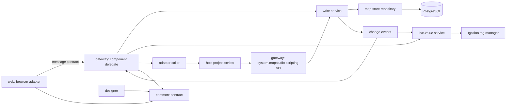
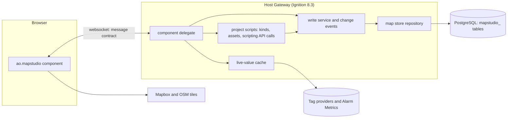
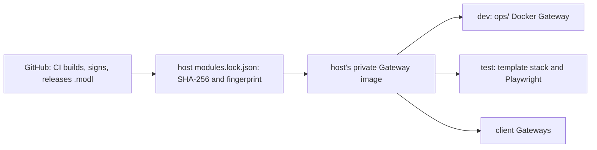
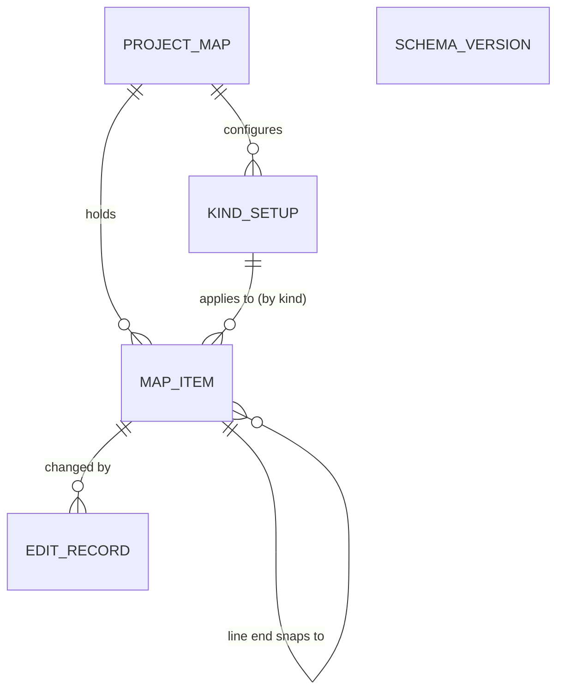

# Quick review lens prompt (story 6, install through the template's module lock)

Run this in a separate, context-free session (ideally a different LLM). Everything it points to is inlined below. Paste back its findings.

---

Read the plan below - it holds the acceptance criteria and intent - and the context files its frontmatter lists (inlined after it). The repository has no `AGENTS.md` or `CLAUDE.md` at its root or in the directories the diff touches (`scripts/ci`, `docs`, the repository root, `_bmad-output`); the rules for this change are the plan's `Always` and `Never` lists and the repository's own conventions (no em dashes anywhere, no secrets or throwaway signing values in git, no `.modl` committed). Then read the unified diff below - it is the change under review (the two PNG files in the diff are screenshots and appear only as binary entries).

Note on scope: the plan's template-side work (a lock entry, the scratch project and the stack run) happened in a throwaway local clone of `ign-scada-template` that is deliberately outside this diff; the plan says that real lock values and the template pull request wait for the v0.1.0 release. Judge this diff against the plan's acceptance criteria that this stage can meet, and against the plan's `Never` list.

Report unmet acceptance criteria, broken rules, and bugs. Each finding: the location, what goes wrong, and evidence checked against the surrounding code. Output a Markdown list of findings only - no severity, priority, or ranking.

Review by inspection only. Do not modify code, run builds or tests, or invoke quality gates. Do not invoke any skill, and do not spawn subagents of your own - you are the reviewer. Return your findings as text in your final message; do not route them through any findings-reporting tool the host may offer.

## FILE: the plan (`story-install-through-the-template-s-module-lock-plan.md`)

---
title: "Install through the template's module lock"
type: 'feature'
ticket: '6'
created: '2026-10-26'
status: 'in-review'
baseline_revision: '0c6a191c0550beaa9aff02c2610bc16b87ab6541'
route: 'full'
route_source: 'pinned'
risk: 'medium'
review: 'quick'
review_source: 'pinned'
lenses_ran: ['quick']
review_loop_iteration: 0
context:
  - '{project-root}/_bmad-output/initiative-flowmap/architecture-map-studio/architecture-map-studio.md'
  - '{project-root}/RELEASING.md'
---

<frozen-after-approval reason="human-owned intent - do not modify unless human renegotiates">

## Intent

**Problem:** Nothing proves that a signed Map Studio release installs the way a real host installs third-party modules: through `ign-scada-template`'s `modules/modules.lock.json`, pinned by SHA-256 and certificate fingerprint (R5, AD-13). No release exists yet, the Map Studio repository is private, and the template's `modl.py fetch` downloads without any credential.

**Approach:** One template pull request adds a lock entry for the released `.modl`, makes the fetch work for the chosen release source, and documents the module; it is proven on the template's test stack with a scratch Perspective project (placed only on the kept test stack, never committed) that shows the map. Until v0.1.0 exists the same change is rehearsed on a locally signed throwaway build that is never committed or pushed with its throwaway values.

**Decisions (owner, 2026-10-26):** (1) The release source is a public repository: the owner makes `aott33/perspective-flowmap` public before the template pull request, so the lock entry's GitHub release URL is fetched without a credential and there is no token and no credential change in `modl.py`. (2) The template's weekly `modules.yml` opens update pull requests for Map Studio like the other modules (the certificate pin still stops a new key). (3) The throwaway-build rehearsal runs now. (4) v0.1.0 is tagged as is; the story 3 spike package is removed later by the refactor sweep (entry 8).

## Boundaries & Constraints

**Always:** The template's CLAUDE.md governs that repo: load `ignition-config` and `ignition-security` there first, never edit `.claude/skills`, never commit a `.modl` (`.gitignore` blocks it), no credential in git (a token only in a secret store or the shell environment), `url` is https, lock fields are read from the module's own `module.xml` via `modl.py inspect`, `sha256` equals the release's `.sha256` file, `certSha256` equals the README line of this repository. The template change is its own pull request, opened as a draft (the Gateway jobs run only when it is ready for review). No em dashes.

**Never:** Edit, commit or run anything in `/home/user/ign-scada-template` from this planning session. Commit a throwaway sha or fingerprint to a pushed branch. Hand-create a view in the template's `projects/Upstream` (the generators own `views`, `check.py` fails on an orphan) or add a page to `scripts/gen/hmi`, `render_all.mjs` or the registry (that is epic 7). Bump the template's Gateway image (`IGNITION_VERSION` 8.3.9) in this pull request; if the module does not load on 8.3.9, stop and report (the platform checks ran on 8.3.10, so 8.3.9 is untested). Change the template's existing map pages. Accept a certificate by hand: the fingerprint comes from the README only.

## I/O & Edge-Case Matrix

| Scenario | Input / State | Expected Output / Behavior | Error Handling |
|----------|--------------|---------------------------|----------------|
| Real release | v0.1.0 published, lock holds its sha256 and the README fingerprint | `modl.py fetch` prints `ok com.aoindustrial.perspective.mapstudio 0.1.0`; image builds; `smoke.sh` sees the module ACTIVE | none |
| Wrong hash | `.modl` differs from `sha256` | `fetch` prints FAIL and removes the file; bootstrap stops | Lock not changed to fit the file |
| Other certificate | signed by a key whose fingerprint differs | `fetch` FAIL "signing certificate changed" | Rotation is a human step (RELEASING.md) |
| Private repo, no credential | fetch with no token and no cached file | clear error naming the variable to set, no traceback | Never prints the token |
| Weekly update check | `modules.yml` runs `check --write` | Map Studio entry is checked or skipped by design; the job does not crash | Per Q2 |

</frozen-after-approval>

## Code Map

Map Studio repo (this worktree, docs only):
- `RELEASING.md`, `README.md` ("Releases and signing") -- already say the lock pins SHA-256 and fingerprint and that a rotation updates host locks; add a short "Installing through a module lock" section with the lock entry and the fetch path chosen in Q1.
- `scripts/ci/modl-verify.sh <file> <fingerprint> [version]` -- run on the downloaded release before the lock is written (structure and fingerprint only, not cryptographic).
- `ops/project/com.inductiveautomation.perspective/{views/MapStudioDev,page-config}`, `ops/project/project.json` -- the tracer's view (`ao.mapstudio`, props `popupView`) and page config; the source for the scratch project (copy, do not move). Component id `ao.mapstudio`; module id `com.aoindustrial.perspective.mapstudio`; `build.gradle.kts` sets `requiredIgnitionVersion` 8.3.0, `freeModule` true, licence Apache-2.0; release file `Map-Studio-<version>.modl` plus `.sha256` (release.yml).
- `docs/platform-checks.md` -- the dated-record format; new `docs/template-install.md` records this story's evidence with screenshots in `docs/screenshots` (AD-15).
- `gateway/.../spike/*`, `MapStudioGatewayHook.java` -- the story 3 spike code ships in the module (inert without a project `setup` resource); see Q4.

Template repo (read for this plan, changed only in the later template pull request):
- `modules/modules.lock.json` -- `ignition` 8.3.9; entries carry `id,name,version,requiredIgnitionVersion,file,url,sha256,certSha256,licence,upstream`. `verify-lock` requires `id,name,version,file,url,sha256,licence,upstream`, https, and `upstream.type` in `github|redirect`.
- `scripts/modules/modl.py` -- `download()` calls `http_get(url)` with no token (private release asset: unauthenticated GET fails, unverified exact status). `fetch` skips the download when `services/ignition/modules/<file>` already matches `sha256` and then verifies every signature with `openssl` and the cert fingerprint, prunes unlocked `.modl`. `gh_releases` sends `GITHUB_TOKEN` only to the releases listing and re-raises any HTTP error except 403/429, so a private repo (404 to a token without access) would crash `check` (read from the code, not run).
- `.github/workflows/modules.yml` (weekly `check --write`, `GITHUB_TOKEN` of the template repo), `stack.yml` (`scripts/gw/bootstrap.sh` runs `fetch` with no token on pull requests; fork pull requests get no secrets), `ci.yml` (`verify-lock`, `check_repo.py`, `gen/check.py`).
- `services/ignition/Dockerfile` copies `modules/*.modl` and `SHA256SUMS`; `scripts/gw/install_image_modules.py` and `smoke.sh` keep the Gateway equal to the lock; `modules.env` carries `ACCEPT_MODULE_CERTS`/`ACCEPT_MODULE_LICENSES` generated from the lock ids, so no manual acceptance.
- `scripts/test/stack.sh` -- builds a worktree of the committed HEAD (uncommitted changes are not tested) under `build/test-stack` (ignored), copies `services/ignition/modules/*` from the main tree, mounts `./projects` into the Gateway; `--keep` leaves it on port 8089.
- `docs/modules.md` ("Modules in use", "Adding a module"), `THIRD_PARTY_NOTICES.md` -- say "four modules from two vendors"; update with the fifth.
- Do not change: `projects/Upstream/**`, `scripts/gen/**`, `tests/render/render_all.mjs`, `.claude/skills/**`, the Dockerfile, compose files.

## Tasks & Acceptance

**Prerequisites (owner, outside this plan; Claude cannot do them):**
- P1 Signing setup per `RELEASING.md`: certificate `CN=Map Studio, O=AO Industrial`, secrets `MODULE_SIGNING_KEYSTORE_B64` and `MODULE_SIGNING_KEYSTORE_PASSWORD`, README `Signing certificate SHA-256:` line replacing `PENDING`.
- P2 CI green on `main`: both jobs currently fail within 3 seconds with no logs (owner checking). Tagging needs it.
- P3 Tag `v0.1.0` on `main`, review the draft release, publish it (draft releases are not downloadable without write access and are skipped by `check`).
- P4 The repository is public (decision 1), so the release asset URL needs no credential.

**Before P1 to P3 (rehearsal, no commit of throwaway values):**
- [x] Locally sign a throwaway build (`scripts/ci/test-signing.sh` shows how; JDK 17, throwaway keystore under `mktemp`, deleted after) and run the template's `modl.py inspect` on it -- first check that the template's openssl signature check accepts this plugin's output (unverified).
- [x] In a template branch kept local (never pushed): lock entry with the throwaway sha256 and fingerprint, the `.modl` in `services/ignition/modules/`, commit, `scripts/test/stack.sh --keep`, scratch project, screenshots. Then delete the branch and `scripts/test/stack.sh --down`.

**Execution (after P1 to P4; the template pull request waits for v0.1.0):**
- [ ] Template `modules/modules.lock.json` -- add the Map Studio entry from the downloaded asset (`modl.py inspect`, `modl-verify.sh`, equal to the `.sha256` file and the README fingerprint); `upstream`: `{"type":"github","repo":"aott33/perspective-flowmap","asset":"Map-Studio-.*\\.modl","tag":"v0.1.0"}`.
- [x] `scripts/ci/build-signed.sh` (this repo) -- found by the rehearsal: wrap the exported certificate in a PKCS#7 DER bundle before the plugin copies it as `certificates.p7b`; without it the template's `modl.py` (openssl pkcs7) failed on the bare PEM certificate. Template `modl.py` is unchanged (decisions 1 and 2: no credential change, check like the others).
- [ ] Template `docs/modules.md`, `THIRD_PARTY_NOTICES.md` -- fifth module, "three vendors" wording, Apache-2.0, history line. No workflow change.
- [x] Template scratch project -- on the kept stack only: copy `ops/project/...` view and page config into `build/test-stack/projects/MapStudioScratch/` with its own `project.json`; `POST /data/api/v1/scan/projects`; open `/data/perspective/client/MapStudioScratch` at 1440 px and 390 px; screenshots. Done as a rehearsal on the throwaway build; repeat once against v0.1.0.
- [x] This repo `docs/template-install.md`, `docs/screenshots/`, `RELEASING.md`, `README.md` -- the evidence (labels `[live 8.3.9]` only for what ran), the lock entry and the fetch path; feeds story 9. Written from the rehearsal; the real lock values are added after v0.1.0. `README.md` needed no change.

**Acceptance Criteria:**
- Given the published v0.1.0, when the template's `modl.py fetch` runs with the Q1 credential (or none if public), then it prints `ok` for Map Studio and the file's SHA-256 equals the release `.sha256`.
- Given the lock entry, when `scripts/test/stack.sh` runs, then it passes, `smoke.sh` reports the module ACTIVE, and the Gateway log shows no Map Studio error.
- Given the kept test stack with the scratch project, when the page is opened, then the map shows its three test points and one line, at 1440 px and 390 px, and a click logs the delegate reply.
- Given the template pull request, when searched, then it holds no `.modl`, token, throwaway sha or throwaway fingerprint.
- Given a wrong hash or other certificate, when `fetch` runs, then it fails as in the matrix.

## Implementation Notes

Rehearsal done 2026-10-26 (owner decisions 1 to 4 above); evidence in `docs/template-install.md`, screenshots in `docs/screenshots/template-scratch-*.png`. Everything template-side ran in a throwaway local clone of `ign-scada-template` (scratchpad, branch never pushed, origin is the local path) because the planning agent may not run git in the shared template checkout; the template checkout itself was not touched. The throwaway keystore, sha256 and fingerprint exist only in the scratchpad and that clone.

- Finding: the first throwaway build failed the template's `modl.py inspect` (`openssl pkcs7` on a bare PEM certificate in `certificates.p7b`). Fixed in this repository: `scripts/ci/build-signed.sh` wraps the certificate as PKCS#7 DER; `scripts/ci/modl-verify.sh` refuses a `certificates.p7b` that is not a PKCS#7 bundle (checked by hand with a module whose bundle was swapped for a bare certificate; no case in `test-signing.sh` yet). `test-signing.sh` passes. The template's `modl.py` needs no change.
- The module loads and runs on the template's 8.3.9 image (ACTIVE, component registered, delegate round trip, no Map Studio warning or error): the image does not need a bump.
- The scratch project is a copy of `ops/project` (view, page config, popup view, `project.json`) copied into the kept test stack's `build/test-stack/projects/MapStudioScratch`, loaded by a project scan; it is never committed. `ops/screenshot.mjs` was run against it with the project name and output folder changed in a scratchpad copy.
- One render failure in the first `stack.sh` run (`phone-native-night /well/Mesa/P12/P12-3H/trends`: `Cannot subscribe to "ProjectDefinition" state. "Parts/Asset/Trends/" does not exist`, an embed path whose type segment was still empty) looked like a template race, not Map Studio: the same page passed in `native-day`, and a re-run of the whole `phone-native-night` pass on the same stack had no failure. A full re-run on a fresh stack passed (`test stack: PASS`, exit 0). Not reproduced without the module: unverified whether the race predates Map Studio.

## Plan Change Log

## Review Triage Log

## Design Notes

Why a scratch project and not a view in `Upstream`: the writer empties the owned view folders and `check.py` fails on any view the generators did not produce, so a hand-placed view would be wiped or break CI. `build/` is ignored and `./projects` is a bind mount, so a project folder added to the kept test stack's worktree reaches the Gateway through a project scan (project scan picks up a new project folder without restart: unverified). A permanent Map Studio page waits for epic 7.

Private release asset (not needed after decision 1; kept for the record, all unverified): the browser URL needs a session; the API route is the asset endpoint with `Accept: application/octet-stream`, which answers a redirect to storage that must not receive the Authorization header. `gh release download <tag> -R aott33/perspective-flowmap -p '*.modl'` does this and uses `GH_TOKEN`. Local fetch needs no code: a downloaded file already in `services/ignition/modules/` whose sha256 matches is used as is, and `stack.sh` copies that folder into its worktree.

Checks from the template's "Before a pull request" that apply: `modl.py verify-lock`; `check_repo.py --jython tools/jython.jar` (JSON, `.modl` not tracked, em dashes); `gen/check.py` (proves no generated file moved); the new modl test with `python3 -I` plus its `ci.yml` step if `modl.py` changes; `docker compose config -q` and `bash -n`/`shellcheck -x` only if compose or shell files change (not planned); `scripts/test/stack.sh` (includes bootstrap, smoke and `render_all.mjs`) and a look at the screenshots. Not affected: theme and icons, `prov` (registry untouched), `tests/prov`, `tests/ui`, `tests/ops`, `tests/fieldsim`, plunger, lint baseline, feedback and db tests, `test_checks.mjs`. CI runs them all anyway.

## Verification

**Commands:**
- `bash scripts/ci/modl-verify.sh Map-Studio-0.1.0.modl "<README fingerprint>" 0.1.0` -- expected: prints the fingerprint, exit 0
- `python3 -I scripts/modules/modl.py inspect Map-Studio-0.1.0.modl` -- expected: `signaturesBad` empty, `certSha256` equals the README
- `python3 -I scripts/modules/modl.py verify-lock && python3 -I scripts/modules/modl.py fetch` (template) -- expected: `lock ok`, `ok com.aoindustrial.perspective.mapstudio`
- `scripts/test/stack.sh --keep` (template, committed branch) -- expected: exit 0, module ACTIVE
- `git grep -I -n -E 'ghp_|github_pat_|BEGIN [A-Z ]*PRIVATE KEY' -- .` in both repos -- expected: no output

**Manual checks:**
- Screenshots of the scratch page at 1440 px and 390 px, and the Gateway log lines for the module, read by the owner.


## FILE: context - architecture-map-studio.md

---
name: 'Map Studio'
type: architecture-spine
purpose: build-substrate
altitude: initiative
paradigm: 'hexagonal (ports and adapters), Gateway-authoritative'
scope: 'the Map Studio module and its contract with host projects, for the seven epics of initiative-flowmap'
status: final
created: '2026-10-26'
updated: '2026-10-26'
binds: [R1, R2, R3, R4, R5, R6, R7, R8, R9, R10, R11, R12, R13, R14, R15, R16, R17, R18, R19, R20, R21, R22, R23, R24, R25, R26, R27, R28, R29, R30, R31, R32, R33, R34, R35, R36, R37, R38, R39]
sources:
  - _bmad-output/initiative-flowmap/initiative-flowmap.md
  - _bmad-output/initiative-flowmap/prd-map-studio/prd-map-studio.md
  - _bmad-output/initiative-flowmap/prd-map-studio/addendum.md
---

# Architecture Spine - Map Studio

## Design Paradigm

Hexagonal (ports and adapters) with the Gateway as the authority. The core lives in the module's Gateway scope: it owns the map store, every write, role checks and live values. The browser client is an adapter that draws and edits and speaks only the message contract to its component delegate. The host project plugs in through ports it implements as project script functions (its kinds, its assets and, as a fallback, its setup) and calls the core only through the scripting API.

| Layer | Lives in | Holds |
| --- | --- | --- |
| Contract | `common/` | component descriptor, props and events schema, message types, map item record, LiveValue, asset contract, kind list and setup schemas |
| Core | `gateway/` | component delegate, write service, map store repository and migrations, change events, live-value service, adapter caller, setup loader, role matrix, scripting API |
| Browser adapter | `web/` | MapLibre rendering, Terra Draw editing, one shared geometry module, popups, tools, undo stack, unsaved-edit queue, message client |
| Designer | `designer/` | palette entry and props editing |
| Host adapters | the host project | script functions for kinds, assets and the setup fallback; calls to `system.mapstudio.*`; popup links; custom popup views |



Dependencies point inward to `common/`. `web/` never reaches the database, tags or host scripts except through the delegate; host scripts reach the map only through `system.mapstudio.*`, never its tables.

## Invariants & Rules

### AD-1 - The Gateway is the authority [ADOPTED]

- **Binds:** all
- **Prevents:** logic split between browser code, Gateway code and host scripts, and side effects outside the map store.
- **Rule:** Every read of the map store, every write, every role check and every tag subscription happens in the module's Gateway scope. The browser holds only what the Gateway sent it plus unsaved edits. Map Studio reads tags only by subscription and writes only to its map store, never to tags, devices, assets or UDT instances; the host's Jython is untouched. Calls into host adapter scripts run with a timeout on a bounded pool.

### AD-2 - One write path: versioned, all-or-none batches [ADOPTED]

- **Binds:** R9, R14 to R21, R26 to R28, R30 to R32, R34, R35, R39
- **Prevents:** silent overwrites, partial imports, duplicate saves on retry, phone editors drawing, and writes that skip the edit record.
- **Rule:** Every change is an `edits.apply` batch `{batchId, ops}` with ops `{op: create|update|delete, entity: item|kindSetup, id, baseVersion, data}` (`baseVersion` 0 on create), from the browser or from `system.mapstudio.applyEdits` (AD-18). The write service checks the role matrix, checks every `baseVersion`, validates every op against the kind list (AD-20), writes, increments versions and records who and when, in one transaction: all ops or none, one undo step, every conflict returned. Deletes are tombstones with a version bump, so undo restores them. A retried `batchId` returns the first result. Large imports go as `edits.begin`, `edits.chunk`, `edits.commit` under one `batchId`. Role matrix: full editing may do every op; phone editing may only update a point's geometry and a map item's properties, and undo those; `map.load` tells the browser its level (`none`, `phone`, `full`).

### AD-3 - The map store [ADOPTED]

- **Binds:** R32, R33, R35
- **Prevents:** schema drift, cross-project leaks and database-specific features creeping in.
- **Rule:** PostgreSQL only in the first version. Tables are prefixed `mapstudio_`, every row is keyed by Ignition project name, geometry is GeoJSON text, and the module creates and migrates its tables itself, recording a schema version. No spatial SQL.

### AD-4 - Host adapters for kinds and assets [ADOPTED]

- **Binds:** R12, R13, R14, R27
- **Prevents:** the module learning one project's data model, and per-click calls into host scripts.
- **Rule:** Kinds and assets come only from project script functions the setup names, returning rows in the published kind list and asset contract shapes; every asset carries a fully qualified base path (provider included). The Gateway caches the results, refreshes them on a timer and on demand, and reports an empty, failing or incomplete adapter in words. The docs ship two example adapters (UDT instances from the tag tree, a named-query wrapper), not module code.

### AD-5 - One setup per project [ADOPTED]

- **Binds:** R9, R12, R13, R33, R36, the refresh interval of AD-6
- **Prevents:** two pages disagreeing about the database, roles or adapters of the one map.
- **Rule:** The database connection, adapter functions, full-editing and phone-editing roles, refresh interval (default 10 s), alarm page, basemaps and token secret name are set once per project in a setup with a versioned schema, as a project-level setup; if the spike shows a custom project resource type is too costly, the setup is a project script function returning the same schema. Components carry only per-page settings such as the starting area. Kind setups are never part of the project setup (AD-16).

### AD-6 - Live values: one shared subscription, batched out [ADOPTED]

- **Binds:** R2, R5, R6, R37
- **Prevents:** tag load that grows with sessions or map items, Alarm Metrics read in a way Ignition does not support, and icons and popups disagreeing on state.
- **Rule:** The Gateway holds one subscription per project to every live value the kind setups turn on (comms, the icon KPI, Alarm Metrics) and keeps it running while the Gateway runs. Each slot is one `LiveValue {value, quality, t, stale, reason}`, with stale computed in the cache from tag quality and comms state. Each open map gets `values.batch {seq, full, items}` once per refresh interval: changes only, or the whole map when `full` (on open, on reconnect, and after a link or kind setup change). No subscription per session or per map item; switched-off values are never subscribed.

### AD-7 - Popups: Map Studio's default, a project's custom view [ADOPTED]

- **Binds:** R6, R7, R8, R39
- **Prevents:** popups that each project must build, two shapes for the same map item, and acknowledging outside Ignition's alarm table.
- **Rule:** Map Studio draws the default popup from the kind setup; while it is open (`popup.open` to `popup.close`) the Gateway pushes that map item's LiveValues on change. A kind setup may name a custom popup view by its project view path, rendered the way the built-in Perspective Map renders a view from a `path` (its custom controls and view layer); it receives the map item object as its parameter: the AD-20 record plus `basePath`, `alarmsPath` and its LiveValues, kept live while the view is open. Placeholders in popup links are dotted paths into the map item object (`{asset.id}`, `{properties.route}`). A missing or failing custom view falls back to the default popup. Map Studio never acknowledges alarms.

### AD-8 - The message contract [ADOPTED]

- **Binds:** all
- **Prevents:** each epic inventing its own message shapes and error handling.
- **Rule:** Every message between browser and Gateway is `{v, type, id, body}`; types are named `area.action` and listed in `common/` (`map.load`, `map.changed`, `edits.apply`, `edits.begin`, `edits.chunk`, `edits.commit`, `values.batch`, `popup.open`, `popup.close`); every error is `{code, message}` with a plain-words message. A type not listed in `common/` is not sent.

### AD-9 - The public contract is versioned [ADOPTED]

- **Binds:** all
- **Prevents:** a host project breaking on a module upgrade without warning.
- **Rule:** Component props and events, the message contract, the map item record and object, LiveValue, the asset contract, the kind list, the setup schema, the scripting API and the CSV formats are documented in `docs/` and follow semantic versioning; a breaking change is a new major version. The component's props are a closed list in `common/`.

### AD-10 - Editing happens in the browser [ADOPTED]

- **Binds:** R10, R11, R14, R17 to R24, R32, R37, R38
- **Prevents:** a Gateway round trip per click or vertex, lost edits, and two undo models.
- **Rule:** Drawing, snapping, validation and undo run in the browser; the Gateway is called when an edit is finished. New map item ids are UUID strings created when the item is drawn. Each component session keeps one undo stack; undoing a saved edit sends the reverse batch through AD-2. Unsaved batches wait in an ordered queue in the browser's local storage, per project, and are replayed through AD-2 with their original versions until saved or discarded. When the map store is unreachable at load, the tools are disabled and no map item is drawn as current.

### AD-11 - Look and colour [ADOPTED]

- **Binds:** R2, R5, R38
- **Prevents:** colours or styles that ignore the host project's theme or read as alarms.
- **Rule:** Every colour comes from the host project's theme tokens; the module ships no colour of its own. Normal state is neutral; hue appears only for abnormal state, always with a word or glyph. State on icons, lines and popups passes the template's engineering review (ER-27) before release.

### AD-12 - Basemaps and tokens

- **Binds:** R36
- **Prevents:** tokens in views or git, and styles MapLibre cannot render.
- **Rule:** Basemaps are none, OpenStreetMap, satellite and Mapbox. Satellite is the Mapbox raster tileset `mapbox.satellite` through the Raster Tiles API, conditional on the owner confirming Mapbox's Product Terms; otherwise a commercial MapTiler or Esri imagery plan. The Gateway reads the token from the project's secret store and sends it to the browser; only public, URL-restricted tokens are used. Every basemap shows its provider's attribution.

### AD-13 - Build, release and upgrade gate [ADOPTED]

- **Binds:** all
- **Prevents:** a release that breaks on a Gateway version it claims to support, or an unsigned or unpinned module on a Gateway.
- **Rule:** The Perspective client packages are pinned to exact versions and the module declares its lowest supported 8.3.x. A release claims a new 8.3.x only after the template's test stack and the module's Playwright suite pass on it. Releases are signed `.modl` files on GitHub, installed through the host's module lock by SHA-256 and certificate fingerprint; never a `.modl` in git.

### AD-14 - Signing key custody [ADOPTED]

- **Binds:** epic-module-foundation and every release
- **Prevents:** a lost or leaked key, and a rotation that silently breaks host locks.
- **Rule:** The owner holds one self-signed module-signing certificate, stored as a GitHub Actions secret usable only by release jobs, with an offline backup in the owner's password manager. Its fingerprint is in the README. A rotation is a documented release carrying the new fingerprint.

### AD-15 - Docs carry proof [ADOPTED]

- **Binds:** all
- **Prevents:** documentation that claims behaviour nobody has seen work.
- **Rule:** The Playwright suite records screenshots of each documented behaviour, and the docs embed them. A documented behaviour without a passing test and screenshot is marked unverified.

### AD-16 - Kind list and kind setup are separate [ADOPTED]

- **Binds:** R12, R15, R16
- **Prevents:** kind setups stored in three places, and overrides saved outside the item's version.
- **Rule:** The kind list comes from the host adapter and is read only. The kind setup lives in the map store as one versioned row per project and kind id (no generated id), changed only through AD-2. Overrides are a field of the map item and save with it.

### AD-17 - Saved changes reach every open map at once [ADOPTED]

- **Binds:** R32
- **Prevents:** saved edits waiting for the next value batch, and subscriptions that miss a newly linked map item.
- **Rule:** Each committed batch emits one in-process change event. Every open map of the project receives `map.changed {seq, ops}` at once, independent of `values.batch`; the live-value service resubscribes from the same event. A gap in `seq` makes the browser reload the map.

### AD-18 - The scripting API [ADOPTED]

- **Binds:** R32, the template cut-over, AD-2
- **Prevents:** host projects or the cut-over writing the tables by SQL, and duplicate map items on a re-run.
- **Rule:** Gateway-scope `system.mapstudio.getMap(project)` and `system.mapstudio.applyEdits(project, batch, actor)` run on the same write service as the browser. Callers may supply map item ids, as UUIDv5 from a stable name, so a re-run updates instead of duplicating; an actor is required. Owned by epic-map-store-and-data; part of the public contract.

### AD-19 - Snapping is stored [ADOPTED]

- **Binds:** R18, R19, R30, R35
- **Prevents:** snapped ends inferred by coordinates in one epic and stored in another.
- **Rule:** A line's `ends` record what each end snaps to (`{start: {itemId}, end: {itemId}}`, or null). Moving a snapped-to map item moves its attached ends in the same batch, through one shared geometry module in `web/` that the phone epic reuses; the Gateway rejects a batch that moves a snapped-to item without its ends. Coordinate equality never infers snapping.

### AD-20 - The map item record is closed and typed [ADOPTED]

- **Binds:** R11, R14, R23, R25 to R28, R35
- **Prevents:** stored derived fields, untyped properties, and duplicates on re-import.
- **Rule:** The stored record is `{id, kind, name, geometry, properties, assetId, overrides, ends, version, deleted}`. Base path, unlinked reason and unknown kind are derived at read time from the adapter caches, never stored. Properties are keyed and typed by the kind list's form fields; the write service validates and normalises every op (CSV strings are converted there, once). Export writes ids, overrides and the exported kinds' setups; importing a known id is an update.

### AD-21 - Operations [ADOPTED]

- **Binds:** R32, R33, epic-map-store-and-data, every release
- **Prevents:** a map lost without a backup, a half-created schema, and two Gateways writing at once.
- **Rule:** Map Studio has no backup of its own: the site's PostgreSQL backups cover the map store, the docs say so, and export is the portable copy. On start the module creates or migrates its tables; when it lacks the rights or a migration fails, it logs an error naming the connection and the missing right, as the historian and alarm journal do, and the map store is unavailable (components say so, tools off) until fixed. A schema newer than the module knows makes the map read only, with the reason logged. In a redundant pair only the active Gateway subscribes and accepts writes; after a failover the new active Gateway rebuilds its caches from the database and the tags, and open maps reload.

### AD-22 - The cut-over writes through the scripting API [ADOPTED]

- **Binds:** epic-template-cutover
- **Prevents:** the template's map seeded by SQL or by hand, and duplicates when the cut-over is re-run.
- **Rule:** A one-time template script reads the registry and `_Model/Map` and writes the Mesa field through `system.mapstudio.applyEdits`, with UUIDv5 ids from each asset's name, so it can be re-run safely.

## Consistency Conventions

| Concern | Convention |
| --- | --- |
| Names | Module id `com.aoindustrial.perspective.mapstudio`; component `ao.mapstudio`; npm `@aoindustrial/perspective-map-studio`; Java packages under `com.aoindustrial.perspective.mapstudio`; tables and columns `mapstudio_` snake_case; message types `area.action`; scripting `system.mapstudio.*`; the PRD's Glossary terms used exactly in code, messages and docs |
| Ids and versions | Map item ids are UUID strings (browser-created, or UUIDv5 from a stable name through the scripting API); kind setups keyed by project and kind id; asset ids are the adapter's strings, unchanged; versions are integers starting at 1 |
| Geometry and coordinates | GeoJSON, longitude before latitude, WGS 84, 6 decimals stored |
| Times | ISO 8601 UTC strings in messages; `timestamptz` in the map store |
| Errors | `{code, message}`; codes are stable kebab-case words (`conflict`, `role`, `stale`, `invalid`, `store-unreachable`); messages are plain words for the user |
| Logging | Gateway loggers named `MapStudio.<area>`; never a token, a password or a map item's properties in a log line |
| Config | Only the project setup (AD-5) and per-component settings; no Gateway-wide module settings |
| Auth | The role matrix (AD-2), checked on the Gateway on every write |
| Breakpoints | Drawing tools off below 768 px; phone layout at 390 px |
| Host scripts in docs | Example adapters and scripts follow Jython 2.7 rules and catch both Java and Python exceptions |
| Licences and attribution | Apache-2.0 with a NOTICE file; attributions for Natural Earth, GeoNames and any icon seed shipped with the module; nothing derived from OpenBridge |
| Static assets | The place-check data and the icon sprite are static assets the module serves; the browser loads the place-check data on first use |
| Text | No em dashes in code, messages, labels or docs |

## Stack

| Name | Version |
| --- | --- |
| Ignition (minimum declared, current) | 8.3.x, set in the spike; 8.3.10 current |
| Java | 17 |
| Gradle module plugin `io.ia.sdk.modl` | 0.5.0 |
| `com.github.node-gradle.node` / Node | 7.1.0 / 22 |
| `@inductiveautomation/perspective-client` | 2.x, exact version set in the spike |
| React / TypeScript / webpack | 16.14.0 / 4.9 / 5 |
| maplibre-gl | 6.16.0, unverified with the adapter and toolchain; older pin as fallback |
| terra-draw / terra-draw-maplibre-gl-adapter | 1.38.0 / 1.5.0 |
| @turf/turf | 7.4.0 |
| PostgreSQL | minimum version and JDBC driver set in the spike, tested with 8.3.10's connection defaults |
| Playwright | pinned in the spike |

## Structural Seed

Map Studio's own layout, modelled on Mustry's module:

```text
perspective-map-studio/
  common/     # contract: descriptor, schemas, message types, map item record, LiveValue
  gateway/    # core: hook, delegate, write service, store and migrations, change events, live values, adapters, setup, scripting API
  designer/   # palette entry and props editing
  web/        # browser adapter: TypeScript, React, MapLibre, Terra Draw, shared geometry module
  e2e/        # Playwright suite and the screenshots the docs embed
  ops/        # local dev Gateway (Docker) for building and testing
  docs/       # contracts, example adapters, example custom popup view, screenshots
```







## Capability → Architecture Map

| Capability / Area | Lives in | Governed by |
| --- | --- | --- |
| R1, R3, R4, R5, R36, R37 map view, labels, search, parity, basemaps, speed | `web/` | AD-1, AD-6, AD-11, AD-12 |
| R2, R6, R7, R8, R39 icons, popups, alarm summary, links, custom popup view | `web/`, `gateway/` live values | AD-6, AD-7, AD-11 |
| R9, R32, R33, R34 roles, saving, map store, conflicts, live updates | `gateway/` write service, store, change events | AD-2, AD-3, AD-5, AD-10, AD-17, AD-18 |
| R12, R13, R14, R15, R16, R27 kinds, assets, linking, kind setup, overrides, import matching | `gateway/` adapters and store, `web/` | AD-4, AD-5, AD-16, AD-20 |
| R10, R11, R17 to R24, R38 tools, drawing, snapping, forms | `web/`, saved through `gateway/` | AD-2, AD-10, AD-11, AD-19 |
| R25, R26, R28, R29, R35 CSV templates, import, bulk edit, reference layer, export | `web/`, `gateway/` | AD-2, AD-9, AD-20 |
| R30, R31 phone | `web/` | AD-2, AD-10, AD-19 |
| Releases, upgrades, signing, docs | build, CI, `e2e/`, `docs/` | AD-13, AD-14, AD-15 |
| Template cut-over | `ign-scada-template` | AD-2, AD-4, AD-5, AD-11, AD-18, AD-22 |
| Operations: backup, schema rights, redundancy | `gateway/`, `docs/` | AD-3, AD-21 |

## Deferred

- **deck.gl and flow animation:** not in the first version; MapLibre layers draw lines and icons. Revisit with flow.
- **Viewport-limited batches:** whole-map batches until the 300-site target needs less.
- **Databases other than PostgreSQL:** after the first version.
- **Setup as a custom project resource or a script:** the spike decides; AD-5 fixes the schema either way.
- **Internal structure of `gateway/` and `web/`:** owned by the code once it exists.
- **Parsers for CSV, KML and GeoJSON, and the place-check data package:** chosen in epic-import-export and epic-editing, within the licence convention.
- **Saving reference layers between sessions:** a reference layer lasts for the session in the first version.
- **Clustering, offline tiles, map version history:** out of scope for the first version.

Open questions, each with its revisit point:

- Do Java tag subscriptions reach Alarm Metrics on folders and UDT instances? The spike checks it; if not, the fallback is a reference or expression tag per asset.
- Can a third-party component open a project view as a custom popup view in 8.3? The spike checks it (Embr Periscope embeds views, so it is likely).
- Can module code call project script functions and register `system.mapstudio.*` functions? The spike checks it; the adapter fallback is a named query.
- Does the Perspective toolchain (React 16.14, TypeScript 4.9) build MapLibre 6 and Terra Draw? The spike checks it; if not, pin an older MapLibre.
- Do Mapbox's current Product Terms allow `mapbox.satellite` raster tiles in MapLibre for client SCADA sites? The owner reads them before epic-viewing.


## FILE: context - RELEASING.md (as changed)

# Releasing Map Studio

Releases are signed `.modl` files on GitHub. Signing happens only in the release workflow (`.github/workflows/release.yml`), from two repository secrets. No key, password or certificate is ever committed (`.gitignore` blocks `*.p12`, `*.jks`, `*.pem`, `*.modl`), and CI on every push and pull request signs only with a throwaway certificate that it generates and discards.

## One-time setup (the owner)

Do this on a trusted machine with a JDK 17 `keytool`.

1. Generate the certificate. Use a password without a backslash, a newline, or leading or trailing whitespace: the build writes it to a temporary Gradle properties file and refuses such passwords with a clear message. `keytool` asks for the password; choose a long one and do not type it on the command line.

   ```bash
   keytool -genkeypair -alias mapstudio -keyalg RSA -keysize 3072 -sigalg SHA256withRSA \
     -validity 3650 -dname "CN=Map Studio, O=AO Industrial" \
     -keystore mapstudio-signing.p12 -storetype PKCS12
   ```

2. Read its fingerprint:

   ```bash
   keytool -list -v -keystore mapstudio-signing.p12 -alias mapstudio | grep SHA256
   ```

3. Back up `mapstudio-signing.p12` and its password in your password manager, plus an offline copy. A lost key means a rotation (below).
4. Create the two repository secrets:

   ```bash
   base64 -w0 mapstudio-signing.p12 | gh secret set MODULE_SIGNING_KEYSTORE_B64 --repo aott33/perspective-flowmap
   gh secret set MODULE_SIGNING_KEYSTORE_PASSWORD --repo aott33/perspective-flowmap   # paste at the prompt
   ```

5. Replace the `PENDING` line in `README.md` with `Signing certificate SHA-256: <the fingerprint from step 2>` (uppercase, colon separated) in a normal pull request. The release workflow refuses to run while the line is missing, and refuses a signed module whose certificate differs from it.

## Cutting a release

1. Merge to `main`; CI must be green.
2. Tag the merge commit with a plain `vX.Y.Z` (no `-rc` or other suffix: Ignition's module version is numeric) and push the tag:

   ```bash
   git switch main && git pull
   git tag -a v0.1.0 -m "v0.1.0"
   git push origin v0.1.0
   ```

3. The `build-sign` job (read-only token, the only job that sees the secrets) checks the tag is on `main`, builds and signs, and checks the signature structure, that the certificate fingerprint equals the README line and that `module.xml`'s version equals the tag. The `draft` job (can write releases, sees no secret, builds nothing) then creates a DRAFT release with `Map-Studio-X.Y.Z.modl` and `Map-Studio-X.Y.Z.modl.sha256`.
4. Review the draft. Download the `.modl`, run `scripts/ci/modl-verify.sh <file> "<README fingerprint>"`, then publish the draft. Publishing is the release approval; the workflow never publishes by itself.

`modl-verify.sh` is a structure and fingerprint check only: it does not verify the signatures cryptographically, so a forged module that carries the genuine certificate file would pass it. The cryptographic check happens when a Gateway installs the module, so install the signed build once on a dev Gateway before you rely on a new certificate. Real verification is a deferred item.

Limit of this setup: the secrets are repository secrets, so anyone who can push a tag to the repository can start the release workflow (it still only creates a draft, and only for a tag on `main`).

## Installing through a host's module lock

A host such as `ign-scada-template` pins the release in its lock file by SHA-256 and certificate fingerprint and downloads it from the public release URL (no credential; the repository is public). The lock entry for release `X.Y.Z`:

```json
{
  "id": "com.aoindustrial.perspective.mapstudio",
  "name": "Map Studio",
  "version": "X.Y.Z",
  "requiredIgnitionVersion": "8.3.0",
  "file": "Map-Studio-X.Y.Z.modl",
  "url": "https://github.com/aott33/perspective-flowmap/releases/download/vX.Y.Z/Map-Studio-X.Y.Z.modl",
  "sha256": "<the release's .sha256 file>",
  "certSha256": "<the README's Signing certificate SHA-256 line>",
  "licence": {"name": "Apache-2.0", "commercial": false},
  "upstream": {"type": "github", "repo": "aott33/perspective-flowmap", "asset": "Map-Studio-.*\\.modl", "tag": "vX.Y.Z"}
}
```

Take `sha256` from the published release's `.sha256` file, `certSha256` from the README, and check both against the downloaded file with the host's own tool (`modl.py inspect`) and `scripts/ci/modl-verify.sh` before writing the entry. The rehearsal that proved this path is in [docs/template-install.md](docs/template-install.md).

## When the repo goes public or the plan allows

Move the secrets behind an environment with a required reviewer:

1. Settings, Environments: create `release`; set yourself as required reviewer; under deployment branches and tags choose "Selected" and add the tag rule `v*`.
2. Move `MODULE_SIGNING_KEYSTORE_B64` and `MODULE_SIGNING_KEYSTORE_PASSWORD` into the `release` environment and delete the repository copies.
3. In `release.yml` uncomment the one line `# environment: release` on the `build-sign` job.
4. Settings, Rules, Rulesets: add a tag ruleset that restricts creation of `v*` tags to the owner.

## Rotation or lost key

A rotation is a release: generate a new certificate (setup steps 1 to 4), change the README fingerprint in the same pull request that announces it, tag a release, and state the old and new fingerprints in the release notes. Every host that locks on the fingerprint (for example the template's `modules/modules.lock.json`) must be updated to the new one before it installs the new release. Revoke nothing silently: the old fingerprint stays in the notes of the releases it signed.

## Testing the signing path

`scripts/ci/test-signing.sh` (also the `signing-check` CI job) generates a throwaway certificate in a temporary directory, signs with the same script the release uses, and checks that a wrong fingerprint or version, empty arguments, the unsigned build, a module with an unsigned file and unsafe passwords are all refused. It needs JDK 17 on `PATH`.


## FILE: the unified diff since the baseline revision 0c6a191c0550beaa9aff02c2610bc16b87ab6541

```diff
diff --git a/RELEASING.md b/RELEASING.md
index 42521e8..cfc57a0 100644
--- a/RELEASING.md
+++ b/RELEASING.md
@@ -48,6 +48,27 @@ Do this on a trusted machine with a JDK 17 `keytool`.
 
 Limit of this setup: the secrets are repository secrets, so anyone who can push a tag to the repository can start the release workflow (it still only creates a draft, and only for a tag on `main`).
 
+## Installing through a host's module lock
+
+A host such as `ign-scada-template` pins the release in its lock file by SHA-256 and certificate fingerprint and downloads it from the public release URL (no credential; the repository is public). The lock entry for release `X.Y.Z`:
+
+```json
+{
+  "id": "com.aoindustrial.perspective.mapstudio",
+  "name": "Map Studio",
+  "version": "X.Y.Z",
+  "requiredIgnitionVersion": "8.3.0",
+  "file": "Map-Studio-X.Y.Z.modl",
+  "url": "https://github.com/aott33/perspective-flowmap/releases/download/vX.Y.Z/Map-Studio-X.Y.Z.modl",
+  "sha256": "<the release's .sha256 file>",
+  "certSha256": "<the README's Signing certificate SHA-256 line>",
+  "licence": {"name": "Apache-2.0", "commercial": false},
+  "upstream": {"type": "github", "repo": "aott33/perspective-flowmap", "asset": "Map-Studio-.*\\.modl", "tag": "vX.Y.Z"}
+}
+```
+
+Take `sha256` from the published release's `.sha256` file, `certSha256` from the README, and check both against the downloaded file with the host's own tool (`modl.py inspect`) and `scripts/ci/modl-verify.sh` before writing the entry. The rehearsal that proved this path is in [docs/template-install.md](docs/template-install.md).
+
 ## When the repo goes public or the plan allows
 
 Move the secrets behind an environment with a required reviewer:
diff --git a/_bmad-output/initiative-flowmap/tickets/epic-module-foundation/tickets/story-install-through-the-template-s-module-lock-plan.md b/_bmad-output/initiative-flowmap/tickets/epic-module-foundation/tickets/story-install-through-the-template-s-module-lock-plan.md
new file mode 100644
index 0000000..e4798b9
--- /dev/null
+++ b/_bmad-output/initiative-flowmap/tickets/epic-module-foundation/tickets/story-install-through-the-template-s-module-lock-plan.md
@@ -0,0 +1,123 @@
+---
+title: "Install through the template's module lock"
+type: 'feature'
+ticket: '6'
+created: '2026-10-26'
+status: 'in-review'
+baseline_revision: '0c6a191c0550beaa9aff02c2610bc16b87ab6541'
+route: 'full'
+route_source: 'pinned'
+risk: 'medium'
+review: 'quick'
+review_source: 'pinned'
+lenses_ran: ['quick']
+review_loop_iteration: 0
+context:
+  - '{project-root}/_bmad-output/initiative-flowmap/architecture-map-studio/architecture-map-studio.md'
+  - '{project-root}/RELEASING.md'
+---
+
+<frozen-after-approval reason="human-owned intent - do not modify unless human renegotiates">
+
+## Intent
+
+**Problem:** Nothing proves that a signed Map Studio release installs the way a real host installs third-party modules: through `ign-scada-template`'s `modules/modules.lock.json`, pinned by SHA-256 and certificate fingerprint (R5, AD-13). No release exists yet, the Map Studio repository is private, and the template's `modl.py fetch` downloads without any credential.
+
+**Approach:** One template pull request adds a lock entry for the released `.modl`, makes the fetch work for the chosen release source, and documents the module; it is proven on the template's test stack with a scratch Perspective project (placed only on the kept test stack, never committed) that shows the map. Until v0.1.0 exists the same change is rehearsed on a locally signed throwaway build that is never committed or pushed with its throwaway values.
+
+**Decisions (owner, 2026-10-26):** (1) The release source is a public repository: the owner makes `aott33/perspective-flowmap` public before the template pull request, so the lock entry's GitHub release URL is fetched without a credential and there is no token and no credential change in `modl.py`. (2) The template's weekly `modules.yml` opens update pull requests for Map Studio like the other modules (the certificate pin still stops a new key). (3) The throwaway-build rehearsal runs now. (4) v0.1.0 is tagged as is; the story 3 spike package is removed later by the refactor sweep (entry 8).
+
+## Boundaries & Constraints
+
+**Always:** The template's CLAUDE.md governs that repo: load `ignition-config` and `ignition-security` there first, never edit `.claude/skills`, never commit a `.modl` (`.gitignore` blocks it), no credential in git (a token only in a secret store or the shell environment), `url` is https, lock fields are read from the module's own `module.xml` via `modl.py inspect`, `sha256` equals the release's `.sha256` file, `certSha256` equals the README line of this repository. The template change is its own pull request, opened as a draft (the Gateway jobs run only when it is ready for review). No em dashes.
+
+**Never:** Edit, commit or run anything in `/home/user/ign-scada-template` from this planning session. Commit a throwaway sha or fingerprint to a pushed branch. Hand-create a view in the template's `projects/Upstream` (the generators own `views`, `check.py` fails on an orphan) or add a page to `scripts/gen/hmi`, `render_all.mjs` or the registry (that is epic 7). Bump the template's Gateway image (`IGNITION_VERSION` 8.3.9) in this pull request; if the module does not load on 8.3.9, stop and report (the platform checks ran on 8.3.10, so 8.3.9 is untested). Change the template's existing map pages. Accept a certificate by hand: the fingerprint comes from the README only.
+
+## I/O & Edge-Case Matrix
+
+| Scenario | Input / State | Expected Output / Behavior | Error Handling |
+|----------|--------------|---------------------------|----------------|
+| Real release | v0.1.0 published, lock holds its sha256 and the README fingerprint | `modl.py fetch` prints `ok com.aoindustrial.perspective.mapstudio 0.1.0`; image builds; `smoke.sh` sees the module ACTIVE | none |
+| Wrong hash | `.modl` differs from `sha256` | `fetch` prints FAIL and removes the file; bootstrap stops | Lock not changed to fit the file |
+| Other certificate | signed by a key whose fingerprint differs | `fetch` FAIL "signing certificate changed" | Rotation is a human step (RELEASING.md) |
+| Private repo, no credential | fetch with no token and no cached file | clear error naming the variable to set, no traceback | Never prints the token |
+| Weekly update check | `modules.yml` runs `check --write` | Map Studio entry is checked or skipped by design; the job does not crash | Per Q2 |
+
+</frozen-after-approval>
+
+## Code Map
+
+Map Studio repo (this worktree, docs only):
+- `RELEASING.md`, `README.md` ("Releases and signing") -- already say the lock pins SHA-256 and fingerprint and that a rotation updates host locks; add a short "Installing through a module lock" section with the lock entry and the fetch path chosen in Q1.
+- `scripts/ci/modl-verify.sh <file> <fingerprint> [version]` -- run on the downloaded release before the lock is written (structure and fingerprint only, not cryptographic).
+- `ops/project/com.inductiveautomation.perspective/{views/MapStudioDev,page-config}`, `ops/project/project.json` -- the tracer's view (`ao.mapstudio`, props `popupView`) and page config; the source for the scratch project (copy, do not move). Component id `ao.mapstudio`; module id `com.aoindustrial.perspective.mapstudio`; `build.gradle.kts` sets `requiredIgnitionVersion` 8.3.0, `freeModule` true, licence Apache-2.0; release file `Map-Studio-<version>.modl` plus `.sha256` (release.yml).
+- `docs/platform-checks.md` -- the dated-record format; new `docs/template-install.md` records this story's evidence with screenshots in `docs/screenshots` (AD-15).
+- `gateway/.../spike/*`, `MapStudioGatewayHook.java` -- the story 3 spike code ships in the module (inert without a project `setup` resource); see Q4.
+
+Template repo (read for this plan, changed only in the later template pull request):
+- `modules/modules.lock.json` -- `ignition` 8.3.9; entries carry `id,name,version,requiredIgnitionVersion,file,url,sha256,certSha256,licence,upstream`. `verify-lock` requires `id,name,version,file,url,sha256,licence,upstream`, https, and `upstream.type` in `github|redirect`.
+- `scripts/modules/modl.py` -- `download()` calls `http_get(url)` with no token (private release asset: unauthenticated GET fails, unverified exact status). `fetch` skips the download when `services/ignition/modules/<file>` already matches `sha256` and then verifies every signature with `openssl` and the cert fingerprint, prunes unlocked `.modl`. `gh_releases` sends `GITHUB_TOKEN` only to the releases listing and re-raises any HTTP error except 403/429, so a private repo (404 to a token without access) would crash `check` (read from the code, not run).
+- `.github/workflows/modules.yml` (weekly `check --write`, `GITHUB_TOKEN` of the template repo), `stack.yml` (`scripts/gw/bootstrap.sh` runs `fetch` with no token on pull requests; fork pull requests get no secrets), `ci.yml` (`verify-lock`, `check_repo.py`, `gen/check.py`).
+- `services/ignition/Dockerfile` copies `modules/*.modl` and `SHA256SUMS`; `scripts/gw/install_image_modules.py` and `smoke.sh` keep the Gateway equal to the lock; `modules.env` carries `ACCEPT_MODULE_CERTS`/`ACCEPT_MODULE_LICENSES` generated from the lock ids, so no manual acceptance.
+- `scripts/test/stack.sh` -- builds a worktree of the committed HEAD (uncommitted changes are not tested) under `build/test-stack` (ignored), copies `services/ignition/modules/*` from the main tree, mounts `./projects` into the Gateway; `--keep` leaves it on port 8089.
+- `docs/modules.md` ("Modules in use", "Adding a module"), `THIRD_PARTY_NOTICES.md` -- say "four modules from two vendors"; update with the fifth.
+- Do not change: `projects/Upstream/**`, `scripts/gen/**`, `tests/render/render_all.mjs`, `.claude/skills/**`, the Dockerfile, compose files.
+
+## Tasks & Acceptance
+
+**Prerequisites (owner, outside this plan; Claude cannot do them):**
+- P1 Signing setup per `RELEASING.md`: certificate `CN=Map Studio, O=AO Industrial`, secrets `MODULE_SIGNING_KEYSTORE_B64` and `MODULE_SIGNING_KEYSTORE_PASSWORD`, README `Signing certificate SHA-256:` line replacing `PENDING`.
+- P2 CI green on `main`: both jobs currently fail within 3 seconds with no logs (owner checking). Tagging needs it.
+- P3 Tag `v0.1.0` on `main`, review the draft release, publish it (draft releases are not downloadable without write access and are skipped by `check`).
+- P4 The repository is public (decision 1), so the release asset URL needs no credential.
+
+**Before P1 to P3 (rehearsal, no commit of throwaway values):**
+- [x] Locally sign a throwaway build (`scripts/ci/test-signing.sh` shows how; JDK 17, throwaway keystore under `mktemp`, deleted after) and run the template's `modl.py inspect` on it -- first check that the template's openssl signature check accepts this plugin's output (unverified).
+- [x] In a template branch kept local (never pushed): lock entry with the throwaway sha256 and fingerprint, the `.modl` in `services/ignition/modules/`, commit, `scripts/test/stack.sh --keep`, scratch project, screenshots. Then delete the branch and `scripts/test/stack.sh --down`.
+
+**Execution (after P1 to P4; the template pull request waits for v0.1.0):**
+- [ ] Template `modules/modules.lock.json` -- add the Map Studio entry from the downloaded asset (`modl.py inspect`, `modl-verify.sh`, equal to the `.sha256` file and the README fingerprint); `upstream`: `{"type":"github","repo":"aott33/perspective-flowmap","asset":"Map-Studio-.*\\.modl","tag":"v0.1.0"}`.
+- [x] `scripts/ci/build-signed.sh` (this repo) -- found by the rehearsal: wrap the exported certificate in a PKCS#7 DER bundle before the plugin copies it as `certificates.p7b`; without it the template's `modl.py` (openssl pkcs7) failed on the bare PEM certificate. Template `modl.py` is unchanged (decisions 1 and 2: no credential change, check like the others).
+- [ ] Template `docs/modules.md`, `THIRD_PARTY_NOTICES.md` -- fifth module, "three vendors" wording, Apache-2.0, history line. No workflow change.
+- [x] Template scratch project -- on the kept stack only: copy `ops/project/...` view and page config into `build/test-stack/projects/MapStudioScratch/` with its own `project.json`; `POST /data/api/v1/scan/projects`; open `/data/perspective/client/MapStudioScratch` at 1440 px and 390 px; screenshots. Done as a rehearsal on the throwaway build; repeat once against v0.1.0.
+- [x] This repo `docs/template-install.md`, `docs/screenshots/`, `RELEASING.md`, `README.md` -- the evidence (labels `[live 8.3.9]` only for what ran), the lock entry and the fetch path; feeds story 9. Written from the rehearsal; the real lock values are added after v0.1.0. `README.md` needed no change.
+
+**Acceptance Criteria:**
+- Given the published v0.1.0, when the template's `modl.py fetch` runs with the Q1 credential (or none if public), then it prints `ok` for Map Studio and the file's SHA-256 equals the release `.sha256`.
+- Given the lock entry, when `scripts/test/stack.sh` runs, then it passes, `smoke.sh` reports the module ACTIVE, and the Gateway log shows no Map Studio error.
+- Given the kept test stack with the scratch project, when the page is opened, then the map shows its three test points and one line, at 1440 px and 390 px, and a click logs the delegate reply.
+- Given the template pull request, when searched, then it holds no `.modl`, token, throwaway sha or throwaway fingerprint.
+- Given a wrong hash or other certificate, when `fetch` runs, then it fails as in the matrix.
+
+## Implementation Notes
+
+Rehearsal done 2026-10-26 (owner decisions 1 to 4 above); evidence in `docs/template-install.md`, screenshots in `docs/screenshots/template-scratch-*.png`. Everything template-side ran in a throwaway local clone of `ign-scada-template` (scratchpad, branch never pushed, origin is the local path) because the planning agent may not run git in the shared template checkout; the template checkout itself was not touched. The throwaway keystore, sha256 and fingerprint exist only in the scratchpad and that clone.
+
+- Finding: the first throwaway build failed the template's `modl.py inspect` (`openssl pkcs7` on a bare PEM certificate in `certificates.p7b`). Fixed in this repository: `scripts/ci/build-signed.sh` wraps the certificate as PKCS#7 DER; `scripts/ci/modl-verify.sh` refuses a `certificates.p7b` that is not a PKCS#7 bundle (checked by hand with a module whose bundle was swapped for a bare certificate; no case in `test-signing.sh` yet). `test-signing.sh` passes. The template's `modl.py` needs no change.
+- The module loads and runs on the template's 8.3.9 image (ACTIVE, component registered, delegate round trip, no Map Studio warning or error): the image does not need a bump.
+- The scratch project is a copy of `ops/project` (view, page config, popup view, `project.json`) copied into the kept test stack's `build/test-stack/projects/MapStudioScratch`, loaded by a project scan; it is never committed. `ops/screenshot.mjs` was run against it with the project name and output folder changed in a scratchpad copy.
+- One render failure in the first `stack.sh` run (`phone-native-night /well/Mesa/P12/P12-3H/trends`: `Cannot subscribe to "ProjectDefinition" state. "Parts/Asset/Trends/" does not exist`, an embed path whose type segment was still empty) looked like a template race, not Map Studio: the same page passed in `native-day`, and a re-run of the whole `phone-native-night` pass on the same stack had no failure. A full re-run on a fresh stack passed (`test stack: PASS`, exit 0). Not reproduced without the module: unverified whether the race predates Map Studio.
+
+## Plan Change Log
+
+## Review Triage Log
+
+## Design Notes
+
+Why a scratch project and not a view in `Upstream`: the writer empties the owned view folders and `check.py` fails on any view the generators did not produce, so a hand-placed view would be wiped or break CI. `build/` is ignored and `./projects` is a bind mount, so a project folder added to the kept test stack's worktree reaches the Gateway through a project scan (project scan picks up a new project folder without restart: unverified). A permanent Map Studio page waits for epic 7.
+
+Private release asset (not needed after decision 1; kept for the record, all unverified): the browser URL needs a session; the API route is the asset endpoint with `Accept: application/octet-stream`, which answers a redirect to storage that must not receive the Authorization header. `gh release download <tag> -R aott33/perspective-flowmap -p '*.modl'` does this and uses `GH_TOKEN`. Local fetch needs no code: a downloaded file already in `services/ignition/modules/` whose sha256 matches is used as is, and `stack.sh` copies that folder into its worktree.
+
+Checks from the template's "Before a pull request" that apply: `modl.py verify-lock`; `check_repo.py --jython tools/jython.jar` (JSON, `.modl` not tracked, em dashes); `gen/check.py` (proves no generated file moved); the new modl test with `python3 -I` plus its `ci.yml` step if `modl.py` changes; `docker compose config -q` and `bash -n`/`shellcheck -x` only if compose or shell files change (not planned); `scripts/test/stack.sh` (includes bootstrap, smoke and `render_all.mjs`) and a look at the screenshots. Not affected: theme and icons, `prov` (registry untouched), `tests/prov`, `tests/ui`, `tests/ops`, `tests/fieldsim`, plunger, lint baseline, feedback and db tests, `test_checks.mjs`. CI runs them all anyway.
+
+## Verification
+
+**Commands:**
+- `bash scripts/ci/modl-verify.sh Map-Studio-0.1.0.modl "<README fingerprint>" 0.1.0` -- expected: prints the fingerprint, exit 0
+- `python3 -I scripts/modules/modl.py inspect Map-Studio-0.1.0.modl` -- expected: `signaturesBad` empty, `certSha256` equals the README
+- `python3 -I scripts/modules/modl.py verify-lock && python3 -I scripts/modules/modl.py fetch` (template) -- expected: `lock ok`, `ok com.aoindustrial.perspective.mapstudio`
+- `scripts/test/stack.sh --keep` (template, committed branch) -- expected: exit 0, module ACTIVE
+- `git grep -I -n -E 'ghp_|github_pat_|BEGIN [A-Z ]*PRIVATE KEY' -- .` in both repos -- expected: no output
+
+**Manual checks:**
+- Screenshots of the scratch page at 1440 px and 390 px, and the Gateway log lines for the module, read by the owner.
diff --git a/docs/screenshots/template-scratch-1440.png b/docs/screenshots/template-scratch-1440.png
new file mode 100644
index 0000000..2772636
Binary files /dev/null and b/docs/screenshots/template-scratch-1440.png differ
diff --git a/docs/screenshots/template-scratch-390.png b/docs/screenshots/template-scratch-390.png
new file mode 100644
index 0000000..5c8f24d
Binary files /dev/null and b/docs/screenshots/template-scratch-390.png differ
diff --git a/docs/template-install.md b/docs/template-install.md
new file mode 100644
index 0000000..1224604
--- /dev/null
+++ b/docs/template-install.md
@@ -0,0 +1,44 @@
+# Install through the template's module lock
+
+Story 6 (epic-module-foundation R5): a signed Map Studio module installs on the `ign-scada-template` test stack through its `modules/modules.lock.json`, pinned by SHA-256 and certificate fingerprint. This record is a **rehearsal** with a locally signed, throwaway build. The real SHA-256 and certificate fingerprint come with the first signed release (v0.1.0), which is not published yet; no throwaway value is written in this repository or in any pushed branch of the template. Date: 2026-10-26.
+
+Labels: **[live 8.3.9]** seen on the template's test stack (`inductiveautomation/ignition:8.3.9`, the image the template pins); **[build]** seen in this repository's scripts; **[template code]** read from `ign-scada-template` source; **[not verified]** not checked here.
+
+## What was run
+
+1. A throwaway PKCS#12 keystore (30 days, in a temporary folder outside both repositories) signed a v0.1.0 build with `scripts/ci/build-signed.sh`, the script the release workflow uses **[build]**. `modl-verify.sh` and the template's `modl.py inspect` both passed on it (6 signatures checked, none bad).
+2. In a throwaway clone of the template, on a branch that is never pushed, a lock entry (shape in [RELEASING.md](../RELEASING.md), "Installing through a host's module lock") was committed with the throwaway SHA-256 and fingerprint, and the `.modl` was placed in the git-ignored `services/ignition/modules/`. `modl.py fetch` accepted it beside the four existing modules (it reuses a cached file whose hash matches) **[template code]**.
+3. `scripts/test/stack.sh --keep` built the template's Gateway image with the module, started the stack and ran bootstrap, smoke and the end-to-end checks; the render passes were limited as the template's CI limits them (`RENDER_PASSES=native-day,phone-native-night`, `RENDER_ROLES=engineer`).
+4. A scratch Perspective project `MapStudioScratch` (this repository's `ops/project` view, page config and popup view, plus a `project.json`) was copied into the kept stack's git-ignored `build/test-stack/projects/`, and a project scan (`POST /data/api/v1/scan/projects`, HTTP 200) loaded it **[live 8.3.9]**. It is never committed: the template's generators own `projects/Upstream` and fail CI on a view they did not write. `node ops/screenshot.mjs` (copied with the project name and output folder changed) then drove it at 1440 px and 390 px.
+
+## Results
+
+**[live 8.3.9]**
+
+| Check | Result |
+| --- | --- |
+| Module on the 8.3.9 image | Installed by the template's sync, state ACTIVE (`/data/api/v1/modules/healthy`: `com.aoindustrial.perspective.mapstudio 0.1.0`); `smoke.sh` reported `ok module com.aoindustrial.perspective.mapstudio`. The Gateway log shows the module starting and the component registering, with no Map Studio warning or error. The self-signed certificate was accepted unattended through the `ACCEPT_MODULE_CERTS` line that `modl.py fetch` generates from the lock. |
+| Does it load on 8.3.9? | **Yes.** The module was built against the 8.3.0 SDK and the platform checks ran on 8.3.10; on 8.3.9 it loads, registers the `ao.mapstudio` component and answers a delegate message. The template's image does not need a bump for this module. |
+| Scratch view, 1440 px and 390 px | The map draws the three test points (no basemap yet) and the test line; clicking point p1 shows `Gateway received click on p1` (Gateway log: `point.click ... for point p1`), opens the `Popups/PointDetails` project view (`Id: p1`, `Name: Point 1 (dev)`), and drawing one line gives `Line drawn with 2 points`. No browser console error or page error in either viewport (the script fails on one). |
+| `scripts/test/stack.sh` | Passed on the second run (exit 0); see "Test stack run" below. |
+
+Evidence: `docs/screenshots/template-scratch-1440.png` and `docs/screenshots/template-scratch-390.png`.
+
+## Finding: the certificate bundle must be PKCS#7
+
+The first throwaway build failed the template's `modl.py inspect` with a traceback from `openssl pkcs7`: the Gradle plugin copies the configured certificate file into the module as `certificates.p7b` without converting it, and `build-signed.sh` gave it the PEM certificate that `keytool -exportcert -rfc` writes, a bare certificate rather than a PKCS#7 bundle. `build-signed.sh` now wraps the certificate in a PKCS#7 DER bundle (`openssl crl2pkcs7`), as the other vendors' modules ship it, and `modl-verify.sh` refuses a `certificates.p7b` that `openssl pkcs7` cannot read. Whether a Gateway would also accept the bare certificate was not tested **[not verified]**. `scripts/ci/test-signing.sh` passes with the change **[build]**; the new refusal was checked by hand against a module with its bundle swapped for a bare certificate, and has no case in `test-signing.sh` yet.
+
+## Test stack run
+
+Two runs of `scripts/test/stack.sh --keep` on the committed rehearsal branch, with `RENDER_PASSES=native-day,phone-native-night` and `RENDER_ROLES=engineer` (the limits the template's CI uses for its fieldsim job; a local run without them covers every pass and all five roles, which was not done here) **[live 8.3.9]**:
+
+- **Run 1: exit 1 at the render suite.** Everything before it passed (modules verified, image built, bootstrap and smoke with the module ACTIVE, field simulator connection, alarm end-to-end, plunger cycles, feedback end-to-end). One render check failed: `phone-native-night /well/Mesa/P12/P12-3H/trends`, `Cannot subscribe to "ProjectDefinition" state. "Parts/Asset/Trends/" does not exist` (an embed path whose type segment was still empty), and the script stopped there, so the signed-in passes did not run. The same page passed in `native-day`; a re-run of the whole `phone-native-night` pass on the same stack had no failure. No Map Studio view or code is on that page, so this looks like an existing race in the template **[not verified]**: it was not reproduced on a stack without the module.
+- **Run 2 (fresh stack): `test stack: PASS`, exit 0, no FAIL line.** Render suite, the signed-in render pass as the engineer role, the signed-in feedback form and the signed-in map editor all passed. The Gateway log holds 13 Map Studio lines, none at warning or error level.
+
+The scratch project was then added to the Run 2 stack and the screenshots above were taken from it (a first set from the Run 1 stack looked the same).
+
+## What waits for v0.1.0
+
+- The owner's signing setup (certificate, two secrets, README fingerprint) and green CI on `main`; the tag; publishing the draft release; the repository going public.
+- The real lock entry from the published asset (the release's `.sha256` file and the README fingerprint; `modl.py inspect` and `modl-verify.sh` on the download), then the template pull request: lock entry, `docs/modules.md`, `THIRD_PARTY_NOTICES.md`, opened as a draft, with `modl.py` and the workflows unchanged. Its weekly `modules.yml` then checks Map Studio releases like the other modules **[template code]**.
+- The rehearsal is repeated once against the real release (fetch from the public URL with no credential, `stack.sh`, scratch project, screenshots). The fetch from the release URL itself was not exercised here **[not verified]**.
diff --git a/scripts/ci/build-signed.sh b/scripts/ci/build-signed.sh
index 2007eb6..fa0b457 100755
--- a/scripts/ci/build-signed.sh
+++ b/scripts/ci/build-signed.sh
@@ -29,6 +29,12 @@ keytool -exportcert -rfc -alias "$alias_name" -keystore "$keystore" \
   -storetype PKCS12 -storepass:env MODULE_SIGNING_KEYSTORE_PASSWORD \
   -file "$work/cert.pem"
 
+# The plugin copies this file into the module as certificates.p7b without
+# converting it, so it must already be a PKCS#7 bundle (DER, as other vendors'
+# modules ship it): a bare PEM certificate there made the template's
+# modl.py (openssl pkcs7) fail in the story 6 rehearsal.
+openssl crl2pkcs7 -nocrl -certfile "$work/cert.pem" -outform DER -out "$work/chain.p7b"
+
 # The plugin reads project properties named ignition.signing.*. Gradle does not
 # honour dotted ORG_GRADLE_PROJECT_ environment names (tested), and a -P
 # argument would put the password in the process list, so the properties go in
@@ -40,7 +46,7 @@ umask 077
 {
   echo "ignition.signing.keystoreFile=$keystore"
   echo "ignition.signing.keystorePassword=$MODULE_SIGNING_KEYSTORE_PASSWORD"
-  echo "ignition.signing.certFile=$work/cert.pem"
+  echo "ignition.signing.certFile=$work/chain.p7b"
   echo "ignition.signing.certAlias=$alias_name"
   echo "ignition.signing.certPassword=$MODULE_SIGNING_KEYSTORE_PASSWORD"
 } > gradle.properties
diff --git a/scripts/ci/modl-verify.sh b/scripts/ci/modl-verify.sh
index aefd3fa..dce1a38 100755
--- a/scripts/ci/modl-verify.sh
+++ b/scripts/ci/modl-verify.sh
@@ -53,6 +53,14 @@ fi
 fp="$(keytool -printcert -file "$work/certificates.p7b" 2>/dev/null | sed -n 's/^[[:space:]]*SHA256: //p' | head -1)"
 [ -n "$fp" ] || fail "could not read the certificate fingerprint"
 
+# Hosts that pin the module (the template's modl.py) read certificates.p7b with
+# `openssl pkcs7`, so it must be a PKCS#7 bundle, not a bare certificate.
+if command -v openssl >/dev/null 2>&1; then
+  openssl pkcs7 -inform DER -in "$work/certificates.p7b" -noout >/dev/null 2>&1 ||
+    openssl pkcs7 -inform PEM -in "$work/certificates.p7b" -noout >/dev/null 2>&1 ||
+    fail "certificates.p7b is not a PKCS#7 bundle (a bare certificate fails host tools that use openssl pkcs7)"
+fi
+
 if [ "$#" -ge 2 ]; then
   norm() { printf '%s' "$1" | tr -d ': ' | tr 'a-f' 'A-F'; }
   [ "$(norm "$fp")" = "$(norm "$expected")" ] || fail "certificate fingerprint $fp does not match expected $expected"

```
