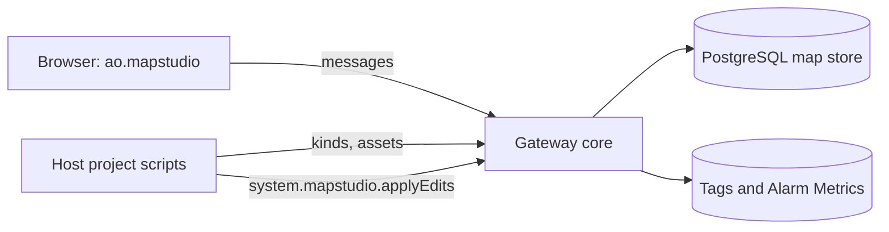
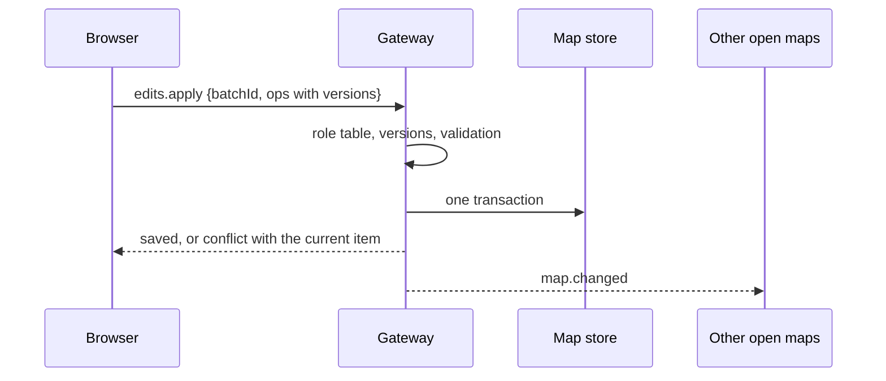
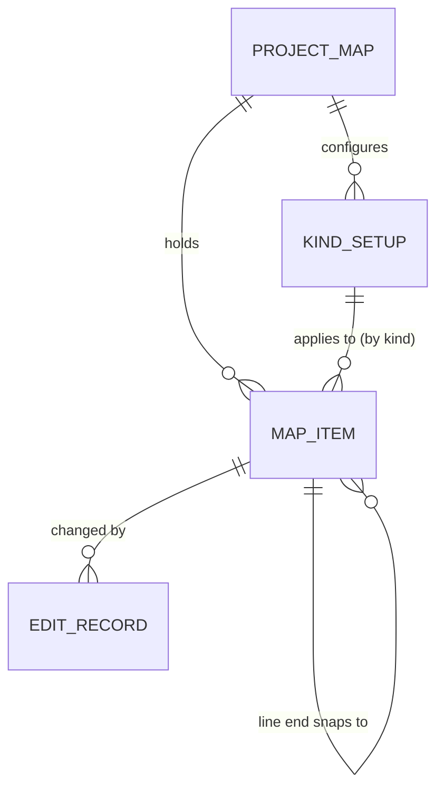

# Map Studio architecture

This page explains how Map Studio is built, for anyone who wants to contribute. The binding rules live in the architecture spine (`_bmad-output/initiative-flowmap/architecture-map-studio/architecture-map-studio.md`); most sections below name the rules they summarise (AD-n), so you can check the detail there. When this page and the spine disagree, the spine wins.

## What Map Studio is

Map Studio is an Ignition 8.3 Perspective component module. It is the map of a Perspective project: everyone sees sites and assets with their live comms, a key value and alarms, and people with an editing role draw and change the map in the browser. It is one component, `ao.mapstudio`, backed by Java code on the Gateway.

## The big idea: the Gateway is in charge

Map Studio follows a pattern called ports and adapters. The core runs on the Gateway and owns everything that matters: the map's data, every save, every role check and every tag subscription. Around it sit adapters:

- **The browser** draws the map and lets people edit it. It talks only to its Gateway side, through one message contract.
- **The host project** (the Ignition project that uses Map Studio) tells it which kinds of map items exist and which assets can be linked, through script functions it writes (AD-4). It changes the map only through Map Studio's scripting API.

So when you add a feature, ask: does the browser need to decide this, or the Gateway? If it changes stored data or checks who may do something, it belongs on the Gateway (AD-1). Drawing, snapping and undo stay in the browser (AD-10).

## The repository

| Folder | What lives there |
| --- | --- |
| `common/` | The contract both sides share: the component's props and events, message types, the map item record, live values, and the asset and kind schemas |
| `gateway/` | The core: the component's Gateway side, the write service, the map store and its migrations, change events, live values, host adapters, the project setup, the scripting API |
| `designer/` | The Designer palette entry and props editing |
| `web/` | The browser side: TypeScript and React, MapLibre for the map, Terra Draw for editing, one shared geometry module |
| `e2e/` | The Playwright suite and the screenshots the docs use |
| `ops/` | A local development Gateway in Docker |
| `docs/` | The contracts, example adapters, an example custom popup view, and screenshots |

`web/`, `gateway/` and `designer/` may depend on `common/`. `web/` and `gateway/` never depend on each other's internals.

## How a save works

Every change, from a dragged vertex to a 120-pad import, is one **batch of edits** (AD-2):

1. The browser collects the change and sends `edits.apply` with each map item's current version.
2. The Gateway checks the user's role against the role table (full editing, or phone editing: move a point and edit properties only).
3. It checks every version, validates every edit against the kind list, and writes them all in one database transaction, or none.
4. It records who made the change and when, and increments each version.
5. It tells every open map in the project at once (`map.changed`), and the live-value service picks up any new tags to watch (AD-17).

If someone else changed the same map item first, the save is refused with their change attached, so nobody overwrites anyone silently. If the save fails for another reason, the batch waits in the browser and is retried (AD-10). Deletes are kept as tombstones, so undo can bring an item back.

## How live values work

Map Studio never subscribes to tags per user or per map item (AD-6). The Gateway keeps **one subscription per project** to every value the kind setups turn on (comms, the icon's key value and Alarm Metrics) and holds the latest values in a cache. Each open map gets one batch per refresh interval, which the project sets (10 seconds by default): changes only, or the whole map on open and reconnect. Each value arrives in one shape: the value, its quality, its time, whether it is stale, and why.

An open popup is the exception: its values are pushed as they change, and only while it is open (AD-7).

## Popups

Map Studio draws a default popup from each kind's setup: details, comms, key values, an alarm summary with a "View alarms" button, and an optional link to the item's own page. A project can name its own Perspective view by its path instead, rendered the way the built-in Perspective Map renders a view from a path, and it receives a documented map item object as its parameter. Map Studio never acknowledges alarms; that happens in Ignition's alarm table (AD-7).

How the custom view is rendered (checked live in story 4, see `docs/platform-checks.md`): the browser mounts Perspective's own `View` component from `@inductiveautomation/perspective-client` with the view path, a mount path below the component's own, and the parameters, the same element the built-in Map uses for its custom controls and view layer. The `View` starts and stops the Gateway view model itself, so no Map Studio Java is involved and bindings in the view work. The content sits in a MapLibre popup through a React portal, so the view stays in the component's React tree. Today the path comes from the spike-only `popupView` prop and the view receives one `mapItem` parameter (`{id, name}`) beside the author's params; a missing or failing view falls back to a text popup with the item id.

## The data

The map store is PostgreSQL tables prefixed `mapstudio_`, created and upgraded by the module (AD-3). Every row belongs to one Ignition project, and shapes are stored as GeoJSON text.

- **Map item:** a closed, typed record: `{id, kind, name, geometry, properties, assetId, overrides, ends, version, deleted}`. Anything derived, such as the base path, is computed when read, never stored (AD-20).
- **Kind setup:** one versioned row per project and kind, saved through the same write path. The list of kinds itself comes from the host project and is read only (AD-16).
- **Snapping:** a line records what its ends snap to; moving the point moves the ends in the same batch (AD-19).

## Contracts you must not break

The component's props and events, the message contract, the map item record and object, the live value shape, the asset contract, the kind list, the setup schema, the scripting API and the CSV formats are public. They follow semantic versioning: a breaking change needs a new major version (AD-9). Messages always use the envelope `{v, type, id, body}`, and errors are `{code, message}` (AD-8). The contract as built so far (messages, error codes, ops, the map item record, the setup schema, the map store tables and the scripting API, version 0.2.0 in draft) is written down in `docs/contract.md`, the project setup in `docs/setup.md`; the code in `common/` is its reference.

## Conventions

- Use the Glossary terms of the PRD (`_bmad-output/initiative-flowmap/prd-map-studio/prd-map-studio.md`) exactly ("map item", "kind setup", "base path") in code, messages and docs.
- Map item ids are UUID strings; coordinates are GeoJSON, longitude first; times are UTC.
- Colours come only from the host project's theme tokens; normal state is neutral grey, and colour means a problem, always with a word or glyph (AD-11).
- Log through `MapStudio.<area>` loggers, and never log a token, a password or a map item's properties.
- Example scripts in the docs follow Jython 2.7 rules.
- No em dashes anywhere.

## Testing and proof

Every documented behaviour has a Playwright test that records a screenshot, and the docs show it (AD-15). A behaviour without a passing test and screenshot is marked unverified. The suite lives in `e2e/`, runs against the dev Gateway from `ops/` (CI starts one in Docker), fails on any browser console error, and also writes `measures.json`: bundle size, frame rate, the size of a value batch and phone findings, each labelled `measured` or `stand-in` with its method. `npm run docs` in `e2e/` refreshes the screenshots the docs embed. A release claims support for a new Ignition 8.3.x only after the `ign-scada-template` test stack and the Playwright suite pass on it (AD-13).

## Releases

CI builds and signs the `.modl` and publishes it as a GitHub release. Projects install it through their module lock, pinned by SHA-256 and the signing certificate's fingerprint, which is in the README (AD-13, AD-14). A `.modl` is never committed to git.

## Operations

- **Backup:** the map store is backed up with the site's PostgreSQL backups; export gives a portable copy.
- **Database rights:** if Map Studio cannot create or upgrade its tables, it logs an error naming the connection and the missing right, as the historian and alarm journal do, and the map is unavailable until it is fixed; it tries again at most once a minute, so no restart is needed.
- **Newer schema:** a map store made by a newer Map Studio is read only, never altered.
- **Redundancy:** only the active Gateway subscribes, saves and migrates; a standby reads and refuses saves; after a failover the caches rebuild and open maps reload (AD-21).

The operator's page is `docs/operations.md`: backups, rights and the error line, the map store's states, schema versions and downgrades, redundant pairs.

## Still open

The spike's four platform questions are answered, with evidence and fallbacks, in `docs/platform-checks.md`: whether Java subscriptions reach Alarm Metrics, whether a component can open a project view as a popup, whether module code can call project scripts and add `system.mapstudio` functions, and whether MapLibre 6 builds with Perspective's toolchain. The go or no-go report (story 9) judges them. Whether Mapbox's terms allow satellite tiles in MapLibre (AD-12) is for the owner to settle. The spine lists each question with its fallback.
