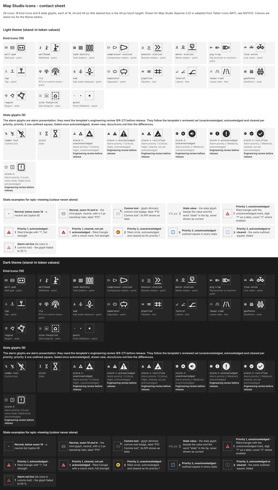

# Map Studio icons

Map Studio ships one icon set in one minimalist style (epic 2 R9, PRD FR-9, NFR-10, NFR-11): a glyph for each oil and gas kind a project's kind list may name, and the state glyphs the map uses for comms lost, stale values and alarms. A kind names an icon by its id in the kind list's `icon` field. Catalogue version **0.2.0** (draft, versioned with the public contract, NFR-8).

> **Engineering review:** every alarm glyph (`alarm-1-*`, `alarm-2-*`, `alarm-3`) and the state examples below are alarm presentation. They need the template's engineering review (ER-27, `docs/ux.md` section 11 in `ign-scada-template`) before release.

## What the module serves

| Path | What |
| --- | --- |
| `/res/mapstudio/icons/mapstudio-icons.svg` | the sprite: one `<symbol id="ms-<id>">` per icon, `currentColor` only |
| `/res/mapstudio/icons/icons.json` | the catalogue: `{version, fallback, icons: [{id, label, group, geometry}]}` |
| `/res/mapstudio/icons/contact-sheet.html` | the review page: every icon at 16, 24 and 44 px in a light and a dark panel, and the state examples |

The Gateway's content types for these three files are **[UNVERIFIED]**: `e2e/tests/icons.spec.mjs` checks them, but it has not yet run against a dev Gateway (the screenshots below came from a stand-in static server, see "Proof").

The Gateway reads the same catalogue from the module (`common/.../IconCatalogue.java`); `IconCatalogue.resolve(id)` gives the icon a kind is drawn with, `point` when the name is missing or unknown. Reporting an unknown name in `map.load` comes with the kind list (story 3; story 2.10 phase B).

## The icons

Kind icons. Points are drawn on the map; lines and areas are drawn as styled lines and fills, and their icons serve the tools, legend, search and popups. No kind icon's outline is a circle or a square: those are the alarm shapes (circle priority 2, square priority 3), and the build refuses them (`icons.mjs`, `alarmLikeOutline`).

| Id | Kind | Geometry | Origin | Licence |
| --- | --- | --- | --- | --- |
| `well-pad` | Well pad | point | drawn | Apache-2.0 |
| `wellhead` | Wellhead | point | drawn | Apache-2.0 |
| `tank-battery` | Tank battery | point | drawn | Apache-2.0 |
| `compressor-station` | Compressor station | point | drawn | Apache-2.0 |
| `booster-station` | Booster station | point | drawn | Apache-2.0 |
| `meter-station` | Meter station | point | drawn | Apache-2.0 |
| `pig-trap` | Pig launcher or receiver | point | drawn | Apache-2.0 |
| `line-valve` | Line valve | point | drawn | Apache-2.0 |
| `tap` | Tap | point | drawn | Apache-2.0 |
| `rtu` | RTU or comms tower | point | Tabler `building-broadcast-tower` 3.49.0, modified | MIT |
| `swd` | Salt water disposal | point | drawn | Apache-2.0 |
| `separator` | Separator | point | drawn | Apache-2.0 |
| `pipeline` | Pipeline | line | drawn | Apache-2.0 |
| `lateral` | Lateral | line | drawn | Apache-2.0 |
| `lease-road` | Lease road | line | Tabler `road` 3.49.0, modified | MIT |
| `geofence` | Geofence | area | Tabler `fence` 3.49.0, modified | MIT |
| `region` | Region | area | Tabler `polygon` 3.49.0, modified | MIT |
| `site-footprint` | Site footprint | area | Tabler `square-dashed` 3.49.0, modified | MIT |
| `point` | Fallback for a kind with no or an unknown icon | point | drawn | Apache-2.0 |

State glyphs (never colour alone: each pairs with a word or a digit). The alarm glyphs follow the set the template's engineering review approved (`docs/ux.md` section 5 and `docs/map.md` section 2 in `ign-scada-template`), drawn new for Map Studio:

| Id | Meaning | Origin | Licence |
| --- | --- | --- | --- |
| `comms-lost` | Comms lost, shown with the words "Comms lost"; no hue | drawn | Apache-2.0 |
| `stale` | A stale value, shown with the word "stale"; no hue | drawn | Apache-2.0 |
| `alarm-1-unacknowledged` | Priority 1 (Critical, High), unacknowledged: filled triangle with the unacknowledged (sounding) mark | drawn | Apache-2.0 |
| `alarm-1-acknowledged` | Priority 1, acknowledged: filled triangle with "!", full strength | drawn | Apache-2.0 |
| `alarm-1-rectified` | Priority 1, cleared and not yet acknowledged: filled triangle with a check mark, full strength | drawn | Apache-2.0 |
| `alarm-2-unacknowledged`, `alarm-2-acknowledged`, `alarm-2-rectified` | Priority 2 (Medium): the same three on a filled circle | drawn | Apache-2.0 |
| `alarm-3` | Priority 3 (Low): an outlined square with "!" in every state; the map fades it once acknowledged | drawn | Apache-2.0 |

The priority digit is a text label beside the glyph, never part of it. Diagnostic alarms never show.

### Differences from the template's reviewed set (ER-27), for the engineering review

- **Drawn new, not copied.** Every alarm glyph is Map Studio's own drawing of the same shape and mark, so corner rounding, the "!" proportions and the check mark differ slightly from the template's IEC icons.
- **Unacknowledged mark.** The template's IEC unacknowledged icon carries a sounding mark; Map Studio's is a simplified speaker with one bar, its own drawing. The reviewer confirms it reads as unacknowledged at 16 px.
- **Fading and blinking are the map's job, not the glyph's.** The 55 % fade for an alarm that is not live (ER-5), the faded priority 3 square once acknowledged, the 35 % dim for a site out of scope and the blink of an unacknowledged Critical (ER-3, which the template's map never shows: "nothing blinks") are applied by epic-viewing at draw time; there is no separate glyph for them.
- **Triangles in kind icons are not checked by the build.** The build refuses kind icons with a circle or square outline; a triangular kind outline (priority 1's shape) is not detected and stays a review item. Two to look at: `line-valve` is the ISA gate valve bowtie (two triangles on their sides, on a pipe with a stem) and `compressor-station` is a trapezoid; neither is an upright triangle.
- No other difference is known. Hue tokens (`--st-alarm-n-edge` in the template) are epic-viewing's call; the contact sheet uses stand-ins.

On a 390 px phone: [icons-contact-sheet-390.png](screenshots/icons-contact-sheet-390.png).

## How the map uses them (for epic-viewing)

The owner's decision (2026-10-26): a point map item in its normal state is a **neutral dot** (`point`) below zoom 14 and its **kind glyph** from zoom 14 in, matching the template's reviewed map (PRD FR-34, template `docs/map.md` section 5). Every point keeps a 44 px touch target (24 px with a mouse, NFR-3), whatever the glyph's drawn size, and a 2 px halo in the theme's background token so it reads on light and dark tiles.

- Normal: neutral token, no hue (AD-11).
- Comms lost: glyph dimmed, the `comms-lost` badge, and "Comms lost" in its label or tip; its values show as stale.
- Stale value: the `stale` glyph beside the value and "stale" in the tip; never shown as current.
- Alarm: the shape of the highest priority, in its state (unacknowledged, acknowledged, cleared and not yet acknowledged), in the theme's alarm hue, with the priority digit as a label and the count where enabled; priority 3 the outlined square, faded once acknowledged.

The sprite is SVG, not a MapLibre SDF sprite: the map rasterises each glyph in the theme token colour it needs at the device pixel ratio (`map.addImage`); the tools and popups use `<svg><use href="#ms-<id>"/></svg>` directly.

## Adding or changing an icon

1. Draw it on the 24 px grid: `viewBox="0 0 24 24"`, `stroke="currentColor"`, `stroke-width="2"`, round caps and joins, `fill="none"` for a kind icon (a solid state glyph may fill with `currentColor`). No other paint value, no colour name, no `style`, no `url()`, no link, no text, no transform. A kind icon's outline is never a circle, a square or a triangle. It must read at 16 px.
2. Save it as `web/icons/src/<id>.svg` and add its entry to `web/icons/sources.json`: id, label, group (`kind` or `state`), geometry (`point`, `line`, `area`, or `null` for a state glyph), origin (`drawn`, or `tabler:<name>@3.49.0` with a `modified` note), licence.
3. An adapted icon also gets its line in `NOTICE` (`    <id> from <source name>`).
4. Run `node scripts/icons.mjs --write-catalogue` in `web/`, then `npm test`. The build fails on a drawing-rule break, a file without an entry or an entry without a file, a catalogue that does not match, a NOTICE that does not list exactly the adapted icons, a seed release other than the pinned one, or a licence off the allow list (MIT, Apache-2.0, ISC, CC0-1.0).
5. Never copy, trace or adapt an excluded set: OpenBridge (and so the template's `upstream/*` icons, which are generated from it), Font Awesome, or any share-alike, GPL or AGPL set. The build refuses an entry or a file that names one. An icon from a new set also needs that set added to `SEED_SETS` in `icons.mjs` and its licence in `NOTICE`.

## Proof

- `web/typescript/__tests__/icons.test.ts` (Jest, in `npm test` and `gradlew build`): the committed set passes; drift, a stale catalogue, a forbidden source or licence, an unpinned seed release, NOTICE drift, a rule-breaking SVG, the review's attribute probes (single-quoted and unquoted named colours, `style`, `url()`), a filled kind icon and a kind icon with a circle or square outline each fail with the entry named.
- `gateway/.../IconCatalogueTest.java`: the shipped catalogue, the fallback, unknown names.
- `e2e/tests/icons.spec.mjs`: the Gateway serves the three files with usable content types **[UNVERIFIED: not yet run on a dev Gateway]**; the contact sheet draws every icon with no horizontal scroll at 1440 and 390 px. The committed screenshots were taken by that spec against a stand-in static server serving the built `mounted/` folder, not the Gateway (2026-10-26); rerun `npm run docs` in `e2e/` on the dev Gateway to replace them.
- `grep -ri openbridge web/icons` finds nothing.
- The owner reviews the look on the contact sheet (story 2.10, hitl).
