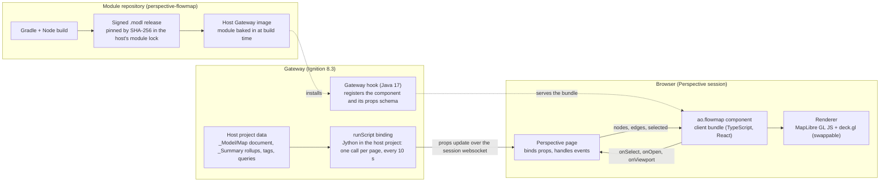

# Flow map module for Ignition Perspective: idea

Oct 25, 2026, Andy Ott. Exported from the Claude Doc; the editable original is https://claude.ai/artifact/2o4VB3S5JLX49ywE2qJJxE

## The idea

A Perspective component module, owned by AO Industrial Systems, that draws flow on a map inside Ignition: places as nodes, connections as edges, direction and rate as motion and width, state as words and glyphs. It renders with an open-source map stack (MapLibre GL JS and deck.gl) and takes plain nodes and edges from whatever the page binds to it, so it fits any Perspective project with places and connections to show. The upstream oil and gas template is the pilot: its `_Model/Map` document and `_Summary` rollups already hold a field's sites, pipelines and rates, so it is the first page and the test bed. No new database, no licence fee on any Gateway. The module lives in its own repository, ships as a signed `.modl`, and enters a project through a module lock the way Embr and Mustry enter the pilot today.

The question this document opens for the BMAD team: is the picture worth owning a module, and what is the smallest spike that answers it?

## Why

People want to watch flow on a map, and Perspective's built-in Map cannot show it. The pilot's map page (the upstream template, PV-3) already draws sites, pipelines split at every tap, alarm glyphs at segment midpoints and a flow arrow on a selected segment, all on `ia.display.map`. That component stops at markers, polylines and static styles: no animation, no per-vertex styling, no hover, no time axis, and every marker rebuild goes through the Gateway. Styling lines by rate is still possible there and should be done first; "watch the field flow" is not.

MapWeave (Cambridge Intelligence) was the prompt for this idea. It is a commercial JavaScript SDK that draws graph layers on MapLibre or Mapbox, licensed per developer and per deployment with unpublished pricing and evaluation-only terms on its public site. Two things rule it out as the default: Perspective has no first-party way to run an arbitrary JavaScript library, and the template's standing decision UX-36 (2026-10-18) keeps commercial modules out of the UI so a client Gateway carries no licence fee. The MQTT Engine is the one exception, taken for infrastructure, not for a screen.

A module of our own keeps the picture and drops the fee: the renderer is open source, the data is the template's, and the module itself can be MIT like Embr. If MapWeave's analytics (geo graph layouts, clustering, the KronoGraph time bar) ever earn their licence, they slot into the same component as a second renderer.

## What it is

One signed `.modl` with three parts, the shape every Perspective component module takes (Embr and Mustry, both in the template's lock and both open source, are the working examples to copy).

| Part | Scope | What it does | Size |
| --- | --- | --- | --- |
| Gateway hook | Java 17 | Registers one component type, `ao.flowmap`, with its props schema and points at the client bundle. No tag reads, no database. | about 50 lines plus Gradle |
| Client bundle | TypeScript, React | Mounts a MapLibre GL canvas in the component's box and draws deck.gl layers from the props: a path layer for segments (width by size, colour by state, a moving dash for direction and rate), icon layers for sites and taps, a text layer for labels. Sends selection and taps back as component events. | the real work |
| Designer part | Java, optional | Palette entry and props editor; the props schema gives most of it. | small |

The renderer is one swappable layer inside the client bundle. MapLibre GL JS (BSD) plus deck.gl (MIT) is the default. MapWeave draws on the same MapLibre canvas, so a licensed renderer could replace the deck.gl layers later without touching the Gateway part, the props or the pages.

The component is Perspective-native from the outside: a view places it, binds its props, and reacts to its events, exactly as the pages treat `ia.display.map` today. In the pilot, the template's generators would emit it the way they emit the built-in Map, inside the same byte gates.

## Who it is for and where it runs

The component is for any Ignition 8.3 Perspective project with places and connections to show: an oil and gas field, a plant's pipe network, a water or power distribution system, a fleet on its routes. It takes plain nodes and edges and knows nothing of any one project. The pilot is the upstream oil and gas template and the clients AO Industrial Systems builds with it: pumpers and operators on the field map, engineers and supervisors on the production and surveillance pages, on desktops and on 390 px phones.

It runs on full Gateways. Edge Gateways run built-in components only, so the pilot's Edge profile keeps the built-in Map. One Gateway, 300 sites and 2,000 segments is the size to design for (the pilot's PV-29 load harness measures it); six sites is the demo.

## The data contract

The component takes two arrays and a selection; any page can build them from its own tags, queries or documents. In the pilot, one `runScript` binding builds the arrays every 10 s from the `_Model/Map` document and the `_Summary` rollups, the pattern its attention board and map page already use. A `runScript` binding is a Perspective expression binding that calls a Gateway script on a timer and hands the return value to a view property: the script runs on the Gateway, in the project's script library, and Perspective sends the result to the browser over the session's websocket as a props update. One call per page every 10 s replaces thousands of per-row tag subscriptions per session, which is why the pilot forbids the latter for lists.

| Prop | Fields | Where the pilot has it today |
| --- | --- | --- |
| `nodes` | id, lat, lon, kind (pad, station, pipeline site, tap), label, state (0 to 3), page | `_Model/Map` sites and taps; `_Summary` CommsLost, Stale, WorstRank; the pad page paths |
| `edges` | id, path (lat, lon list), product, size (in), rate, unit, direction, state, label | `_Model/Map` segments split at taps with chainage; line meters (LM-1, GM-1) and the Ranger pressure band for rate and state |
| `selected` (two-way) | node or edge id, or none | the page's own `selected` state, as the map page keeps it |
| `basemap` | none, osm, mapbox, plus the token binding | the per-Gateway switch in `gateways.csv` and the `map_token` secret |
| `options` | animate, speed, units, label density, theme tokens | new; defaults match the template's style tokens |
| events | `onSelect(id)`, `onOpen(page)`, `onViewport(bounds)` | the tap scripts of the map page, reused |

GeoJSON is the interchange format at the edges: the pilot already imports and exports it for its map editor (PV-3 phase 2), and a GeoJSON prop is the natural fallback for any other project. History (a time slider replaying yesterday's flow) would come from `system.historian` queries in the same binding, later.

## Scope

**Version 1** is the pilot's field map, drawn better: sites, taps and segments from the data contract; line width by size and colour by state; animated dashes for direction and rate; labels that thin out as you zoom out; tap and hover selection with events back to the page; the three basemaps; the night and day themes through the host project's style tokens; the phone layout (no zoom buttons, pinch and drag); the Designer props editor.

**Later**, each its own decision: a time slider replaying flow from the historian; clustering of sites at low zoom; a legend built from the props; offline basemap tiles for sites without internet; a second renderer (MapWeave) behind the same props if its analytics earn the licence.

**Out of scope**: editing the map (the pilot's map editor stays a Perspective page on PostgreSQL); any write to a device; replacing the alarm table (the map points at it, as the pilot's rules say); Edge Gateways.

## Principles and constraints

Carried over from the pilot, so the module fits the projects it serves; most are good rules for any Perspective project.

- **Open source, licence-free on the Gateway.** MIT for the module, BSD and MIT for the renderer; no dependency that charges per deployment (the pilot's UX-36).
- **Perspective-native.** Props in, events out, nothing else: no direct tag reads, no database calls, no `system.*` from the browser. The page owns the data and the binding.
- **One binding per page.** The arrays arrive as one props update; never a tag subscription per node or edge (the pilot's list rule).
- **State by words and glyphs, never by colour alone.** Colour, animation and glyphs that mean state are alarm presentation and go through engineering review (the pilot's ER-27), as on its current map.
- **Phone first.** Everything must work at 390 px with touch gestures; nothing wider than a phone.
- **Theme tokens only.** Colours come from CSS variables the host project passes in; the pilot passes its `--st-*` tokens, night and day.
- **Supply chain as for Embr and Mustry.** A GitHub release, signed with our certificate, pinned by SHA-256 and certificate fingerprint in the host's module lock, verified by its fetch, baked into its private Gateway image. Never a `.modl` in git.
- **Ignition 8.3.x, Java 17, Jython untouched.** The module adds no Gateway scripting; the host's Jython 2.7 rules are unaffected.
- **Verified live.** Every claim about the Perspective client API or the module SDK is checked on a live Gateway and recorded in claude-ignition-skills, as the pilot does for everything else.

## Architecture sketch

The module's own code is highlighted by the right-hand lane and the component: the client bundle, the Gateway hook that registers it, and the build and release that deliver it.

The browser draws, the Gateway supplies, the repository ships: the module's own code is the client bundle, the Gateway hook that registers it, and the build and release that deliver it; the data binding and the data stay in the host project (the pilot here), and a Perspective page ties them together with props and events.

## Risks and unknowns

The toolchain and the upgrade tax are the real risks; the data is not one.

| Risk | What could go wrong | How the spike answers it |
| --- | --- | --- |
| Toolchain weight | Java 17, Gradle with IA's module plugin, Node and a TypeScript bundle, module signing: four tools to keep working | Build the skeleton from Mustry's open-source module in the first days; if it takes more than two, the cost is real |
| Perspective client coupling | The bundle compiles against IA's Perspective client packages; an 8.3.x upgrade can break it, and the packages lag the Gateway version | Pin the package versions to the Gateway in the lock; a stack run on every upgrade, as for every module |
| Performance at scale | 2,000 segments and 300 sites animated at 60 fps on a laptop browser and a phone; a 10 s props update that re-sends every array | Measure with the PV-29 scale registry; diff props in the bundle so only changed ids redraw |
| Designer props editor | Arrays of objects edit poorly in the Designer; a schema the Designer rejects blocks the component | Use the schema shapes Embr Charts uses for its series; the pages bind the arrays, nobody types them |
| Basemap and privacy | Tiles leave the site; MapLibre needs a style URL; Mapbox needs the token on the client | Reuse the pilot's basemap decisions as they stand (none, OSM, Mapbox with the public token) |
| Signing and trust | Our certificate anchor in every client's lock; a lost key means a new anchor everywhere | One signing key in the supply chain, documented like the Embr anchor in `docs/modules.md` |
| Maintenance | A second product to keep alive beside the pilot and the skills | A module small enough that a release is a bump and a stack run; the data adapter stays in the host project |
| Scope creep | The map editor, alarms or writes drifting into the module | The props contract is the boundary; the Out of scope list above holds |

## The first spike

One to two days of agent work that ends in a yes or a no, before any product planning.

1. Copy the skeleton of Mustry's open-source Perspective component module (in the template's lock) into the new repository, with Inductive Automation's ignition-module-starter skill loaded in Claude Code for the scaffold, the Gradle module plugin and signing; build it unchanged with Gradle and Node.
2. Replace its component with `ao.flowmap`: a MapLibre GL canvas that draws a static GeoJSON prop (the pilot's Mesa field exported by its map editor) with one deck.gl path layer and one icon layer.
3. Sign the module with a self-signed certificate, add it to the pilot's module lock, rebuild the Gateway image, run `scripts/test/stack.sh --keep` and place the component on a scratch view.
4. Feed it live: one `runScript` binding that builds the nodes and edges from `_Model/Map` and `_Summary`, with a 10 s refresh; tap a segment and see the event reach the page.
5. Animate the dashes by rate and look at it at 1440 px and 390 px in both themes.

Measures to record: hours to a green build; bundle size; frame rate with the 30-pad scale registry; the 10 s props payload in KB (the load driver counts frames); what broke on the phone.

Go when the skeleton builds in under two days, the live view renders the demo field with animated flow at 390 px, and the payload and frame rate leave room for 300 pads. No-go when the toolchain or the Perspective client API fights back for most of the time, in which case the built-in Map with styled lines is the answer and this document records why.

## Open questions for the BMAD team

For the analyst and the brief:

- [ ] Who is the user we design for first: the pumper on a phone, or the supervisor on a wall screen?
- [ ] What does "flow" mean on each line: the meter's rate, the pressure band, or a modelled value when neither exists?
- [ ] Is this a pilot feature, a product of its own on the Ignition Exchange, or both?

For the PM and the PRD:

- [ ] Does the module replace the pilot's map page or sit beside it as a second page until it is proven?
- [ ] Which v1 items are must-have: animation, hover, labels that thin out, the Designer editor?
- [ ] Which alarm presentation rules carry over unchanged (ER-27), and who reviews the new ones (motion, width by rate)?
- [ ] Offline sites: is a basemap-free mode (lines on a blank canvas) enough for v1?

For the architect:

- [ ] Where does the data adapter live: in the host project (the pilot's `ops` library, proposed) or in the module as a Gateway script?
- [ ] Props as arrays versus a GeoJSON prop: one or both?
- [ ] Delta updates: does the bundle diff the arrays, or does the binding send only changed ids?
- [ ] Which Perspective client package versions, and how is an 8.3.x upgrade gated?
- [ ] The signing key: where it lives, who holds it, how a rotation reaches every client lock.
- [ ] Licence of the module: MIT like Embr, or something that keeps the source open but the name ours?

## Naming

Call the repository `perspective-flowmap`, not `perspective-map`. "Perspective Map" is already the name of Ignition's built-in component (`ia.display.map`), so `perspective-map` would collide in every search, palette and conversation, and it says nothing about what this one adds. "Flow map" names the picture (flow on a map) and reads as a product.

| Thing | Name | Why |
| --- | --- | --- |
| Repository | `aott33/perspective-flowmap` | the Perspective prefix says what it plugs into, like Mustry's `mustry-perspective-component-module`; flowmap says what it draws |
| Module id | `com.aoindustrial.perspective.flowmap` | reverse domain of aoindustrial.ca, the convention Embr and Mustry follow |
| Module name (Gateway page) | Flow Map | two words, what people say |
| Component type | `ao.flowmap` | a short vendor prefix like `embr.` and `mustry.`; the Designer palette shows the name, not the id |
| npm package of the bundle | `@aoindustrial/perspective-flowmap` | private or public, same name as the repo |

Alternatives considered: `ign-flowmap` (fits the template's `ign-scada-template` but hides that it is a Perspective component), `flowmap-module` (too generic on GitHub), `perspective-geoflow` (clever, less plain).

## Working it through BMAD

This document is the input to the first BMAD step, not a brief: export it to Markdown as `docs/idea.md` in the new repository and let the analyst agent turn it into the project brief, with the open questions above as its interview list. Then the usual order: the PM writes the PRD from the brief (the data contract and the scope sections carry over almost as they are), the architect writes the architecture from the sketch and the risks (the spike's measures become its acceptance), and the scrum master cuts the spike as the first story before any feature story. Keep two rules from the pilot in the BMAD config: no em dashes in any artifact, and every claim about Perspective or the SDK verified on a live Gateway and recorded in claude-ignition-skills.

References, all public:

- [Ignition module starter](https://github.com/inductiveautomation/ignition-module-starter), Inductive Automation's Claude Code skill for new module authors on 8.3: prerequisites (JDK 17), scaffolding with the module generator, the `io.ia.sdk.modl` Gradle plugin, build, install and signing. Load it in the new repository before the spike.
- [Ignition SDK examples](https://github.com/inductiveautomation/ignition-sdk-examples), the `perspective-component` example and its Gradle layout
- [Mustry Perspective component module](https://github.com/Mustry-Solutions/mustry-perspective-component-module), an open-source 8.3 module in the template's lock
- [Embr](https://github.com/mussonindustrial/embr), Periscope and Charts, the other two modules in the lock
- [MapLibre GL JS](https://maplibre.org/maplibre-gl-js/docs/) (BSD) and [deck.gl](https://deck.gl/) (MIT)
- [Cambridge Intelligence developer site](https://developers.cambridge-intelligence.com/), MapWeave and its MapLibre and Mapbox adapters
- The pilot's `docs/map.md` (the map page and the map document), `docs/modules.md` (the lock and the supply chain), `docs/performance.md` (the load harness), `docs/ux.md` section 11 (alarm presentation review)
