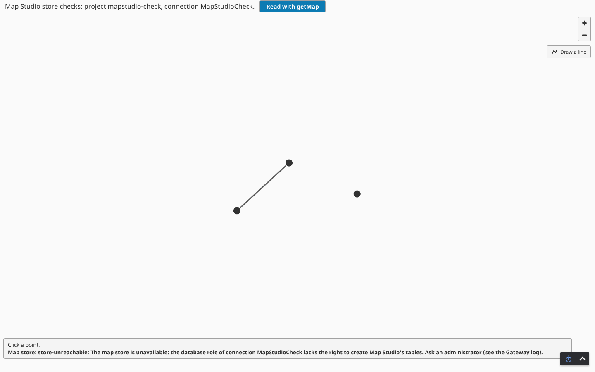
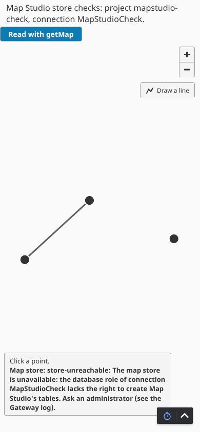
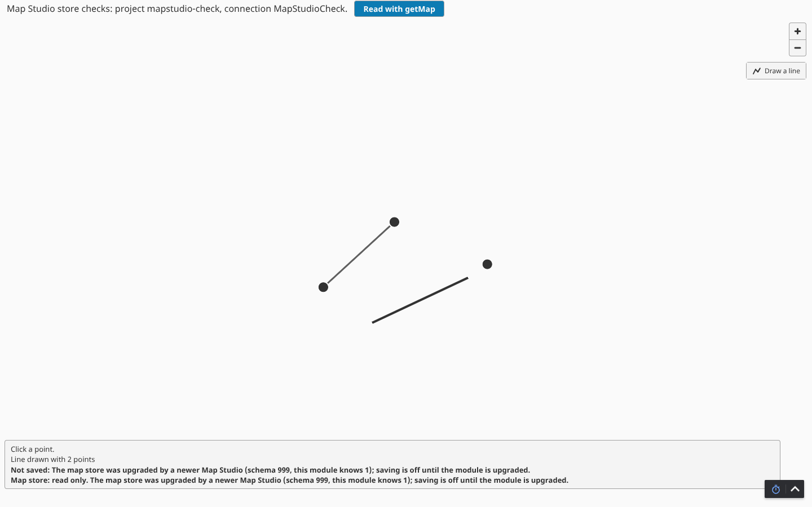
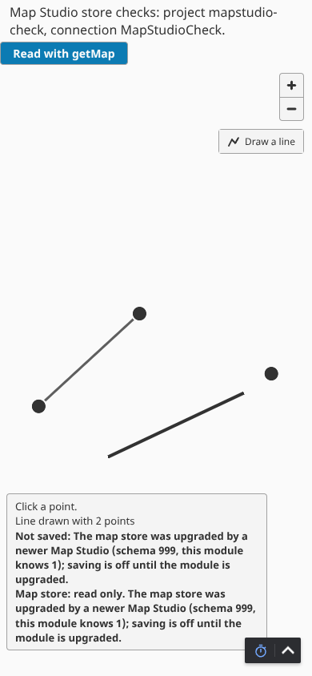

# Running Map Studio's map store

For the people who run the Gateway: backups, database rights, what the map store's states mean, schema versions, and redundant pairs (AD-3, AD-21). The contract is in `docs/contract.md`; the live checks behind this page are in `docs/platform-checks.md`, section "Epic 2 story 5 - map store states".

Labels: **[live 8.3.10]** seen on the `ops/` dev Gateway by `ops/store-checks.sh` and the e2e suite; **[SDK 8.3.0 javap]** read from the SDK jars' signatures, not run; **[unverified]** written but not seen working.

## Where the map lives

Each project's Map Studio setup (`com.aoindustrial.perspective.mapstudio/setup/setup.json`) names one Gateway database connection. Map Studio keeps its map store there, in PostgreSQL tables whose names start with `mapstudio_`, every row keyed by the project's name. Several projects may share one connection.

## Backups

Map Studio has no backup of its own: the site's PostgreSQL backups cover its tables, and a restore brings back the maps, the edit record and the schema version together. To copy only Map Studio's tables, for example before an upgrade:

```sh
pg_dump --host <db-host> --username <owner-role> --dbname <database> \
  --table 'mapstudio_*' --format custom --file mapstudio-$(date -u +%Y%m%d).dump
```

`pg_restore` puts them back. Restore the whole set of `mapstudio_` tables, never one table alone: the change sequence (`mapstudio_project`), the items, the edit record and the schema version belong together. A portable export (CSV) comes with a later release.

## Database rights

- **First start and upgrades** need a role that may CREATE in the connection's schema: Map Studio creates its tables, and a newer module adds a migration, in one transaction under a PostgreSQL advisory lock. PostgreSQL 15 and later give ordinary roles no CREATE on schema `public`, so grant it, or use the database owner's role for the first start.
- **After that** a least-privilege role is enough: CONNECT on the database, USAGE on the schema, SELECT, INSERT and UPDATE on the `mapstudio_` tables, USAGE and SELECT on their sequences **[live 8.3.10]**. Map Studio reads the schema version first, with no lock and no DDL, and creates nothing when the schema is current.

When the role lacks a right, the Gateway log has one error line from the logger `MapStudio.store` **[live 8.3.10]**:

```text
Map Studio cannot prepare its map store on database connection MapStudioCheck: migration 1, statement 1 of 8 (CREATE TABLE IF NOT EXISTS mapstudio_schema_version ...) failed with SQLState 42501, the database role lacks CREATE on schema public: ERROR: permission denied for schema public
```

It names the connection, the migration, the statement (its number in the migration's transaction and its first words), the SQLState, the missing right when the SQLState is 42501, and PostgreSQL's own message. It never holds a password, a value or a map item's properties. Any other failed statement gives the same line with its SQLState (for example 42P07 when a table of that name is already there), and a failure that is not a database error says SQLState "none". The whole migration is rolled back: no `mapstudio_` table it created is left behind.

While the map store is unavailable a map shows "Map store: store-unreachable: The map store is unavailable: ... Ask an administrator (see the Gateway log)." and nothing can be saved (`map.load` and `applyEdits` answer `store-unreachable`).

**Recovery:** fix the right (`GRANT CREATE ON SCHEMA public TO <role>`, or the table in the way). No restart is needed: Map Studio tries again at most once a minute, the next time a map of a project naming that connection is opened or saved, and logs the error line again only when it changes **[live 8.3.10]**. A Gateway or module restart also tries again at once.

## The map store's states

| State | What it means | Map | Saving |
| --- | --- | --- | --- |
| ready | the schema is current | read | allowed (by role) |
| read only | the schema is newer than this module, or this Gateway is a standby | read | refused `read-only`, with the reason |
| unavailable | the connection never became usable, or a migration failed | not read | refused `store-unreachable` |

The component shows the state on its map container (`data-store-state`: `ready`, `read-only` or `unavailable`) and, when read only or unavailable, says why under the map. `system.mapstudio.getMap(project)` still returns the list of map item records on a read-only store; the list's `readOnly` attribute is the reason (None when saving works), and `applyEdits` raises `read-only: <reason>`.

## Schema versions and downgrades

Each module release knows a newest schema version; migrations only ever add (`gateway/src/main/resources/.../store/migrations/`, one file per version, never changed once released). When the recorded version is newer than the module knows, which happens after a downgrade or when an older Gateway shares the database with a newer one, Map Studio migrates nothing and changes nothing, logs one warning, and the map is read only:

```text
Map Studio's map store on database connection MapStudioCheck is at schema version 999, newer than this module knows (1); the map is read only here until the Map Studio module is upgraded. Nothing was migrated or changed.
```

The map shows "Map store: read only. The map store was upgraded by a newer Map Studio (schema 999, this module knows 1); saving is off until the module is upgraded." **[live 8.3.10]**. To downgrade for real, restore the `mapstudio_` tables from a backup taken before the upgrade; there is no down migration.

## Redundant pairs

**[unverified]**: written from the SDK's signatures (`GatewayContext.getRedundancyManager()`, `RedundancyManager.isRedundancyEnabled()`, `isActive()`, `addRedundancyStateListener`) **[SDK 8.3.0 javap]** and unit tested over a stand-in; only an independent Gateway has been seen live.

- An independent Gateway (redundancy off) reads, saves and migrates.
- Of a redundant pair only the active node saves and migrates. A standby reads the map and the schema version only (no lock, no DDL); every save there is refused `read-only` with "This Gateway is the standby of a redundant pair; saving is off here. Open the map on the active Gateway to save." If the standby finds the schema not yet created, its map store is unavailable until the active node has created it (the next try a minute later finds it) or until it becomes active itself, when it runs the migrator at once.
- Map Studio reads the redundancy state on every save, so a missed change event cannot leave a standby saving. A state it cannot read counts as standby.
- Both nodes of a pair should name the same database connection and run the same module version. Reloading maps that are open during a failover comes with live updates (epic 2, entry 4).

## Proof

`ops/store-checks.sh` (development only, run by hand) adds a check project on the connection `MapStudioCheck` and runs four scenarios against it: a role without CREATE, a table in the way, the retry after the fix, and a newer schema. Screenshots of the unavailable and read-only states at 1440 and 390 px:





