# Engineering review ER-27: the hue tokens and the map's alarm presentation (release 0.3.0)

The review pack of epic 3 entry 12 (R16, R5; architecture AD-11; `ign-scada-template` `docs/ux.md` section 11, ER-27). Map Studio draws alarm state, comms lost, stale, value styles and area tints on a map, a new alarm presentation surface, and every hue it uses is a theme token chosen here. Nothing in this page is applied to a live Gateway: the owner's engineering review (ER-27) of the tokens, the glyphs and the layout departures from the template's reviewed map is the gate before release 0.3.0 (epic-viewing, Constraints). This page shows every state the map draws, in the light and the dark Perspective theme side by side, what changed against the template's reviewed rules, and a verdict line per item for the reviewer.

**How to review.** Read sections 1 and 2 (the tokens and the contrast check), then look at each pair of renders in section 3 and write the verdict on its `Verdict:` line (accepted, or the change asked for). Record the review as a row in [platform-checks.md](platform-checks.md) ("Epic 3 entry 12") and a dated Decision in the epic's Notes (`_bmad-output/initiative-flowmap/tickets/epic-viewing/epic-viewing.md`), as the 0.2.0 glyph review was recorded in [icons.md](icons.md). A change asked for is built before the 0.3.0 tag (entry 13).

Labels: **[live 8.3.10]** rendered on the `ops/` dev Gateway (Ignition 8.3.10, the showcase project `mapstudio-showcase` in its review states and the dev project's `/styles` page) by `e2e/tests/review.spec.mjs` and `styles.spec.mjs` with `E2E_DOCS=1`; **[build]** checked by a unit test in node; **[ER-27]** for the reviewer.

## 1. The tokens

Every colour the map draws is a CSS custom property on the component root (`.mapstudio`), which a host project's theme may define; the module's stylesheet gives each a fallback to a variable of Perspective's bundled themes, never a colour literal (`web/typescript/mapstudio.css`, `markers.ts` `MARKER_TOKENS`; the unit test `markers.test.ts` pins the fallbacks and refuses a literal). The values below are what the bundled `light` and `dark` themes of 8.3.10 give the fallbacks, read on the showcase page by the contrast check **[live 8.3.10]**; the module holds none of them.

| Token | Draws | Fallback | Light | Dark | Why this one |
| --- | --- | --- | --- | --- | --- |
| `--mapstudio-comms-lost` | the comms-lost kind glyph and dashed ring in the disc, the comms-lost badge, the Needs you count and the legend row; always with the comms-lost glyph and the words "Comms lost" | `--qual-4` (magenta-70 light, magenta-40 dark) | #B01355 | #F78BB8 | The owner's decision (2026-10-28): its own token in the magenta or purple family, which no alarm, preset or tint uses, so it is never read as an alarm. Of the two families the bundled themes offer, only magenta passes 3:1 in both themes: purple (`--qual-1`, purple-70 light 5.87, purple-60 dark) is 2.81 against the dark map, and the one purple the themes share (`--div-4`, purple-50) is 2.96 against the light map. A host theme that wants purple defines the token itself (the template's cutover can give purple-70 light and purple-50 dark, which pass) |
| `--mapstudio-alarm-1` | priority 1 (Critical, High): the triangle glyph, its digit, the line hue, the popup's alarm block edge | `--error` (red-60 light, red-50 dark) | #DE1B1B | #F55353 | The theme's own error red, as DESIGN.md assumed and the template's `--st-alarm-1` convention |
| `--mapstudio-alarm-2` | priority 2 (Medium): the circle glyph, digit, line hue, block edge | `--warning` (bronze-60 light, bronze-50 dark) | #AD5F00 | #CF7911 | The theme's warning amber |
| `--mapstudio-alarm-3` | priority 3 (Low): the outlined square, digit, line hue, block edge | `--info` (blue-60 light, blue-50 dark) | #3272D9 | #5691F0 | The theme's info blue; the template's priority 3 is also its lowest hue, and the outlined square and the digit carry the level without it |
| `--mapstudio-attention` | the `attention` preset: a 3 px outline round the disc, the line, with the word "Attention" | `--neutral-90` | #323232 | #F4F4F4 | No hue (DESIGN.md: a heavier outline plus the word) |
| `--mapstudio-warning` | the `warning` preset: a 2.5 px ring, the line, "Warning" | `--warning` | #AD5F00 | #CF7911 | Shares the hue of priority 2 (below) |
| `--mapstudio-fault` | the `fault` preset: a 2.5 px ring, the line, "Fault" | `--error` | #DE1B1B | #F55353 | Shares the hue of priority 1 (below) |
| `--mapstudio-tint-1` | area category tint: a 22 % fill and an 80 % 1.5 px outline | `--qual-3` (teal) | #086962 | #08827A | Low saturation as drawn; teal is no state's family |
| `--mapstudio-tint-2` | | `--qual-7` (green) | #038537 | #46E385 | Green is no state's family (Map Studio has no success hue) |
| `--mapstudio-tint-3` | | `--qual-2` (sky, primary-50) | #229AD6 | #53BAED | The primary family; the selection ring is `--callToAction` in the same family but a 2 px ring with a gap, never a wash |
| `--mapstudio-tint-4` | | `--qual-8` (navy, blue-80 light, blue-50 dark) | #114599 | #5691F0 | Blue is priority 3's family: in the light theme navy is far from the info blue, in the dark theme the two fallbacks coincide (#5691F0). As drawn, a 22 % wash with an 80 % outline against an outlined square with a digit **[ER-27]** |
| `--mapstudio-tint-5` | | `--qual-10` (sand, bronze-50 light, bronze-40 dark) | #CF7911 | #E89C3F | Bronze is priority 2's and the warning preset's family; as drawn a wash against a circle glyph with a digit or a ring with a word **[ER-27]** |
| `--mapstudio-tint-6` | | `--div-12` (light teal, teal-40, the same value in both themes) | #21C2B7 | #21C2B7 | The bundled palette has five hue families no state uses (teal, green, sky, navy, sand); the sixth tint is a second teal at another lightness |

What changed against the stand-ins of entries 5 and 1: comms lost moved from `--qual-1` (purple) to `--qual-4` (magenta) for the dark theme's contrast; `tint-4` moved off `--qual-9` (magenta-50, the comms-lost family) to navy, `tint-6` to the light teal; the alarm and preset tokens are unchanged.

**Presets against alarms (ER-27).** `warning` and `fault` share the hues of alarm priorities 2 and 1, because a Perspective theme has one warning and one error hue and a preset means "this value is abnormal" in the same sense. They are never confused on the map: a preset draws as a ring round the marker's disc (2.5 px in its token) with its word in the state chip beside the name ("Warning", "Fault"), and on a line as the line's hue with the word in the line's chip; an alarm draws as the IEC glyph (triangle, circle or outlined square) with its digit at the top-right of the disc, or at the line's midpoint, and in the Needs you count. A preset never draws a glyph or a digit, an alarm never a ring, and when both apply the badge draws over the ring, so the reviewer sees both (section 3.5). The alternative, presets on hues of their own, has no free hue family left in the bundled palette (magenta and purple are comms lost's, blue is priority 3's) and would need every host theme to define two more tokens; the reviewer may still ask for it.

**The host theme.** A host defines any token on `.mapstudio` in its theme (for example `--mapstudio-alarm-1: var(--st-alarm-1-edge)` in the `ign-scada-template` at the cutover, epic-template-cutover); the contrast check then runs against that theme (`cd e2e && npm test -- review.spec` on a stack with the host project).

## 2. The contrast check

`e2e/lib/contrast.mjs` (WCAG 2.1 relative luminance and contrast ratio, alpha compositing for marks drawn at an opacity; unit tested in `contrast.test.mjs` **[build]**) lists every mark the map draws that carries state, the token it draws in and the surfaces it is seen against. `e2e/tests/review.spec.mjs` reads every token's computed value from the showcase page in each theme, computes the ratios and fails on a state mark under **3:1** (WCAG 2.1 success criterion 1.4.11, non-text contrast; prd NFR-3; DESIGN.md Colors). The surfaces are the **blank map** (`--mapstudio-blank`, `--neutral-20`: the basemap None and the halo of every marker, badge, text and line), the **panel surface** (`--mapstudio-surface`, `--neutral-10`: every floating panel, the popup, the chip fill and the marker's disc) and a **light raster sample**, the land colour of the standard OpenStreetMap style (#F2EFE9, openstreetmap-carto `@land-color`), the lightest ground a tile shows in either theme (the suite's tile stub is a flat test colour, so the sample is this constant). A mark on the marker's halo disc or inside the disc never meets the raster, so it is checked against the blank and the panel; a line is checked against its halo (section 2, the fix) and reported against the raster.

The full tables, generated by the check from the computed values **[live 8.3.10]**: [light theme](review-er27-contrast-light.md) and [dark theme](review-er27-contrast-dark.md). The state marks, in short:

| Mark | Light: blank, panel, raster | Dark: blank, panel, raster |
| --- | --- | --- |
| Priority 1 glyph, digit, line (`--mapstudio-alarm-1`) | 4.46, 4.70, 4.28 | 3.81, 5.38, (2.93 before the line halo) |
| Priority 2 (`--mapstudio-alarm-2`) | 4.33, 4.56, 4.15 | 3.91, 5.51, (2.86) |
| Priority 3 (`--mapstudio-alarm-3`) | 4.20, 4.43, 4.03 | 4.09, 5.78, (2.73) |
| Comms lost glyph, ring, badge (`--mapstudio-comms-lost`) | 6.22, 6.55 | 5.70, 8.05 |
| Stale glyph (`--label`) and chip words | 11.66, 12.28 | 11.66, 16.45 |
| Stale ring and dashed line (`--neutral-60`) | 4.13, 4.35, 3.96 | 4.96, 7.00, (2.25) |
| Attention outline (`--neutral-90`) | 11.66, 12.28 | 11.66, 16.45 |
| Warning ring and line | as priority 2 | as priority 2 |
| Fault ring and line | as priority 1 | as priority 1 |

Every state mark passes on every counted surface in both themes. Two misses were found and fixed in this entry:

1. **Comms lost in the dark theme.** The stand-in `--qual-1` (purple-60 in the dark theme) was 2.81 against the dark map, the surface of the comms-lost badge's halo disc. The token moved to `--qual-4` (magenta), 5.70 and 8.05 in the dark theme, 6.22 and 6.55 in the light; the purple the themes share (`--div-4`) would have been 2.96 in the light theme.
2. **Lines on a light raster tile in the dark theme.** A line in the dark theme's alarm hues (2.73 to 2.93) or the dashed stale look (2.25) was under 3:1 on an OpenStreetMap tile, which a dark-theme session may show. Every line now draws over a **halo in the blank-map token, one pixel each side**, as every marker, badge and text label has had since entry 7 (`markers.ts` `LINE_HALO_WIDTH`, `lineHaloDash`; `MapStudio.tsx`, three halo layers under the line layers, the dash of a dashed or dotted halo scaled per weight so it sits under the line's dashes). On the blank map the halo is invisible; on a tile the line reads against its halo, which is the blank-map surface the table counts. The raster figures stay in the tables as the look the halo was added for.

Informational rows (not state marks, the words beside them or the text rule cover them): the area tints' outlines at 80 % (light 1.78 to 5.06, dark 2.23 to 5.51 against the blank map; a category is also named in the legend and the popup), a normal pipeline and a lateral (no state), the selection ring and an item's name (text, 4.5:1 or better on its halo in both themes).

## 3. The renders, light and dark

From the showcase project in its review states (`e2e/tests/review.spec.mjs`; the dev `/styles` page's "Showcase review alarms" raises them, "Showcase review off" restores the mockups' states): P14 priority 1 unacknowledged (the mockups' alarm), **CS01 priority 2** unacknowledged, **CTB1 priority 3**, **P12 priority 1 acknowledged**, **PT-1 priority 2** on the line L-SWD, **PT-2 priority 3 acknowledged**, P21 comms lost, SWD1 stale; the second line state takes PT-2's comms away. Basemap None (the suite renders no external tile; the Legend panel offers OpenStreetMap on the dev stack). Each pair is the light theme (`/`) and the dark theme (`/dark`, a page whose view sets the session's theme at startup) **[live 8.3.10]**.

### 3.1 Every state on the map: the alarm priorities and acknowledgement states, comms lost, stale

| Light | Dark |
| --- | --- |
| 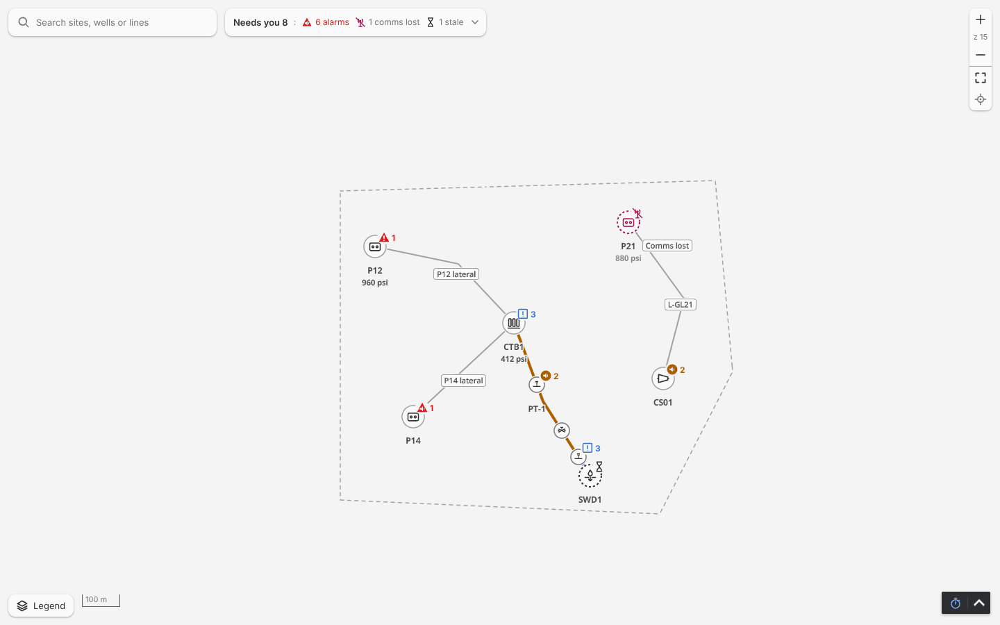 | 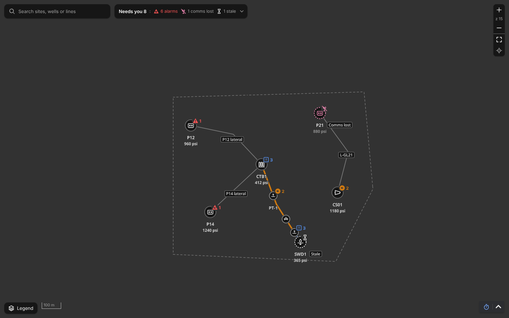 |

What is drawn: the alarm badge is the priority glyph itself in its token on a halo disc (18 px), solid while the alarm is unacknowledged (P14, CS01, CTB1, PT-1) and the hollow glyph once acknowledged (P12, PT-2; priority 3 is the outlined square in both states), the digit beside it in the same token; the comms-lost item (P21) draws its kind glyph and a dashed ring in `--mapstudio-comms-lost` with the comms-lost badge and the chip "Comms lost"; the stale item (SWD1) a dashed neutral ring, the stale badge in the text colour and the chip "Stale"; a normal item (none here beyond the laterals' ends) is the neutral disc with its kind glyph and no hue.

What changed against the template's reviewed rules (template `docs/ux.md` ER-27, `docs/map.md` section 5 item 1): **the kind glyph is in the marker** (the template's markers show state only, a dot for a normal site); **the badge is the bare glyph on a halo** (entry 15, punch list items 3 and 4: the template's icon is the IEC shape in the hue; an earlier build here drew a filled disc, which read as priority 2); **comms lost has a colour** (the template: "comms lost ... never a colour"; owner, 2026-10-28, because it is critical and must not get lost; the glyph and the words stay, so colour is never the only signal); **stale has no colour** (the owner's decision, as the template); **nothing blinks and nothing fades** (the template's map never blinks either; its cards fade an alarm that is not live, ER-5, and fade an acknowledged priority 3 square: Map Studio draws neither fade); the unacknowledged mark is Map Studio's own drawing (icons.md, reviewed in 0.2.0).

Verdict (tokens `--mapstudio-alarm-1/2/3`, the badge, the acknowledgement look):

Verdict (`--mapstudio-comms-lost`, the magenta family; or purple from the host theme):

Verdict (stale with no colour):

### 3.2 The Needs you bar and list, and the legend's key

| Light | Dark |
| --- | --- |
| 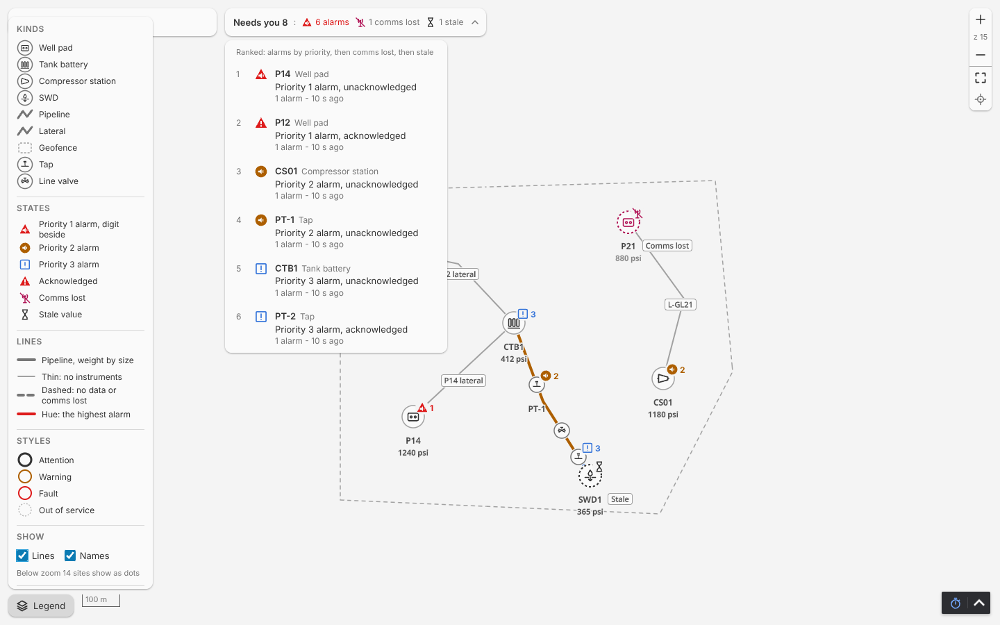 | 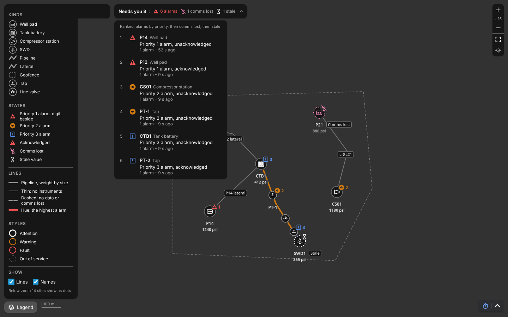 |

What is drawn: the bar counts the items by their worst state ("Needs you 8: 6 alarms, 1 comms lost, 1 stale"), each count with its glyph in its token (the highest alarm's glyph, the comms-lost glyph in `--mapstudio-comms-lost`, the stale glyph in the text colour); the list ranks alarms by priority (unacknowledged before acknowledged within one), then comms lost, then stale, each row with the state glyph, the name and kind, the state in words, the detail and age; "All OK" in the secondary text colour with nothing to attend to ([mapstudio-needs-you-ok-1440.png](screenshots/mapstudio-needs-you-ok-1440.png), the dev project). The Legend panel's **States** section is the key of every state glyph as the badge draws it: Priority 1 alarm with the digit beside, Priority 2, Priority 3, Acknowledged (the hollow priority 1 glyph), Comms lost, Stale value; **Lines** the four line looks; **Styles** the four presets; **Areas** the tints a kind setup turns on.

What changed against the template: the template's map has a chip row ("Sites 12", the count chips of its board) and a collapsible items panel; Map Studio has the Needs you bar and list beside the search field (EXPERIENCE.md, R15) and no items panel in View mode; the template's legend is a checkbox form, Map Studio's a key of every glyph with the toggles and the basemap choice (R14). The counts count map items by their worst state, as the template's chips count assets by their worst band (its ER-7), not alarms.

Verdict (the Needs you counts and the ranking):

Verdict (the legend's key):

### 3.3 The presets and the area tints

From the dev project's `/styles` page, which draws every preset on a point and a line and every tint, in both themes (`styles.spec.mjs`, [styles.md](styles.md)): the stand-in hues of entry 1 with the three token moves of section 1.

| Light | Dark |
| --- | --- |
| 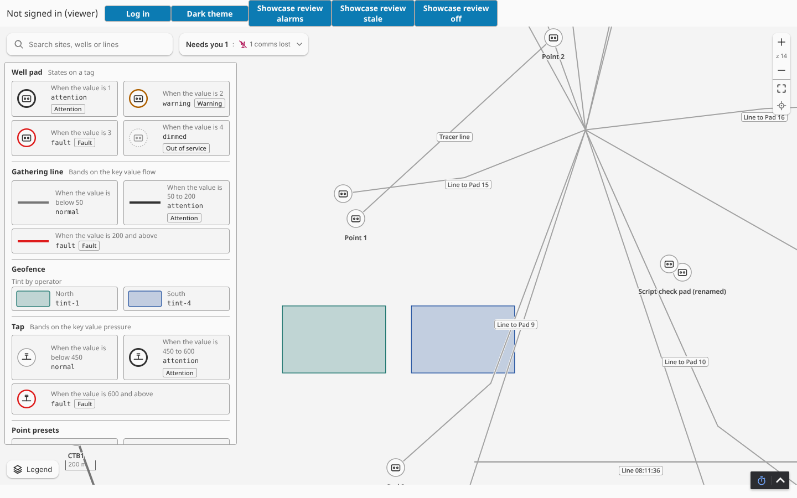 | 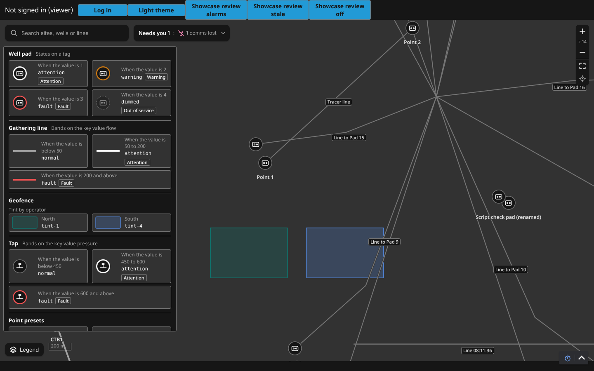 |

On the map, a warning marker, an attention line and two tinted geofences: [mapstudio-styles-1440.png](screenshots/mapstudio-styles-1440.png) (light).

What changed against the template: the template's map has no value-driven styles and no area tints (prd FR-38, FR-39 are Map Studio's; owner, 2026-10-26). The rule (AD-11): a preset is a ring and a word, never colour alone; an alarm draws over a preset; a stale source drops the preset; a tint is a wash on an area only. `warning` and `fault` share the alarm hues of priorities 2 and 1 (section 1).

Verdict (the presets, and whether `warning` and `fault` may share the alarm hues):

Verdict (the six tints):

### 3.4 The line looks per segment and instrument alarms

| Light | Dark |
| --- | --- |
| 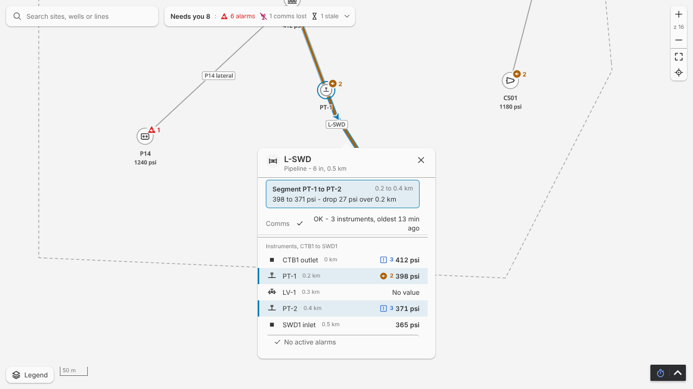 | 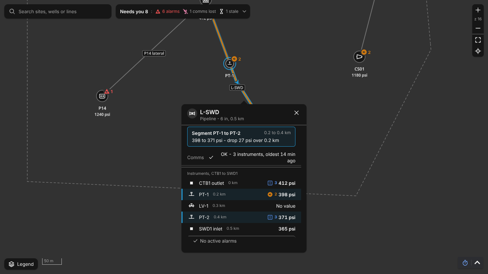 |
| 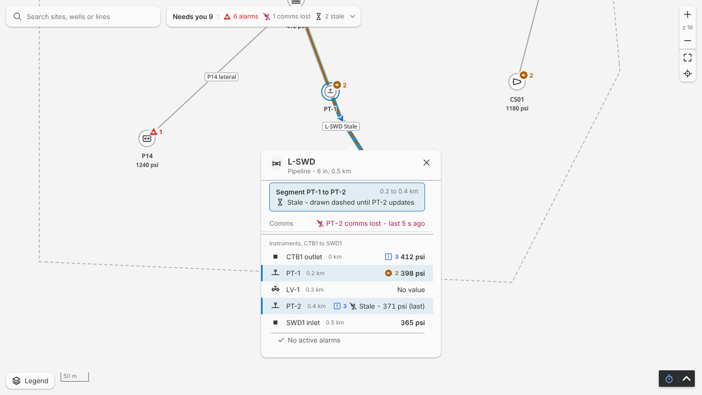 | 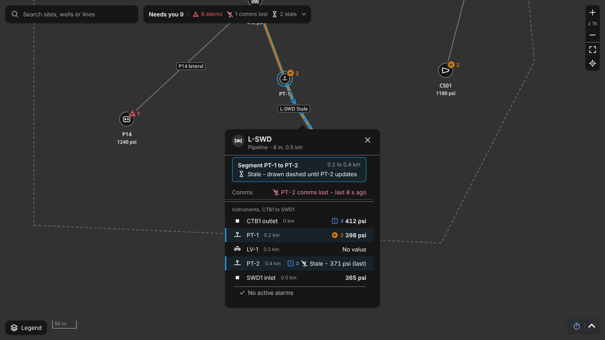 |

What is drawn: L-SWD (6 in, 6 px) is cut at its measuring instruments PT-1 and PT-2; each segment draws from the worse of its two end instruments: CTB1 to PT-1 and PT-1 to PT-2 in the priority 2 hue (PT-1's alarm), PT-2 to SWD1 in the priority 3 hue (PT-2's acknowledged alarm); PT-1 and PT-2 draw as 24 px instrument markers at their place on the line with their own alarm badges and digits; the clicked segment's two instruments are highlighted in the popup and ringed on the map; with PT-2's comms lost (second row) its two segments dash in the neutral pipeline tone with no hue, PT-2's marker takes the comms-lost look over its alarm badge, and the popup says so. The thin 2 px laterals and L-GL21 (no instrument) in the lateral tone; the line's own alarm would colour the whole line with the badge at the midpoint.

What changed against the template (`docs/map.md` section 5 item 3): the template grades a segment from its taps' board rows and draws the alarm glyph at the segment's midpoint; Map Studio draws the instrument's alarm at the instrument's place (owner, 2026-10-27) and the line's own alarm at the midpoint; the segment look is otherwise the template's (the hue of the worse end alarm, dashed for no data or comms lost at either end, a plain neutral line with none, thin with no taps, weight by size never by state, the flow arrow on the selected segment only). Since entry 12 every line has a one-pixel halo in the blank-map token (section 2).

Verdict (instrument alarms at their place, the per-segment look, the line halo):

### 3.5 The point card

| Light | Dark |
| --- | --- |
| 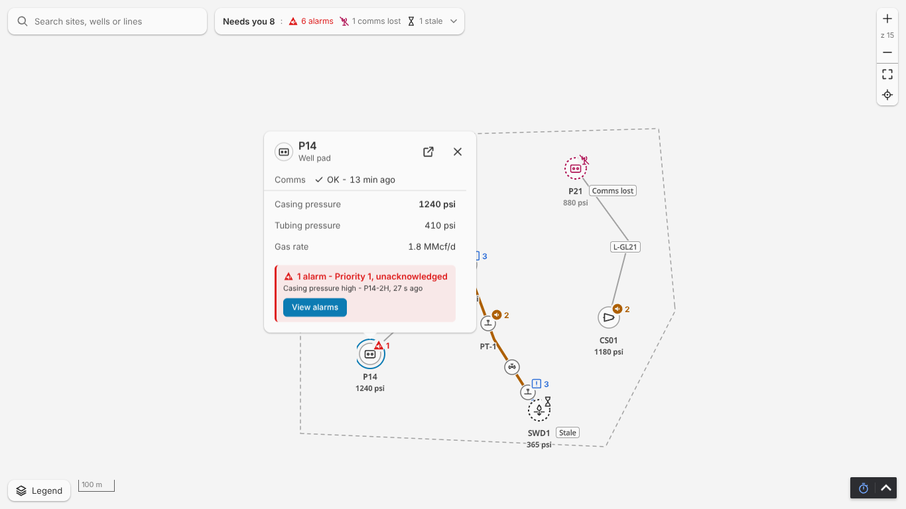 | 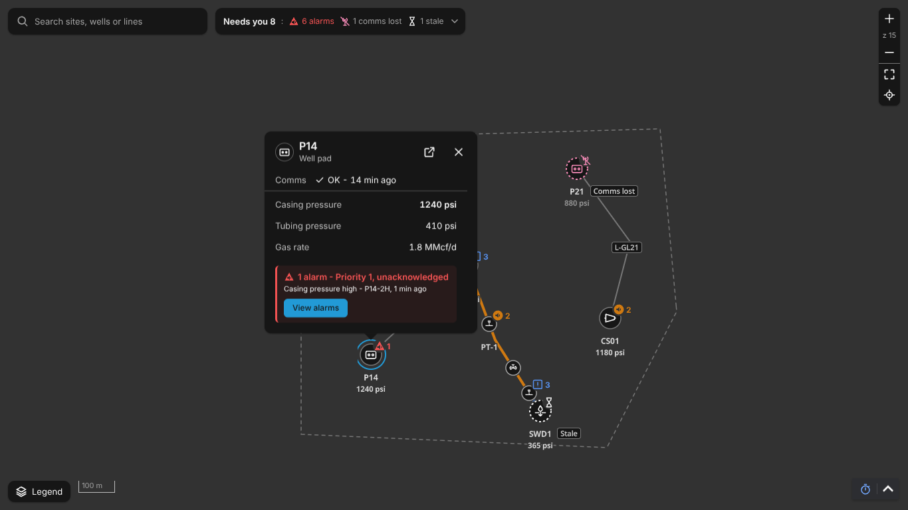 |

What is drawn: the header (kind glyph in a ringed disc, the name, the kind, the page link and Map Studio's own close), Comms with the data age, the three key values, the alarm block in the priority's tint (8 % of the token over the surface) with the token as its left edge, the heading "1 alarm - Priority 1, unacknowledged", the most important alarm in words with its source and age, and **View alarms** to the project's alarm page; Map Studio acknowledges nothing.

What changed against the template: the template's map opens a side pane (desktop) with the site's rows; Map Studio opens a card over the marker (DESIGN.md popup-card, the owner's popup review D1 to D5). The alarm block's tint and edge are new presentation (EXPERIENCE.md Engineering Review Items, 8).

Verdict (the card and its alarm block):

### 3.6 The phone bottom sheet

| Light | Dark |
| --- | --- |
| 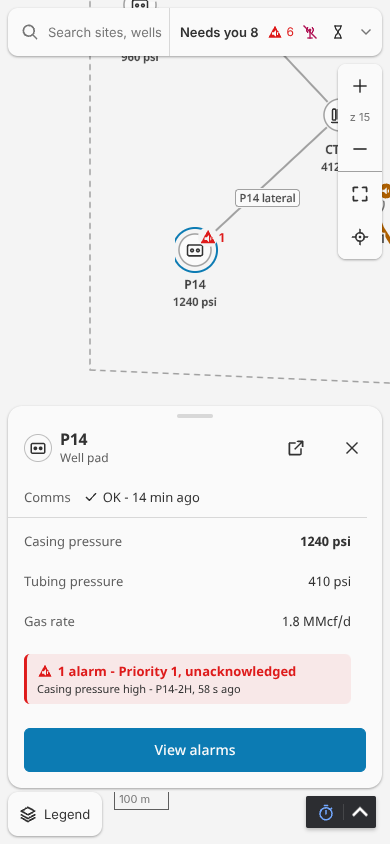 | 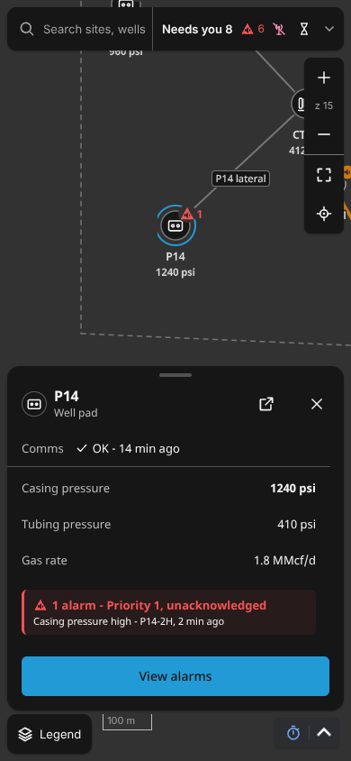 |

And the one top bar with the Needs you list open: [light](screenshots/review-light-needs-you-390.png), [dark](screenshots/review-dark-needs-you-390.png).

What changed against the template (`docs/map.md` section 5 items 7 and 11): the template's phone keeps a chip row and **top sheets**; Map Studio opens a **bottom sheet** (8 px from the sides, above the App Bar toggle, a handle, 44 px buttons, a footer with View alarms) and shares one expanding top bar between search and Needs you (EXPERIENCE.md, Engineering Review Items 1).

Verdict (bottom sheets and the one top bar, against the template's chip row and top sheets):

### 3.7 The custom popup view's close row

| Light | Dark |
| --- | --- |
| 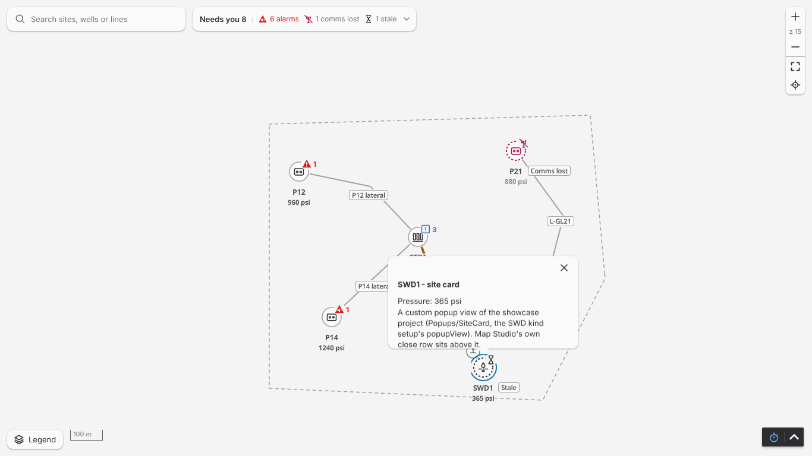 | 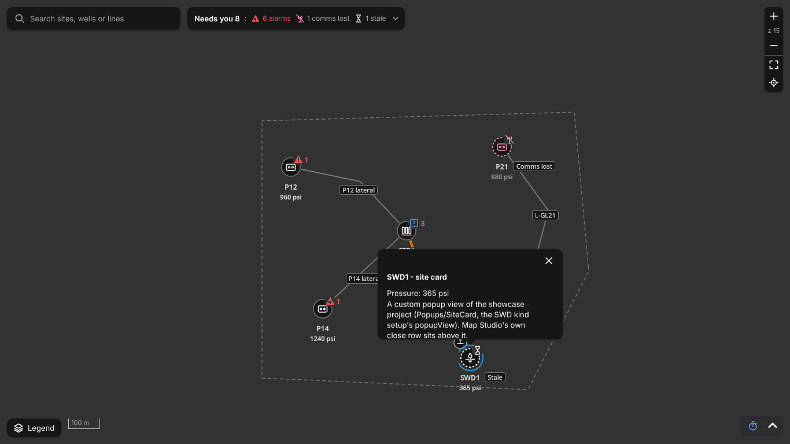 |
| 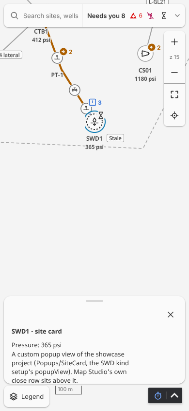 | 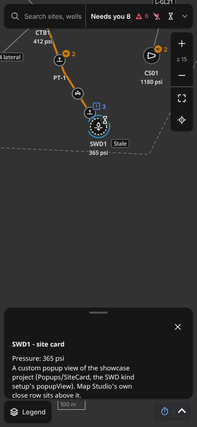 |

What is drawn: the SWD kind setup of the showcase names `Popups/SiteCard`, a project view, as its popup; the view opens in place of the default popup under a row with Map Studio's own close (32 px on the card, 44 px with the handle on the phone sheet; owner, 2026-10-29: every popup closes the same way), with `mapItem` live.

What changed against the template: no equivalent; a project view in a map popup is Map Studio's (R9).

Verdict (the close row above a custom view):

### 3.8 The template's `docs/map.md` section 5 checklist

[map-parity.md](map-parity.md) maps the template's eleven items to met or listed for this review. The items listed:

| # | The template's item | Map Studio | Verdict |
| --- | --- | --- | --- |
| 1 | Markers show state only; the comms icon with no hue | the kind glyph in the marker; comms lost in its token; the badge the bare glyph (3.1) | Verdict: |
| 3 | Lines: the alarm glyph with the digit at the segment's midpoint | an instrument's alarm at its place, the line's own at the midpoint; the segment look per end instruments (3.4) | Verdict: |
| 5 | Fit field and Return to selected bottom-right with the zoom | in the one zoom card top-right; the bottom-right corner is the Perspective App Bar's (DESIGN.md) | Verdict: |
| 7 | A collapsible panel and legend, chips below 1024 px | the Needs you bar and list, the search field, the legend as a key (3.2) | Verdict: |
| 11 | The phone keeps the shape with top sheets | bottom sheets and one top bar (3.6) | Verdict: |

Items 2, 4, 6, 8, 9 and 10 are met as the template has them (names from zoom 14, dots below 12, the toggles, the shared marker, a tap on the ground, Fit keeps).

## 4. The record

The verdicts above are the owner's (hitl). When the review is done: a row in [platform-checks.md](platform-checks.md) under "Epic 3 entry 12" ("Engineering review (ER-27), 0.3.0: passed" or the changes asked for, reviewer and date), a dated Decision in the epic's Notes, and, for a change, the entry that builds it before the 0.3.0 tag. The template's cards take the comms-lost colour at the cutover so an operator sees one convention (owner, 2026-10-28; epic-template-cutover).
